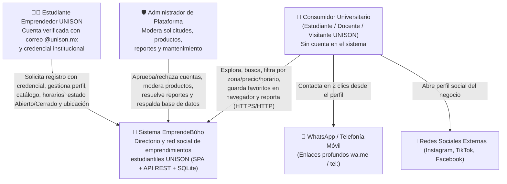
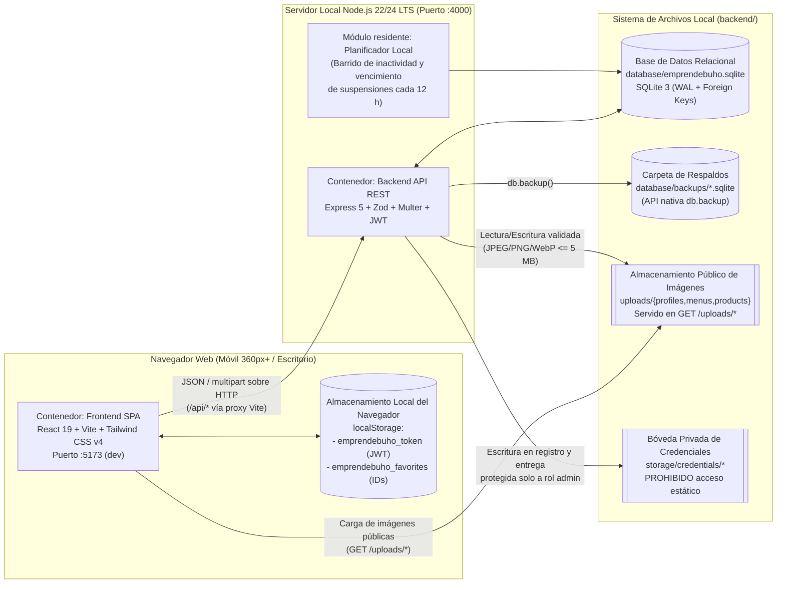
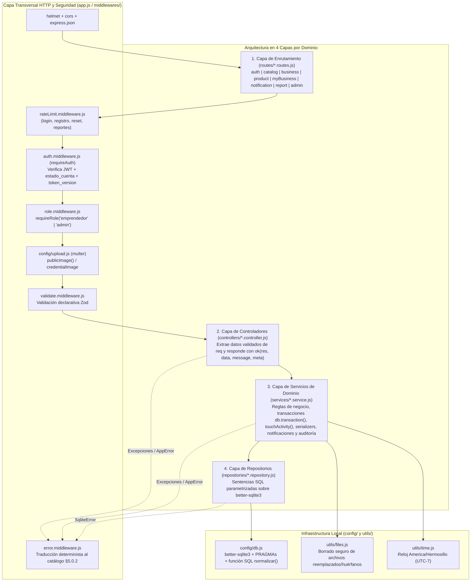
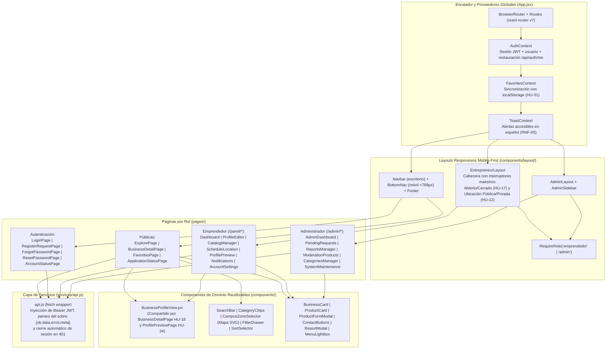
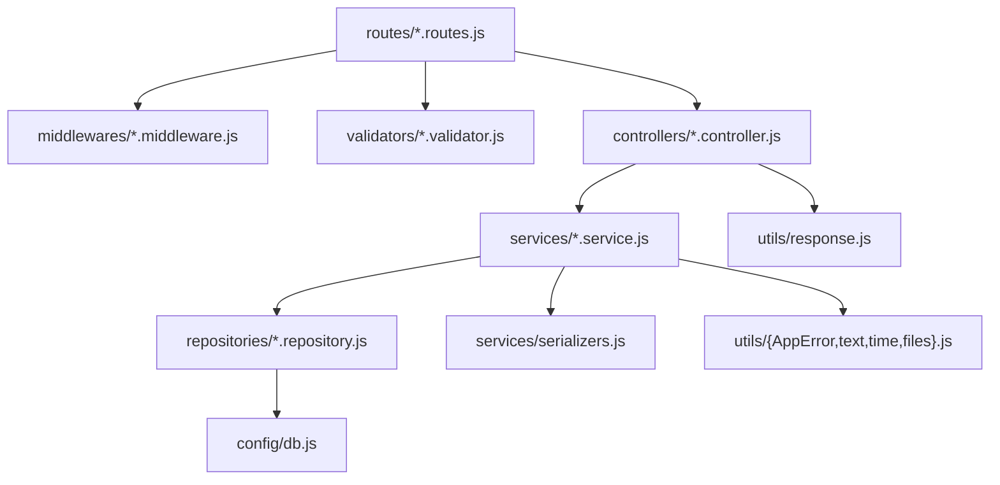
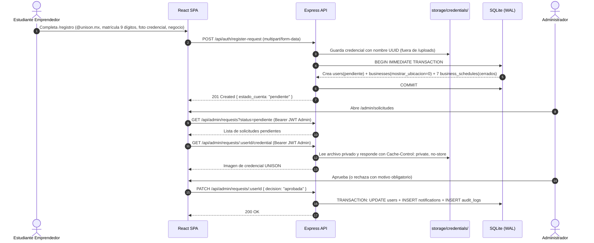
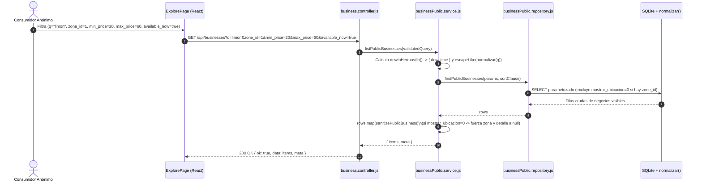
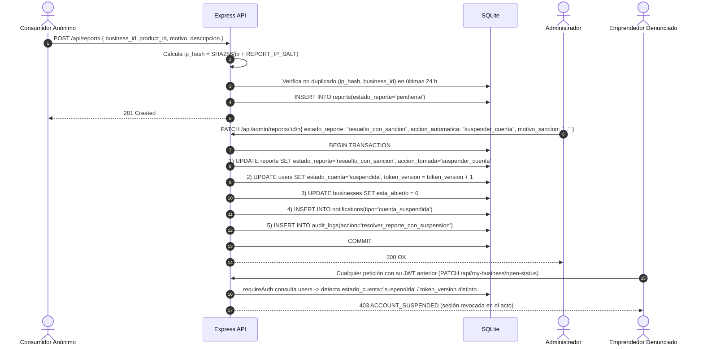
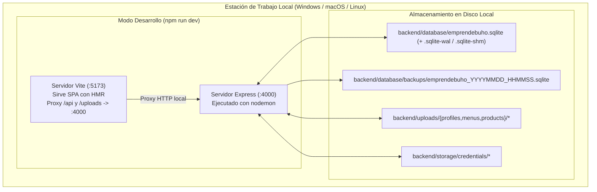
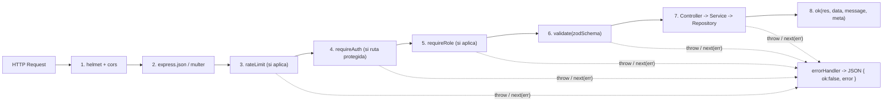

# Especificación Formal de Arquitectura de Software (SAD) — EmprendeBúho

* **Sistema:** EmprendeBúho — *"Tu campus, tus emprendimientos"*
* **Organización / Contexto:** Universidad de Sonora (UNISON), Campus Hermosillo — Ingeniería de Software II
* **Versión:** 2.0
* **Fecha:** 2026-10-19
* **Documentos relacionados:**
  * Contrato maestro de producto y API: [`especificacion_tecnica_emprendebuho.md`](../especificacion_tecnica_emprendebuho.md)
  * Especificación formal de base de datos: [`docs/especificacion-base-de-datos.md`](especificacion-base-de-datos.md)
  * Esquema SQL ejecutable: [`backend/database/schema.sql`](../backend/database/schema.sql)
  * Plan de construcción por fases: [`docs/plan-de-construccion.md`](plan-de-construccion.md)
  * Bitácora de decisiones técnicas (ADR): [`docs/decisiones-tecnicas.md`](decisiones-tecnicas.md)

---

## 1. Propósito, Alcance y Principios Arquitectónicos

### 1.1 Propósito del Documento
Este Documento de Arquitectura de Software (*Software Architecture Document*, SAD) especifica de manera formal y verificable la estructura estática, el comportamiento dinámico, la descomposición en capas, los mecanismos transversales de seguridad y privacidad, y las garantías de atributos de calidad de **EmprendeBúho**, combinando el **Modelo C4** (Contexto, Contenedores, Componentes y Código) con el modelo de **4+1 Vistas de Kruchten** (Lógica, Procesos, Desarrollo, Despliegue y Escenarios).

### 1.2 Restricciones de Alcance Arquitectónico
De acuerdo con §1.2 de la especificación maestra:
1. **Ejecución 100 % local y autónoma:** el sistema opera íntegramente en una estación de trabajo local sin servicios en la nube, sin servidores SMTP externos y sin motores de bases de datos cliente-servidor externos.
2. **Prohibición de pagos y carritos:** no existen módulos de pasarelas de pago, carritos de compra ni saldos.
3. **Prohibición de logística de reparto:** el sistema conecta al consumidor con el emprendedor mediante enlaces profundos de contacto directo (`wa.me`, `tel:`, redes sociales); el acuerdo ocurre fuera de la plataforma.
4. **Acceso sin fricción para el consumidor:** toda la consulta del directorio, buscador, filtros, favoritos y reportes opera sin cuenta de consumidor.

### 1.3 Principios Rectores de Diseño

| Código | Principio | Materialización en la Arquitectura |
| ----- | ----- | ----- |
| **PA-01** | **Separación estricta de responsabilidades en 4 capas (Backend)** | `Routes → Controllers → Services → Repositories`. Ningún controlador contiene lógica de negocio ni SQL; ningún repositorio conoce objetos HTTP (`req`, `res`). |
| **PA-02** | **Privacidad por diseño y por defecto (`RNF-06`)** | La ubicación inicia apagada (`mostrar_ubicacion = 0`), las credenciales estudiantiles viven fuera de la raíz estática (`backend/storage/credentials/`) y toda salida pública pasa obligatoriamente por el serializador `sanitizePublicBusiness()`. |
| **PA-03** | **Integridad declarativa en la base de datos** | Las invariantes de dominio (matrícula de 9 dígitos, horario válido, ubicación pública con zona obligatoria, motivo obligatorio en sanciones, un solo contacto principal) se imponen simultáneamente con `zod` en la entrada HTTP y con restricciones `CHECK` / `UNIQUE` / `FOREIGN KEY` en SQLite. |
| **PA-04** | **Revocación inmediata de sesión sin estado compartido** | Los JWT incluyen `tv` (`token_version`). Cada petición autenticada verifica en SQLite (lectura en microsegundos por clave primaria) el `estado_cuenta` y la versión del token, permitiendo invalidar sesiones al instante al suspender o eliminar cuentas. |
| **PA-05** | **Determinismo de errores en español (`RNF-05`)** | Un único middleware global (`error.middleware.js`) intercepta `AppError`, `ZodError`, `MulterError` y `SqliteError` y los traduce al catálogo cerrado de 14 códigos (§5.0.2) sin exponer trazas de pila ni errores crudos de SQLite. |

---

## 2. Modelo C4 de la Arquitectura

### 2.1 Nivel 1 (C1) — Diagrama de Contexto del Sistema

Muestra a **EmprendeBúho** como una caja negra y sus interacciones con los tres actores humanos del campus UNISON y los sistemas externos invocados mediante enlaces profundos del navegador.

---

### 2.2 Nivel 2 (C2) — Diagrama de Contenedores

Detalla las unidades ejecutables y de almacenamiento dentro del entorno local del monorepo (`emprendebuho/`).

---

### 2.3 Nivel 3 (C3) — Diagrama de Componentes del Backend (`backend/src/`)

El servidor Express 5 se estructura en cuatro capas horizontales estrictas más un conjunto de componentes transversales:

#### Responsabilidades de los Componentes del Backend

| Componente | Archivos | Responsabilidad Única |
| ----- | ----- | ----- |
| **Configuración y Arranque** | `config/env.js`, `config/db.js`, `config/upload.js`, `app.js`, `server.js` | Validar variables de entorno, abrir SQLite en modo WAL, registrar `normalizar()`, ejecutar `schema.sql` y `seed.js` si la BD está vacía, montar Express y programar el mantenimiento periódico. |
| **Middlewares de Seguridad y Validación** | `middlewares/{auth,role,validate,rateLimit,error}.middleware.js` | Autenticar tokens contra `users.token_version`, autorizar por rol, limitar tasa por IP, validar `body`/`query`/`params` con `zod` y formatear todos los errores. |
| **Módulo de Autenticación y Cuenta** | `auth.{routes,controller,service,validator}.js`, `user.repository.js` | Registro con credencial (`HU-01`), reutilización de cuentas rechazadas/eliminadas, login con verificación de estado (`HU-40`), consulta pública de estatus (`HU-27`), recuperación de contraseña (`HU-32`) y baja de cuenta (`HU-28`). |
| **Módulo Público de Directorio y Productos** | `catalog.*`, `business.*`, `product.*`, `businessPublic.repository.js`, `productPublic.repository.js`, `serializers.js` | Catálogos (`HU-05`), exploración y búsqueda multicriterio de negocios y productos (`HU-14, 15, 18, 19, 23, 29, 30, 31, 33, 37, 38, 39`) garantizando `sanitizePublicBusiness()` (`RNF-06`). |
| **Módulo de Panel del Emprendedor** | `myBusiness.{routes,controller,service,repository,validator}.js`, `product.{service,repository,validator}.js` | Gestión autenticada del propio negocio (`HU-02..13, 17, 34, 36`) y actualización automática de `last_activity_at` e `inactivo_oculto = 0` en cada escritura (`touchActivity`). |
| **Módulo de Reportes y Notificaciones** | `report.*`, `notification.*` | Recepción de denuncias anónimas con deduplicación por `ip_hash` (`HU-26`) y bandeja de notificaciones internas + log estructurado en consola (`HU-27`). |
| **Módulo de Administración y Mantenimiento** | `admin.*`, `maintenance.service.js`, `audit.repository.js` | Aprobación/rechazo con entrega privada de credencial (`HU-20B/21`), suspensión temporal (`HU-22`), moderación de productos (`HU-20A`), resolución transaccional de reportes (`HU-24, 35`), categorías (`HU-16`), barrido de inactividad, respaldos `.sqlite` y bitácora (`HU-25`). |

---

### 2.4 Nivel 3 (C3) — Diagrama de Componentes del Frontend (`frontend/src/`)

---

## 3. Vistas Arquitectónicas 4+1

### 3.1 Vista Lógica y Reglas de Dependencia entre Capas

La vista lógica impone una dependencia estrictamente unidireccional de arriba hacia abajo. Ningún módulo inferior puede importar un módulo superior:

**Invariantes de la Vista Lógica:**
1. **Prohibición de SQL fuera de `repositories/`:** ningún archivo en `routes/`, `controllers/` o `services/` puede invocar `db.prepare()`.
2. **Transacciones confinadas en `services/`:** cuando un caso de uso modifica más de una tabla (registro de emprendedor, actualización de horarios/contactos, aprobación/rechazo, suspensión, resolución de reportes), el servicio envuelve las llamadas al repositorio dentro de `db.transaction(() => { ... })()`.
3. **Sanitización obligatoria de salida:** todo endpoint público y la vista previa del emprendedor devuelven exclusivamente objetos transformados por `serializers.sanitizePublicBusiness()`.

---

### 3.2 Vista de Procesos y Comportamiento Dinámico (Diagramas de Secuencia)

#### 3.2.1 Proceso 1: Solicitud de Registro UNISON y Revisión por Administrador (`HU-01`, `HU-20B`, `HU-21`, `HU-27`, `HU-40`)

#### 3.2.2 Proceso 2: Búsqueda Multicriterio con Garantía de Privacidad (`HU-12`, `HU-14`, `HU-15`, `HU-23`, `HU-30`, `HU-33`, `HU-38`, `HU-39`, `RNF-06`)

#### 3.2.3 Proceso 3: Reporte de Consumidor y Resolución con Sanción Atómica (`HU-20A`, `HU-22`, `HU-24`, `HU-26`, `HU-35`)

#### 3.2.4 Modelo de Concurrencia en Tiempo de Ejecución
* **Proceso único Node.js + SQLite en modo WAL (`PRAGMA journal_mode = WAL`):**
  * En modo *Write-Ahead Logging*, los lectores no bloquean a los escritores ni los escritores bloquean a los lectores.
  * El driver `better-sqlite3` ejecuta cada sentencia preparada o bloque `db.transaction()` de manera síncrona y atómica en el hilo de Node.js en fracciones de milisegundo (para el volumen de datos del campus: cientos de negocios y pocos miles de productos), evitando condiciones de carrera (*race conditions*) entre lecturas y escrituras concurrentes sin necesidad de bloqueos distribuidos.
  * `PRAGMA busy_timeout = 5000` garantiza que si el proceso de respaldo o una herramienta externa abre el archivo simultáneamente, SQLite espere hasta 5 segundos antes de devolver `SQLITE_BUSY`.

---

### 3.3 Vista de Desarrollo (Organización de Paquetes y Módulos)

| Workspace | Paquete / Carpeta | Estándar de Módulos | Propósito |
| ----- | ----- | ----- | ----- |
| Raíz (`/`) | `package.json` | npm workspaces | Orquestar `dev`, `test`, `build`, `lint` y `db:reset`. |
| `backend/` | `src/config/` | ES Modules (`import`/`export`) | Variables de entorno (`env.js`), conexión SQLite (`db.js`) y `multer` (`upload.js`). |
| `backend/` | `src/middlewares/` | ES Modules | Seguridad, autenticación, roles, validación `zod`, límites de tasa y errores. |
| `backend/` | `src/validators/` | ES Modules | Esquemas `zod` reutilizables de entrada HTTP. |
| `backend/` | `src/repositories/` | ES Modules | Consultas SQL preparadas y nombradas (`:param`). |
| `backend/` | `src/services/` | ES Modules | Lógica de negocio, transacciones, serializadores y tareas de mantenimiento. |
| `backend/` | `src/controllers/` | ES Modules | Adaptadores HTTP delgados (`req` → servicio → `ok(res, ...)`). |
| `backend/` | `src/routes/` | ES Modules | Definición de endpoints REST bajo `/api`. |
| `backend/` | `tests/` | `node:test` + `supertest` | Pruebas de integración extremo a extremo sobre SQLite temporal. |
| `frontend/` | `src/context/` | React 19 JSX | Estado global (`AuthContext`, `FavoritesContext`, `ToastContext`). |
| `frontend/` | `src/services/` | ES Modules | Cliente HTTP centralizado (`api.js`). |
| `frontend/` | `src/components/` | React 19 JSX + Tailwind v4 | Componentes reutilizables divididos en `layout`, `routing`, `business`, `product`, `search` y `common`. |
| `frontend/` | `src/pages/` | React 19 JSX | Vistas por rol (`public`, `auth`, `entrepreneur`, `admin`). |

---

### 3.4 Vista Física y de Despliegue Local

---

### 3.5 Vista de Escenarios y Garantías de Atributos de Calidad (`RNF-01` a `RNF-06`)

| RNF | Atributo de Calidad | Estímulo | Respuesta Arquitectónica y Medición Verificable |
| ----- | ----- | ----- | ----- |
| **RNF-01** | **Usabilidad (Máximo 2 clics al contacto)** | Un estudiante entre clases entra a `/` buscando comida abierta y desea mandar WhatsApp. | **Clic 1:** toca la tarjeta `BusinessCard` en `/` → abre `/negocio/:slug`. **Clic 2:** toca el botón primario `Enviar WhatsApp` en `ContactButtons` (visible sin hacer scroll ni abrir submenús) → abre `https://wa.me/52...`. |
| **RNF-02** | **Adaptabilidad Mobile-First** | Acceso desde pantalla móvil de `360px` de ancho. | En `< 768px` se oculta la navegación de escritorio y se fija `BottomNav.jsx` en la parte inferior con objetivos táctiles `>= 44x44 px`; los filtros avanzados abren en un `FilterDrawer` deslizable. |
| **RNF-03** | **Disponibilidad y Precisión Horaria (`07:00–21:00`)** | Consulta del filtro *"Disponibles a esta hora"* o visualización del indicador *"Fuera de su horario habitual"*. | El cálculo se realiza en el servidor usando explícitamente la zona `America/Hermosillo` (UTC-7 todo el año, sin horario de verano) mediante `utils/time.js`, evitando desfases si el navegador del usuario tiene otra zona configurada. |
| **RNF-04** | **Identidad Visual UNISON y Accesibilidad** | Renderizado de botones, insignias y cabeceras con la paleta institucional. | Variables `--unison-blue` (`#002D62`) y `--unison-gold` (`#F2A900`) en `index.css`. Regla arquitectónica obligatoria: prohibido usar `#F2A900` como texto sobre blanco (`1.9:1`); siempre se usa como fondo con texto `#002D62` (`7.5:1`, nivel WCAG AAA). |
| **RNF-05** | **Manejo de Errores Claros en Español** | El usuario sube un archivo `.pdf` en vez de imagen, envía un correo duplicado o pierde conexión. | `error.middleware.js` captura `MulterError`, `SqliteError` y `ZodError` y devuelve siempre `{ ok: false, error: { code, message, details } }` en español; `api.js` intercepta errores de red (`TypeError: Failed to fetch`) y muestra *"No se pudo conectar con el servidor local"*. |
| **RNF-06** | **Privacidad Estricta del Emprendedor** | Un emprendedor apaga `mostrar_ubicacion = 0` (`HU-12`) y un consumidor inspecciona el tráfico JSON de la API o filtra por zona. | La consulta SQL excluye al negocio de `?zone_id=` y `sanitizePublicBusiness()` fuerza `campus_zone_id: null`, `zona_codigo: null`, `zona_nombre: null` y `ubicacion_detalle: null` en `GET /api/businesses`, `GET /api/businesses/:slug`, `GET /api/products` y `GET /api/my-business/preview`. |

---

## 4. Mecanismos Arquitectónicos Transversales

### 4.1 Defensa en Profundidad para Archivos Subidos (`config/upload.js`)

| Tipo de Imagen | Carpeta Destino | ¿Expuesta en `/uploads`? | Quién puede leerla | Límite y Formatos |
| ----- | ----- | ----- | ----- | ----- |
| Foto de perfil (`HU-04`) | `backend/uploads/profiles/` | Sí (`/uploads/profiles/<uuid>.<ext>`) | Público | `image/jpeg`, `image/png`, `image/webp` (`<= 5 MB`) |
| Foto de menú (`HU-03`) | `backend/uploads/menus/` | Sí (`/uploads/menus/<uuid>.<ext>`) | Público | `image/jpeg`, `image/png`, `image/webp` (`<= 5 MB`) |
| Imagen de producto (`HU-02`) | `backend/uploads/products/` | Sí (`/uploads/products/<uuid>.<ext>`) | Público | `image/jpeg`, `image/png`, `image/webp` (`<= 5 MB`) |
| Credencial UNISON (`HU-01`) | `backend/storage/credentials/` | **No (Prohibido)** | Solo `admin` vía `GET /api/admin/requests/:userId/credential` | `image/jpeg`, `image/png`, `image/webp` (`<= 5 MB`) |

### 4.2 Tubería de Procesamiento de una Petición en Express 5

---

## 5. Matriz de Trazabilidad Arquitectónica (RF y RNF → Componentes)

| Requerimiento | Componentes del Backend | Componentes del Frontend | Tablas SQLite Involucradas |
| ----- | ----- | ----- | ----- |
| **RF-01** (Aprobación de registro UNISON) | `auth.controller`, `admin.controller`, `auth.service`, `admin.service`, `config/upload` | `RegisterRequestPage`, `PendingRequestsPage`, `ApplicationStatusPage` | `users`, `businesses`, `business_schedules`, `notifications`, `audit_logs` |
| **RF-02** (Login y gestión de perfil) | `auth.*`, `myBusiness.*`, `auth.middleware` | `LoginPage`, `AuthContext`, `EntrepreneurLayout`, `ProfileEditorPage` | `users`, `businesses`, `business_contacts`, `categories` |
| **RF-03** (CRUD y pausa de catálogo) | `myBusiness.controller`, `product.service`, `product.repository` | `CatalogManagerPage`, `ProductFormModal`, `ConfirmDialog` | `products`, `businesses` |
| **RF-04** (Horario semanal) | `myBusiness.controller`, `myBusiness.service`, `myBusiness.repository` | `ScheduleLocationPage`, `ScheduleTable` | `business_schedules`, `businesses` |
| **RF-05** (Interruptor Abierto/Cerrado) | `myBusiness.controller` (`PATCH /open-status`), `utils/time.js` | `EntrepreneurLayout`, `StatusBadge` | `businesses`, `business_schedules` |
| **RF-06** (Ubicación voluntaria y privada) | `myBusiness.controller` (`PATCH /location`), `serializers.sanitizePublicBusiness` | `EntrepreneurLayout`, `ScheduleLocationPage`, `ZoneBadge`, `CampusZoneSelector` | `businesses`, `campus_zones` |
| **RF-07** (Búsqueda sin cuenta) | `business.controller`, `product.controller`, `utils/text.js` (`normalizar`) | `ExplorePage`, `SearchBar`, `BusinessCard`, `ProductCard` | `businesses`, `products`, `users` |
| **RF-08** (Filtrado multicriterio) | `businessPublic.service`, `businessPublic.repository` | `CategoryChips`, `CampusZoneSelector`, `PriceRangeFilter`, `FilterDrawer`, `SortSelector` | `businesses`, `categories`, `campus_zones`, `products`, `business_schedules` |
| **RF-09** (Moderación de productos y suspensión) | `admin.controller`, `admin.service`, `report.service`, `maintenance.service` | `ModerationProductsPage`, `ReportsManagerPage`, `PendingRequestsPage` | `products`, `users`, `businesses`, `reports`, `notifications`, `audit_logs` |
| **RF-10** (Medios de contacto directo) | `myBusiness.service` (normalización), `businessPublic.service` | `ContactButtons`, `ProfileEditorPage`, `utils/contactLinks.js` | `business_contacts` |
