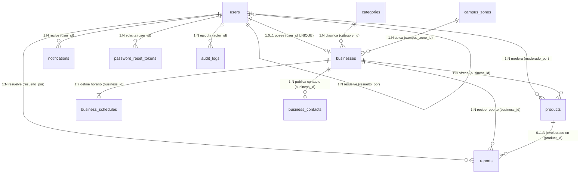

# Especificación Formal de la Base de Datos Relacional — EmprendeBúho

* **Sistema:** EmprendeBúho — *"Tu campus, tus emprendimientos"*
* **Motor de Base de Datos:** SQLite 3.x (driver síncrono `better-sqlite3`)
* **Archivo físico local:** `backend/database/emprendebuho.sqlite`
* **Archivo DDL oficial:** [`backend/database/schema.sql`](../backend/database/schema.sql)
* **Versión:** 2.0
* **Fecha:** 2026-10-19

---

## 1. Configuración Física y Parámetros del Motor SQLite

Al abrir la conexión en `backend/src/config/db.js`, es obligatorio ejecutar las siguientes directivas `PRAGMA` y registrar las funciones personalizadas antes de preparar cualquier consulta:

| Directiva / Función | Valor | Propósito Técnico |
| ----- | ----- | ----- |
| `PRAGMA foreign_keys` | `ON` | SQLite desactiva las llaves foráneas por defecto en cada conexión; activarlo obliga al motor a verificar `ON DELETE CASCADE`, `RESTRICT` y `SET NULL`. |
| `PRAGMA journal_mode` | `WAL` | Activa *Write-Ahead Logging* (`emprendebuho.sqlite-wal`), permitiendo lecturas concurrentes sin bloqueo mientras se ejecuta una transacción de escritura. |
| `PRAGMA busy_timeout` | `5000` | Espera hasta 5000 ms antes de arrojar `SQLITE_BUSY` si una operación de respaldo o mantenimiento retiene un bloqueo de escritura. |
| `PRAGMA encoding` | `'UTF-8'` | Codificación estándar para nombres con acentos y eñes del español de México. |
| Función SQL `normalizar(s)` | Determinista (`deterministic: true`) | Aplica `String(s).normalize('NFD').replace(/\p{M}/gu, '').toLowerCase().trim()` para búsquedas y ordenamientos insensibles a mayúsculas y acentos (`HU-15`, `HU-30`, `HU-37`). |

### Convenciones de Tipos de Datos en SQLite
* **Identificadores primarios:** `INTEGER PRIMARY KEY AUTOINCREMENT` (excepto `business_schedules`, que es una tabla agrupada `WITHOUT ROWID` con llave primaria compuesta `(business_id, dia_semana)`).
* **Booleanos:** `INTEGER NOT NULL DEFAULT 0 CHECK (col IN (0, 1))`. El serializador del backend los transforma a `true`/`false` en el JSON de la API.
* **Precios monetarios (`MXN`):** `REAL NOT NULL CHECK (precio >= 0 AND precio <= 99999.99)` validado en la capa de aplicación a máximo 2 decimales.
* **Fechas y marcas de tiempo (`DATETIME`):** almacenadas en UTC como texto `'YYYY-MM-DD HH:MM:SS'` (`CURRENT_TIMESTAMP`). Los horarios semanales de atención (`hora_apertura`, `hora_cierre`) se almacenan como texto `'HH:MM'` en formato de 24 horas referido a `America/Hermosillo` (UTC-7 fijo).

---

## 2. Modelo Entidad-Relación Lógico y Normalización

### 2.1 Diagrama Entidad-Relación Completo

### 2.2 Resumen de las 11 Tablas del Sistema

| # | Tabla | Tipo de Entidad | Cardinalidad clave | Historias de Usuario |
| ----- | ----- | ----- | ----- | ----- |
| 1 | `users` | Fuerte (Seguridad) | 1 usuario emprendedor ↔ 1 negocio | HU-01, 20B, 21, 22, 28, 32, 40 |
| 2 | `categories` | Catálogo | 1 categoría → $N$ negocios (`RESTRICT`) | HU-05, 16, 19 |
| 3 | `campus_zones` | Catálogo espacial | 1 zona → $N$ negocios (`RESTRICT`) | HU-10, 23, 30 |
| 4 | `businesses` | Fuerte (Núcleo) | Raíz agregada del emprendimiento | HU-03, 04, 05, 06, 10, 12, 14, 15, 17, 18, 25, 34, 39 |
| 5 | `business_schedules` | Débil (`WITHOUT ROWID`) | Exactamente 7 filas (`0..6`) por negocio | HU-36, 38 |
| 6 | `business_contacts` | Débil | $0..10$ contactos por negocio (máx. 1 principal) | HU-13, 29 |
| 7 | `products` | Fuerte (Catálogo) | $0..N$ productos por negocio | HU-02, 07, 08, 09, 11, 20A, 33, 37 |
| 8 | `reports` | Transaccional | $N$ reportes sobre 1 negocio y $0..1$ producto | HU-24, 26, 35 |
| 9 | `notifications` | Transaccional | Bandeja interna por usuario | HU-20A, 21, 22, 27 |
| 10 | `password_reset_tokens` | Seguridad efímera | Códigos de 6 dígitos con hash y expiración | HU-32 |
| 11 | `audit_logs` | Bitácora inmutable | Registro de acciones de admin y mantenimiento | HU-20A, 21, 22, 24, 25, 28 |

### 2.3 Justificación de Normalización (3NF / BCNF)

1. **Primera Forma Normal (1NF):** todos los atributos son atómicos. Los horarios por día no se guardan como un bloque JSON ni columnas repetidas (`lunes_abre`, `martes_abre`), sino en la relación `business_schedules`; los medios de contacto no se guardan en columnas fijas (`whatsapp`, `instagram`, `tiktok`), sino en `business_contacts`, permitiendo múltiples contactos y filtrado uniforme.
2. **Segunda Forma Normal (2NF):** en la única tabla con clave primaria compuesta, `business_schedules(business_id, dia_semana)`, los atributos `hora_apertura`, `hora_cierre` y `cerrado_todo_el_dia` dependen funcionalmente de la clave completa `(business_id, dia_semana)`.
3. **Tercera Forma Normal (3NF) y Forma Normal de Boyce-Codd (BCNF):**
   * Los datos de la categoría (`nombre`, `slug`, `icono`) viven en `categories` y los de la zona (`codigo`, `nombre`, `descripcion`, `mapa_x`, `mapa_y`) en `campus_zones`; `businesses` solo almacena las llaves foráneas `category_id` y `campus_zone_id`.
   * No se almacenan columnas calculadas como `precio_minimo`, `precio_maximo`, `en_horario_ahora` ni `reportes_del_negocio`: todas se obtienen en tiempo de lectura mediante subconsultas indexadas, eliminando anomalías de actualización cuando un producto cambia de precio o se pausa.

---

## 3. Diccionario de Datos Exhaustivo

### 3.1 Tabla `users` — Usuarios (Emprendedores y Administradores)

> Los consumidores **no** tienen fila en esta tabla (§1.2). Todo usuario con `rol = 'emprendedor'` debe tener obligatoriamente `matricula_unison` y `credencial_path`.

| Columna | Tipo | Nulo | Default | Restricciones (`CHECK` / `UNIQUE` / `FK`) | Descripción Semántica |
| ----- | ----- | ----- | ----- | ----- | ----- |
| `id` | `INTEGER` | `NOT NULL` | `AUTOINCREMENT` | `PRIMARY KEY` | Identificador único del usuario. |
| `nombre_completo` | `TEXT` | `NOT NULL` | — | `CHECK (length(trim(nombre_completo)) BETWEEN 3 AND 120)` | Nombre y apellidos del estudiante o administrador. |
| `matricula_unison` | `TEXT` | `NULL` | `NULL` | `UNIQUE`, `CHECK (IS NULL OR (length=9 AND NOT GLOB '*[^0-9]*'))` | Expediente estudiantil UNISON de 9 dígitos (`221200001`). Obligatorio si `rol = 'emprendedor'`. |
| `email_institucional` | `TEXT` | `NOT NULL` | — | `UNIQUE COLLATE NOCASE` | Correo institucional `@unison.mx` (comparación insensible a mayúsculas). |
| `password_hash` | `TEXT` | `NOT NULL` | — | — | Hash `bcrypt` (10 salt rounds) de la contraseña. |
| `credencial_path` | `TEXT` | `NULL` | `NULL` | Obligatorio si `rol = 'emprendedor'` | Ruta relativa en `backend/storage/credentials/<uuid>.<ext>` (privada). |
| `rol` | `TEXT` | `NOT NULL` | `'emprendedor'` | `CHECK (rol IN ('emprendedor', 'admin'))` | Rol de autorización en el sistema. |
| `estado_cuenta` | `TEXT` | `NOT NULL` | `'pendiente'` | `CHECK (IN ('pendiente','aprobada','rechazada','suspendida','eliminada'))` | Estado del ciclo de vida de la cuenta (§4.5.1). |
| `motivo_estado` | `TEXT` | `NULL` | `NULL` | Obligatorio cuando `estado_cuenta IN ('rechazada','suspendida')` | Motivo redactado por el administrador al rechazar o suspender. |
| `suspendida_hasta` | `DATETIME` | `NULL` | `NULL` | — | Fecha UTC en que vence la suspensión temporal (`NULL` = hasta reactivación manual). |
| `resuelto_por` | `INTEGER` | `NULL` | `NULL` | `REFERENCES users(id) ON DELETE SET NULL` | Administrador que aprobó, rechazó o suspendió por última vez la cuenta. |
| `fecha_resolucion` | `DATETIME` | `NULL` | `NULL` | — | Marca de tiempo UTC de la última resolución administrativa. |
| `token_version` | `INTEGER` | `NOT NULL` | `0` | — | Contador monotónico. Incrementarlo invalida todos los JWT emitidos previamente. |
| `last_login_at` | `DATETIME` | `NULL` | `NULL` | — | Fecha UTC del último inicio de sesión exitoso. |
| `created_at` | `DATETIME` | `NOT NULL` | `CURRENT_TIMESTAMP` | — | Fecha de creación del registro. |
| `updated_at` | `DATETIME` | `NOT NULL` | `CURRENT_TIMESTAMP` | Actualizado por `trg_users_updated_at` | Fecha de última modificación. |

---

### 3.2 Tabla `categories` — Categorías del Sistema (`HU-05`, `HU-16`, `HU-19`)

| Columna | Tipo | Nulo | Default | Restricciones | Descripción Semántica |
| ----- | ----- | ----- | ----- | ----- | ----- |
| `id` | `INTEGER` | `NOT NULL` | `AUTOINCREMENT` | `PRIMARY KEY` | Identificador de la categoría. |
| `nombre` | `TEXT` | `NOT NULL` | — | `UNIQUE COLLATE NOCASE`, `CHECK (length(trim(nombre)) BETWEEN 2 AND 60)` | Nombre visible (*"Repostería y Postres"*). |
| `slug` | `TEXT` | `NOT NULL` | — | `UNIQUE`, `CHECK (slug NOT GLOB '*[^a-z0-9-]*')` | Identificador URL en minúsculas (`reposteria`). |
| `descripcion` | `TEXT` | `NOT NULL` | `''` | `CHECK (length(descripcion) <= 200)` | Descripción breve opcional. |
| `icono` | `TEXT` | `NOT NULL` | `'Store'` | — | Nombre del componente de ícono en `lucide-react` (`Utensils`, `Cake`, `Gem`…). |
| `activa` | `INTEGER` | `NOT NULL` | `1` | `CHECK (activa IN (0, 1))` | `1` = disponible para nuevos negocios y filtros; `0` = desactivada sin romper FKs. |
| `created_at` | `DATETIME` | `NOT NULL` | `CURRENT_TIMESTAMP` | — | Fecha de alta. |
| `updated_at` | `DATETIME` | `NOT NULL` | `CURRENT_TIMESTAMP` | Actualizado por `trg_categories_updated_at` | Fecha de última edición. |

---

### 3.3 Tabla `campus_zones` — Zonas del Campus UNISON (`HU-10`, `HU-23`, `HU-30`)

| Columna | Tipo | Nulo | Default | Restricciones | Descripción Semántica |
| ----- | ----- | ----- | ----- | ----- | ----- |
| `id` | `INTEGER` | `NOT NULL` | `AUTOINCREMENT` | `PRIMARY KEY` | Identificador de la zona. |
| `codigo` | `TEXT` | `NOT NULL` | — | `UNIQUE` | Código corto inmutable (`ZONA-CIENCIAS`, `ZONA-PLAZA`, `ZONA-MOVIL`). |
| `nombre` | `TEXT` | `NOT NULL` | — | `UNIQUE` | Nombre oficial del sector del campus. |
| `descripcion` | `TEXT` | `NOT NULL` | `''` | — | Edificios, escuelas y referencias que comprende la zona. |
| `mapa_x` | `INTEGER` | `NULL` | `NULL` | `CHECK (IS NULL OR BETWEEN 0 AND 100)`, `CHECK ((mapa_x IS NULL) = (mapa_y IS NULL))` | Coordenada X (`0..100`) en el mapa esquemático SVG y para distancia de cercanía (`NULL` en `ZONA-MOVIL`). |
| `mapa_y` | `INTEGER` | `NULL` | `NULL` | `CHECK (IS NULL OR BETWEEN 0 AND 100)` | Coordenada Y (`0..100`) en el mapa esquemático SVG. |
| `orden_visual` | `INTEGER` | `NOT NULL` | `0` | — | Orden de aparición en selectores desplegables. |
| `activa` | `INTEGER` | `NOT NULL` | `1` | `CHECK (activa IN (0, 1))` | Indica si la zona está habilitada. |

---

### 3.4 Tabla `businesses` — Emprendimientos Estudiantiles (`HU-03`..`HU-06`, `HU-10`, `HU-12`, `HU-17`, `HU-25`)

| Columna | Tipo | Nulo | Default | Restricciones | Descripción Semántica |
| ----- | ----- | ----- | ----- | ----- | ----- |
| `id` | `INTEGER` | `NOT NULL` | `AUTOINCREMENT` | `PRIMARY KEY` | Identificador único del negocio. |
| `user_id` | `INTEGER` | `NOT NULL` | — | `UNIQUE REFERENCES users(id) ON DELETE CASCADE` | Emprendedor propietario (relación `1:1`). |
| `category_id` | `INTEGER` | `NOT NULL` | — | `REFERENCES categories(id) ON DELETE RESTRICT` | Categoría principal del negocio. |
| `campus_zone_id` | `INTEGER` | `NULL` | `NULL` | `REFERENCES campus_zones(id) ON DELETE RESTRICT` | Zona del campus seleccionada por el emprendedor. |
| `nombre_negocio` | `TEXT` | `NOT NULL` | — | `CHECK (length(trim(nombre_negocio)) BETWEEN 2 AND 80)` | Nombre comercial público. |
| `slug` | `TEXT` | `NOT NULL` | — | `UNIQUE`, `CHECK (slug NOT GLOB '*[^a-z0-9-]*')` | Slug único para la ruta `/negocio/:slug`. |
| `descripcion` | `TEXT` | `NOT NULL` | `''` | `CHECK (length(descripcion) <= 1000)` | Presentación del negocio (`HU-06`). |
| `foto_perfil_url` | `TEXT` | `NULL` | `NULL` | — | URL relativa en `/uploads/profiles/...` (`HU-04`). |
| `foto_menu_url` | `TEXT` | `NULL` | `NULL` | — | URL relativa en `/uploads/menus/...` (`HU-03`). |
| `esta_abierto` | `INTEGER` | `NOT NULL` | `0` | `CHECK (esta_abierto IN (0, 1))` | Interruptor manual en tiempo real Abierto (`1`) / Cerrado (`0`) (`HU-17`). |
| `mostrar_ubicacion` | `INTEGER` | `NOT NULL` | `0` | `CHECK (IN (0, 1))`, `CHECK (mostrar_ubicacion = 0 OR campus_zone_id IS NOT NULL)` | Interruptor de privacidad de ubicación (`HU-12`, `RNF-06`). |
| `ubicacion_detalle` | `TEXT` | `NOT NULL` | `''` | `CHECK (length(ubicacion_detalle) <= 120)` | Punto de referencia textual (*"Bancas frente al edificio 3K"*). |
| `inactivo_oculto` | `INTEGER` | `NOT NULL` | `0` | `CHECK (inactivo_oculto IN (0, 1))` | `1` si fue ocultado automáticamente por `>= 30` días sin actividad (`HU-25`). |
| `last_activity_at` | `DATETIME` | `NOT NULL` | `CURRENT_TIMESTAMP` | — | Última actividad del emprendedor (login o edición). |
| `created_at` | `DATETIME` | `NOT NULL` | `CURRENT_TIMESTAMP` | — | Fecha de creación. |
| `updated_at` | `DATETIME` | `NOT NULL` | `CURRENT_TIMESTAMP` | Actualizado por `trg_businesses_updated_at` | Fecha de última modificación. |

---

### 3.5 Tabla `business_schedules` — Horario Semanal (`HU-36`, `HU-38`)

Tabla agrupada `WITHOUT ROWID`. Siempre existen exactamente 7 filas por negocio (`dia_semana` de `0` a `6`).

| Columna | Tipo | Nulo | Default | Restricciones | Descripción Semántica |
| ----- | ----- | ----- | ----- | ----- | ----- |
| `business_id` | `INTEGER` | `NOT NULL` | — | `PK (1)`, `REFERENCES businesses(id) ON DELETE CASCADE` | Negocio al que pertenece el horario. |
| `dia_semana` | `INTEGER` | `NOT NULL` | — | `PK (2)`, `CHECK (dia_semana BETWEEN 0 AND 6)` | Día: `0=Domingo`, `1=Lunes`, `2=Martes`, `3=Miércoles`, `4=Jueves`, `5=Viernes`, `6=Sábado`. |
| `hora_apertura` | `TEXT` | `NULL` | `NULL` | `CHECK (IS NULL OR GLOB '[0-2][0-9]:[0-5][0-9]')` | Hora de apertura `'HH:MM'` en 24 h (`America/Hermosillo`). |
| `hora_cierre` | `TEXT` | `NULL` | `NULL` | `CHECK (IS NULL OR GLOB '[0-2][0-9]:[0-5][0-9]')` | Hora de cierre `'HH:MM'` en 24 h; debe cumplir `hora_apertura < hora_cierre` cuando no está cerrado todo el día. |
| `cerrado_todo_el_dia` | `INTEGER` | `NOT NULL` | `1` | `CHECK (IN (0, 1))` | `1` = no abre ese día; `0` = abre en el intervalo `[hora_apertura, hora_cierre)`. |

---

### 3.6 Tabla `business_contacts` — Medios de Contacto (`HU-13`, `HU-29`)

| Columna | Tipo | Nulo | Default | Restricciones | Descripción Semántica |
| ----- | ----- | ----- | ----- | ----- | ----- |
| `id` | `INTEGER` | `NOT NULL` | `AUTOINCREMENT` | `PRIMARY KEY` | Identificador del contacto. |
| `business_id` | `INTEGER` | `NOT NULL` | — | `REFERENCES businesses(id) ON DELETE CASCADE` | Negocio propietario. |
| `tipo_contacto` | `TEXT` | `NOT NULL` | — | `CHECK (IN ('whatsapp','telefono','instagram','facebook','tiktok','otro'))` | Canal de comunicación. |
| `valor` | `TEXT` | `NOT NULL` | — | `CHECK (length(valor) BETWEEN 2 AND 200)`, `UNIQUE(business_id, tipo_contacto, valor)` | Valor normalizado: 10 dígitos para WhatsApp/teléfono, usuario sin `@` para Instagram/TikTok, URL `https` para Facebook/otro. |
| `etiqueta` | `TEXT` | `NULL` | `NULL` | `CHECK (IS NULL OR length(etiqueta) <= 40)` | Etiqueta opcional (*"Pedidos por WhatsApp"*). |
| `es_principal` | `INTEGER` | `NOT NULL` | `0` | `CHECK (IN (0, 1))` + índice único parcial `uq_contacts_principal` | Indica el contacto destacado del negocio (máximo uno por negocio). |
| `orden` | `INTEGER` | `NOT NULL` | `0` | — | Posición de visualización en `ContactButtons.jsx`. |
| `created_at` | `DATETIME` | `NOT NULL` | `CURRENT_TIMESTAMP` | — | Fecha de creación. |

---

### 3.7 Tabla `products` — Catálogo de Productos (`HU-02`, `HU-07`..`HU-09`, `HU-11`, `HU-20A`, `HU-33`, `HU-37`)

| Columna | Tipo | Nulo | Default | Restricciones | Descripción Semántica |
| ----- | ----- | ----- | ----- | ----- | ----- |
| `id` | `INTEGER` | `NOT NULL` | `AUTOINCREMENT` | `PRIMARY KEY` | Identificador del producto. |
| `business_id` | `INTEGER` | `NOT NULL` | — | `REFERENCES businesses(id) ON DELETE CASCADE` | Negocio que ofrece el producto. |
| `nombre` | `TEXT` | `NOT NULL` | — | `CHECK (length(trim(nombre)) BETWEEN 2 AND 80)` | Nombre del producto (*"Brownie de Nuez"*). |
| `descripcion` | `TEXT` | `NOT NULL` | — | `CHECK (length(trim(descripcion)) BETWEEN 1 AND 500)` | Descripción de ingredientes, tamaño o detalles. |
| `precio` | `REAL` | `NOT NULL` | — | `CHECK (precio >= 0 AND precio <= 99999.99)` | Precio unitario en pesos mexicanos (`MXN`). |
| `imagen_url` | `TEXT` | `NULL` | `NULL` | Obligatoria al crear en aplicación | Ruta en `/uploads/products/<uuid>.<ext>` (`NULL` tras borrado lógico). |
| `estado` | `TEXT` | `NOT NULL` | `'activo'` | `CHECK (IN ('activo','pausado','oculto_admin','eliminado'))` | Estado en el catálogo (§4.5.2 de la especificación). |
| `motivo_moderacion` | `TEXT` | `NULL` | `NULL` | `CHECK (estado <> 'oculto_admin' OR motivo_moderacion IS NOT NULL)` | Razón por la que un administrador ocultó el producto (`HU-20A`). |
| `moderado_por` | `INTEGER` | `NULL` | `NULL` | `REFERENCES users(id) ON DELETE SET NULL` | Administrador que aplicó la moderación. |
| `moderado_at` | `DATETIME` | `NULL` | `NULL` | — | Fecha UTC de moderación (si `updated_at > moderado_at`, el producto fue editado tras ser moderado). |
| `created_at` | `DATETIME` | `NOT NULL` | `CURRENT_TIMESTAMP` | — | Fecha de alta. |
| `updated_at` | `DATETIME` | `NOT NULL` | `CURRENT_TIMESTAMP` | Actualizado por `trg_products_updated_at` | Fecha de última modificación. |

---

### 3.8 Tabla `reports` — Reportes de Consumidores (`HU-24`, `HU-26`, `HU-35`)

| Columna | Tipo | Nulo | Default | Restricciones | Descripción Semántica |
| ----- | ----- | ----- | ----- | ----- | ----- |
| `id` | `INTEGER` | `NOT NULL` | `AUTOINCREMENT` | `PRIMARY KEY` | Identificador del reporte. |
| `business_id` | `INTEGER` | `NOT NULL` | — | `REFERENCES businesses(id) ON DELETE CASCADE` | Negocio denunciado. |
| `product_id` | `INTEGER` | `NULL` | `NULL` | `REFERENCES products(id) ON DELETE SET NULL` | Producto específico involucrado (opcional). |
| `motivo` | `TEXT` | `NOT NULL` | — | `CHECK (IN ('informacion_falsa','contenido_inapropiado','producto_prohibido','suplantacion','otro'))` | Categoría tipificada del reporte. |
| `descripcion` | `TEXT` | `NOT NULL` | `''` | `CHECK (length <= 1000)`, `CHECK (motivo <> 'otro' OR length(trim(descripcion)) >= 10)` | Detalle proporcionado por el consumidor. |
| `ip_hash` | `TEXT` | `NOT NULL` | — | — | `SHA-256(req.ip + REPORT_IP_SALT)` para limitar a 1 reporte por negocio cada 24 h sin guardar la IP en claro. |
| `estado_reporte` | `TEXT` | `NOT NULL` | `'pendiente'` | `CHECK (IN ('pendiente','en_revision','resuelto_con_sancion','desestimado'))` | Estado de atención administrativa. |
| `accion_tomada` | `TEXT` | `NULL` | `NULL` | `CHECK (IS NULL OR IN ('ninguna','ocultar_producto','suspender_cuenta'))` | Acción ejecutada al resolver el reporte (`HU-24`). |
| `notas_admin` | `TEXT` | `NULL` | `NULL` | — | Observaciones internas del administrador. |
| `resuelto_por` | `INTEGER` | `NULL` | `NULL` | `REFERENCES users(id) ON DELETE SET NULL` | Administrador que cerró el reporte. |
| `created_at` | `DATETIME` | `NOT NULL` | `CURRENT_TIMESTAMP` | — | Fecha de envío. |
| `resolved_at` | `DATETIME` | `NULL` | `NULL` | — | Fecha de resolución. |

---

### 3.9 Tabla `notifications` — Notificaciones del Sistema (`HU-20A`, `HU-21`, `HU-22`, `HU-27`)

| Columna | Tipo | Nulo | Default | Restricciones | Descripción Semántica |
| ----- | ----- | ----- | ----- | ----- | ----- |
| `id` | `INTEGER` | `NOT NULL` | `AUTOINCREMENT` | `PRIMARY KEY` | Identificador de la notificación. |
| `user_id` | `INTEGER` | `NOT NULL` | — | `REFERENCES users(id) ON DELETE CASCADE` | Usuario destinatario. |
| `tipo` | `TEXT` | `NOT NULL` | — | `CHECK (IN ('cuenta_aprobada','cuenta_rechazada','cuenta_suspendida','cuenta_reactivada','producto_oculto','producto_restaurado','sistema'))` | Evento que originó la notificación. |
| `titulo` | `TEXT` | `NOT NULL` | — | — | Encabezado corto en español. |
| `mensaje` | `TEXT` | `NOT NULL` | — | — | Cuerpo completo con el motivo o instrucciones. |
| `leida` | `INTEGER` | `NOT NULL` | `0` | `CHECK (leida IN (0, 1))` | `0` = no leída; `1` = leída. |
| `created_at` | `DATETIME` | `NOT NULL` | `CURRENT_TIMESTAMP` | — | Fecha de emisión. |

---

### 3.10 Tabla `password_reset_tokens` — Códigos de Recuperación (`HU-32`)

| Columna | Tipo | Nulo | Default | Restricciones | Descripción Semántica |
| ----- | ----- | ----- | ----- | ----- | ----- |
| `id` | `INTEGER` | `NOT NULL` | `AUTOINCREMENT` | `PRIMARY KEY` | Identificador del token. |
| `user_id` | `INTEGER` | `NOT NULL` | — | `REFERENCES users(id) ON DELETE CASCADE` | Usuario que solicitó recuperar su contraseña. |
| `codigo_hash` | `TEXT` | `NOT NULL` | — | — | Hash `SHA-256` del código numérico de 6 dígitos (nunca se guarda en claro). |
| `expires_at` | `DATETIME` | `NOT NULL` | — | — | `datetime('now', '+15 minutes')`. |
| `intentos` | `INTEGER` | `NOT NULL` | `0` | `CHECK (intentos BETWEEN 0 AND 5)` | Intentos fallidos de validación; al llegar a 5 se marca `usado = 1`. |
| `usado` | `INTEGER` | `NOT NULL` | `0` | `CHECK (usado IN (0, 1))` | `1` cuando ya fue canjeado o invalidado. |
| `created_at` | `DATETIME` | `NOT NULL` | `CURRENT_TIMESTAMP` | — | Fecha de solicitud. |

---

### 3.11 Tabla `audit_logs` — Bitácora de Auditoría y Mantenimiento (`HU-25`)

| Columna | Tipo | Nulo | Default | Restricciones | Descripción Semántica |
| ----- | ----- | ----- | ----- | ----- | ----- |
| `id` | `INTEGER` | `NOT NULL` | `AUTOINCREMENT` | `PRIMARY KEY` | Identificador del evento. |
| `actor_id` | `INTEGER` | `NULL` | `NULL` | `REFERENCES users(id) ON DELETE SET NULL` | Usuario que ejecutó la acción (`NULL` si fue una tarea automática del sistema). |
| `accion` | `TEXT` | `NOT NULL` | — | — | Verbo normalizado (`aprobar_cuenta`, `rechazar_cuenta`, `suspender_cuenta`, `ocultar_producto`, `resolver_reporte`, `barrido_inactividad`, `respaldo_bd`, `baja_cuenta`). |
| `entidad_tipo` | `TEXT` | `NOT NULL` | — | — | `'user' \| 'business' \| 'product' \| 'report' \| 'category' \| 'system'`. |
| `entidad_id` | `INTEGER` | `NULL` | `NULL` | — | ID de la fila afectada. |
| `detalles` | `TEXT` | `NULL` | `NULL` | `CHECK (detalles IS NULL OR json_valid(detalles))` | Objeto JSON válido con el estado previo/nuevo y motivos. |
| `created_at` | `DATETIME` | `NOT NULL` | `CURRENT_TIMESTAMP` | — | Fecha exacta del evento. |

---

## 4. Estrategia de Indexación y Planes de Ejecución Verificados (`EXPLAIN QUERY PLAN`)

Todos los índices fueron verificados contra **SQLite 3.50.4** usando `EXPLAIN QUERY PLAN`.

| Índice | Tabla y Columnas | Consulta que Optimiza | Resultado real de `EXPLAIN QUERY PLAN` |
| ----- | ----- | ----- | ----- |
| `idx_businesses_visible` | `businesses(inactivo_oculto, esta_abierto)` | Listado del directorio público y filtro `open_now` (`HU-14`, `HU-39`). | `SEARCH b USING INDEX idx_businesses_visible` |
| `idx_businesses_activity` | `businesses(inactivo_oculto, last_activity_at)` | Barrido automático de negocios inactivos (`HU-25`). | `SEARCH businesses USING COVERING INDEX idx_businesses_activity (inactivo_oculto=? AND last_activity_at<?)` |
| `idx_businesses_category` | `businesses(category_id)` | Filtro por categoría y conteo de negocios por categoría (`HU-16`, `HU-19`). | `SEARCH b USING INDEX idx_businesses_category (category_id=?)` |
| `idx_businesses_zone` | `businesses(campus_zone_id, mostrar_ubicacion)` | Filtro por zona del campus respetando privacidad (`HU-12`, `HU-23`). | `SEARCH b USING INDEX idx_businesses_zone (campus_zone_id=? AND mostrar_ubicacion=?)` |
| `idx_products_business_estado` | `products(business_id, estado, precio)` | **Índice cubriente** para `MIN(precio)`, `MAX(precio)`, filtro de rango de precios por negocio (`HU-33`) y listado del catálogo (`HU-18`). | `SEARCH p USING COVERING INDEX idx_products_business_estado (business_id=? AND estado=? AND precio>? AND precio<?)` |
| `idx_products_estado_precio` | `products(estado, precio)` | Buscador global de productos por rango de precios (`GET /api/products`, `HU-33`, `HU-37`). | `SEARCH p USING INDEX idx_products_estado_precio (estado=? AND precio>? AND precio<?)` |
| `PRIMARY KEY (business_id, dia_semana)` | `business_schedules` (`WITHOUT ROWID`) | Verificación de `en_horario_ahora` y filtro por día/hora (`HU-38`). | `SEARCH s USING PRIMARY KEY (business_id=? AND dia_semana=?)` |
| `uq_contacts_principal` | `business_contacts(business_id) WHERE es_principal = 1` | Índice único parcial: garantiza a nivel de motor que un negocio nunca tenga dos contactos principales (`HU-13`). | Garantía de unicidad parcial en B-Tree. |
| `idx_users_estado` | `users(rol, estado_cuenta, created_at)` | Bandeja de solicitudes pendientes ordenada por antigüedad sin `TEMP B-TREE` (`HU-20B/21`). | `SEARCH users USING INDEX idx_users_estado (rol=? AND estado_cuenta=?)` |
| `idx_reports_estado` | `reports(estado_reporte, created_at)` | Bandeja de reportes del administrador (`HU-35`). | `SEARCH reports USING INDEX idx_reports_estado (estado_reporte=?)` |
| `idx_reports_dedupe` | `reports(ip_hash, business_id, created_at)` | **Índice cubriente** anti-abuso (1 reporte / 24 h por IP y negocio, `HU-26`). | `SEARCH reports USING COVERING INDEX idx_reports_dedupe (ip_hash=? AND business_id=? AND created_at>?)` |
| `idx_notifications_user` | `notifications(user_id, leida)` | **Índice cubriente** para el contador de notificaciones no leídas en cabecera (`HU-27`). | `SEARCH notifications USING COVERING INDEX idx_notifications_user (user_id=? AND leida=?)` |
| `idx_reset_tokens_user` | `password_reset_tokens(user_id, usado)` | Búsqueda del código de recuperación vigente (`HU-32`). | `SEARCH password_reset_tokens USING INDEX idx_reset_tokens_user` |
| `idx_audit_created` | `audit_logs(created_at)` | Paginación cronológica de la bitácora de auditoría (`HU-25`). | `SCAN audit_logs USING INDEX idx_audit_created` |

---

## 5. Catálogo de Transacciones Atómicas Obligatorias

Toda operación que modifique más de una tabla o fila debe ejecutarse dentro de `db.transaction(() => { ... })()` en la capa `services/`:

| ID | Operación | Tablas Modificadas en la Transacción | Garantía de Atomicidad |
| ----- | ----- | ----- | ----- |
| **TX-01** | Solicitud de registro (`HU-01`) | `users`, `businesses`, `business_schedules` (7 filas) | Si falla cualquier restricción, no queda un usuario huérfano sin negocio ni un negocio sin sus 7 días de horario, y el controlador borra la credencial recién subida. |
| **TX-02** | Reemplazo de horario semanal (`HU-36`) | `business_schedules` (7 `UPDATE`/`INSERT` con `ON CONFLICT`), `businesses.last_activity_at` | Nunca queda una semana con menos de 7 días ni horarios parcialmente actualizados. |
| **TX-03** | Reemplazo de contactos (`HU-13`) | `business_contacts` (`DELETE` + $N$ `INSERT`), `businesses.last_activity_at` | Evita violar temporalmente `uq_contacts_principal` al cambiar cuál es el contacto principal. |
| **TX-04** | Decisión sobre solicitud (`HU-20B/21`) | `users`, `notifications`, `audit_logs` | El cambio de estado, la notificación al estudiante y la auditoría ocurren juntos o no ocurren. |
| **TX-05** | Suspensión / reactivación de cuenta (`HU-22`) | `users` (`estado_cuenta`, `token_version + 1`), `businesses` (`esta_abierto = 0`), `notifications`, `audit_logs` | Invalida sesiones activas y cierra el negocio en el mismo instante en que se suspende la cuenta. |
| **TX-06** | Moderación de producto (`HU-20A`) | `products`, `notifications`, `audit_logs` | El producto nunca queda en `'oculto_admin'` sin su notificación y registro en bitácora. |
| **TX-07** | Resolución de reporte con sanción (`HU-24`) | `reports`, más tablas de `TX-05` o `TX-06` según `accion_automatica` | Si falla la sanción (p. ej. reporte sin `product_id` al elegir `ocultar_producto`), el reporte no se marca como resuelto. |
| **TX-08** | Baja de cuenta por el emprendedor (`HU-28`) | `users` (`estado_cuenta = 'eliminada'`, `token_version + 1`), `businesses` (`esta_abierto = 0`, `mostrar_ubicacion = 0`), `audit_logs` | Oculta el negocio, apaga su ubicación y revoca el token de forma indivisible. |
| **TX-09** | Barrido de mantenimiento (`HU-25`) | `businesses` (inactivos), `users` (suspensiones vencidas), `notifications`, `audit_logs` | Ejecución periódica e idempotente con bitácora del número de registros afectados. |

---

## 6. Respaldo en Caliente y Recuperación (`HU-25`)

* **Mecanismo de respaldo:** se utiliza la API nativa de respaldo en línea `await db.backup(destinationPath)` provista por `better-sqlite3`. A diferencia de copiar el archivo `.sqlite` con `fs.copyFile` (que puede producir una copia corrupta si hay páginas pendientes en el archivo `.sqlite-wal`), `db.backup()` copia página por página de forma transaccionalmente consistente sin bloquear las lecturas del servidor.
* **Nomenclatura y retención:** los archivos se guardan en `backend/database/backups/emprendebuho_YYYYMMDD_HHMMSS.sqlite`. Tras cada respaldo exitoso se conservan los `BACKUP_KEEP` (por defecto `10`) archivos más recientes y se eliminan los más antiguos.
