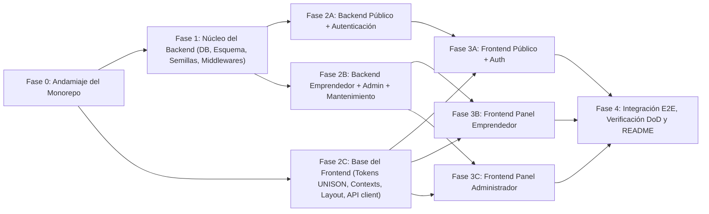

# Plan de Construcción y Guía de Orquestación para Agentes — EmprendeBúho

Este documento divide la construcción completa de **EmprendeBúho** en fases ordenadas y paralelizables para que uno o varios agentes de software construyan el sistema sin pisarse archivos ni tomar decisiones contradictorias.

> **Documento maestro:** Toda definición de tablas, endpoints, validaciones y vistas proviene de [`especificacion_tecnica_emprendebuho.md`](../especificacion_tecnica_emprendebuho.md) (v2.0) y de las reglas de [`AGENTS.md`](../AGENTS.md).

---

## 1. Grafo de Fases y Paralelización



* **Ejecución con un solo agente (secuencial):** `F0 → F1 → F2A → F2B → F2C → F3A → F3B → F3C → F4`.
* **Ejecución con subagentes en paralelo:**
  * **Ola 1:** `F0` (agente coordinador).
  * **Ola 2 (en paralelo):** `F1` (Backend Core) + `F2C` (Frontend Core).
  * **Ola 3 (en paralelo):** `F2A` (Backend Público/Auth) + `F2B` (Backend Emprendedor/Admin).
  * **Ola 4 (en paralelo):** `F3A` (UI Pública/Auth) + `F3B` (UI Emprendedor) + `F3C` (UI Admin).
  * **Ola 5:** `F4` (Integración final y verificación del Definition of Done).

---

## 2. Especificación Detallada por Fase (Propiedad de Archivos y Criterios de Aceptación)

### Fase 0 — Andamiaje del Monorepo (`F0`)
* **Objetivo:** Inicializar `package.json` de raíz, `backend/` y `frontend/`, carpetas con `.gitkeep`, `.env.example` y configuración de Vite + Tailwind v4.
* **Archivos exclusivos de esta fase:**
  * `package.json` (raíz)
  * `backend/package.json`, `backend/.env.example`
  * `backend/database/backups/.gitkeep`, `backend/uploads/{profiles,menus,products}/.gitkeep`, `backend/storage/credentials/.gitkeep`
  * `frontend/package.json`, `frontend/vite.config.js`, `frontend/index.html`
* **Checklist de aceptación:**
  * [ ] `npm install` desde la raíz instala sin errores ambos workspaces.
  * [ ] `backend/.env` se crea copiando `backend/.env.example` (y `git status` confirma que `.env` está ignorado).
* **Commit:** `chore: inicializar monorepo backend y frontend (F0)`

---

### Fase 1 — Núcleo del Backend: Base de Datos, Semillas y Middlewares (`F1`)
* **Objetivo:** Dejar lista la base de datos SQLite con el esquema v2, la función `normalizar()`, la semilla con las cuentas demo, los middlewares transversales y el arnés de pruebas.
* **Archivos exclusivos de esta fase:**
  * `backend/database/schema.sql` (copiar íntegro de §4.2 de la especificación)
  * `backend/database/seed.js` (§4.4: 8 categorías, 9 zonas con `mapa_x`/`mapa_y`, 1 admin, 4 emprendedores demo con imágenes placeholder SVG y 2 reportes)
  * `backend/src/config/{env.js, db.js, upload.js}`
  * `backend/src/utils/{AppError.js, response.js, text.js, time.js, files.js}`
  * `backend/src/middlewares/{auth.middleware.js, role.middleware.js, validate.middleware.js, rateLimit.middleware.js, error.middleware.js}`
  * `backend/src/services/{serializers.js, notification.service.js}`
  * `backend/src/app.js`, `backend/src/server.js`, `backend/src/routes/index.js` (con `GET /api/health` inicial)
  * `backend/tests/helpers/testApp.js`
* **Checklist de aceptación:**
  * [ ] `npm run db:reset` crea `emprendebuho.sqlite` sin errores y puebla las 8 categorías, 9 zonas y 5 usuarios iniciales.
  * [ ] `error.middleware.js` traduce `AppError`, `ZodError`, `MulterError` y `SqliteError` (`SQLITE_CONSTRAINT_UNIQUE`, `FOREIGNKEY`, `CHECK`) al sobre estándar (§5.0.2) sin filtrar trazas crudas.
  * [ ] `sanitizePublicBusiness()` oculta `campus_zone_id`, `zona_codigo`, `zona_nombre` y `ubicacion_detalle` cuando `mostrar_ubicacion` es `0`/`false`.
* **Commit:** `feat(backend): esquema SQLite v2, semillas, middlewares y utilidades base (F1)`

---

### Fase 2A — Backend Público, Catálogos, Reportes y Autenticación (`F2A`)
* **Historias cubiertas:** `HU-01`, `HU-14`, `HU-15`, `HU-18`, `HU-19`, `HU-23`, `HU-26`, `HU-27`, `HU-28`, `HU-29`, `HU-30`, `HU-31`, `HU-32`, `HU-33`, `HU-37`, `HU-38`, `HU-39`, `HU-40`.
* **Archivos exclusivos de esta fase:**
  * `backend/src/validators/{auth.validator.js, public.validator.js, report.validator.js}`
  * `backend/src/repositories/{user.repository.js, catalog.repository.js, businessPublic.repository.js, productPublic.repository.js, report.repository.js, notification.repository.js}`
  * `backend/src/services/{auth.service.js, catalog.service.js, businessPublic.service.js, productPublic.service.js, report.service.js}`
  * `backend/src/controllers/{auth.controller.js, catalog.controller.js, business.controller.js, product.controller.js, report.controller.js, notification.controller.js}`
  * `backend/src/routes/{auth.routes.js, catalog.routes.js, business.routes.js, product.routes.js, report.routes.js, notification.routes.js}`
  * `backend/tests/{auth.test.js, businesses.public.test.js, reports.test.js}`
* **Checklist de aceptación:**
  * [ ] `node --test tests/auth.test.js tests/businesses.public.test.js tests/reports.test.js` pasa al 100 %.
  * [ ] Verificados los casos críticos: privacidad `RNF-06`, búsqueda sin acentos (`normalizar`), filtro de precio en un solo `EXISTS`, horario semiabierto `[apertura, cierre)`, reutilización de cuenta rechazada/eliminada y revocación inmediata por `token_version`.
* **Commit:** `feat(backend): endpoints públicos, autenticación, notificaciones y reportes (F2A)`

---

### Fase 2B — Backend del Emprendedor, Administración y Mantenimiento (`F2B`)
* **Historias cubiertas:** `HU-02` a `HU-13`, `HU-16`, `HU-17`, `HU-20A`, `HU-20B`, `HU-21`, `HU-22`, `HU-24`, `HU-25`, `HU-34`, `HU-35`, `HU-36`.
* **Archivos exclusivos de esta fase:**
  * `backend/src/validators/{myBusiness.validator.js, product.validator.js, admin.validator.js}`
  * `backend/src/repositories/{myBusiness.repository.js, product.repository.js, admin.repository.js, audit.repository.js}`
  * `backend/src/services/{myBusiness.service.js, product.service.js, admin.service.js, maintenance.service.js}`
  * `backend/src/controllers/{myBusiness.controller.js, admin.controller.js}`
  * `backend/src/routes/{myBusiness.routes.js, admin.routes.js}`
  * `backend/tests/{my-business.test.js, admin.test.js}`
* **Checklist de aceptación:**
  * [ ] `node --test tests/my-business.test.js tests/admin.test.js` pasa al 100 %.
  * [ ] Toda mutación de `/api/my-business/*` invoca `touchActivity(businessId)`.
  * [ ] Toda mutación de `/api/admin/*` registra fila en `audit_logs` dentro de la misma transacción.
  * [ ] La credencial estudiantil solo se sirve en `GET /api/admin/requests/:userId/credential` para rol `admin`.
* **Commit:** `feat(backend): panel emprendedor, moderación admin y mantenimiento (F2B)`

---

### Fase 2C — Base del Frontend: Diseño UNISON, Contextos, Layout y Cliente API (`F2C`)
* **Historias y RNF cubiertos:** `RNF-01`, `RNF-02`, `RNF-04`, `RNF-05`, base de `HU-31` y `HU-40`.
* **Archivos exclusivos de esta fase:**
  * `frontend/src/styles/index.css` (§6.1)
  * `frontend/src/services/api.js`
  * `frontend/src/context/{AuthContext.jsx, FavoritesContext.jsx, ToastContext.jsx}`
  * `frontend/src/hooks/{useApi.js, useDebounce.js, useHermosilloNow.js}`
  * `frontend/src/utils/{format.js, contactLinks.js, constants.js}`
  * `frontend/src/components/routing/RequireRole.jsx`
  * `frontend/src/components/layout/{Navbar.jsx, BottomNav.jsx, Footer.jsx, AdminSidebar.jsx, EntrepreneurLayout.jsx, AdminLayout.jsx}`
  * `frontend/src/components/common/{ErrorAlert.jsx, EmptyState.jsx, ConfirmDialog.jsx, ImageUploader.jsx, Spinner.jsx, Toggle.jsx, Pagination.jsx, DevCodeBox.jsx, Avatar.jsx}`
  * `frontend/src/App.jsx`, `frontend/src/main.jsx`
* **Checklist de aceptación:**
  * [ ] `npm run build` compila sin errores.
  * [ ] En `< 768px` aparece `BottomNav.jsx` fijo y en `>= 768px` la `Navbar.jsx` completa.
  * [ ] Ningún componente usa texto dorado `#F2A900` sobre fondo claro.
* **Commit:** `feat(frontend): sistema de diseño UNISON, contextos, layouts y cliente API (F2C)`

---

### Fase 3A — Frontend Público, Exploración, Perfil y Autenticación (`F3A`)
* **Historias cubiertas:** `HU-01`, `HU-14`, `HU-15`, `HU-18`, `HU-19`, `HU-23`, `HU-26`, `HU-27` (consulta pública), `HU-29`, `HU-30`, `HU-31`, `HU-32`, `HU-33`, `HU-37`, `HU-38`, `HU-39`, `HU-40`.
* **Archivos exclusivos de esta fase:**
  * `frontend/src/components/business/{BusinessCard.jsx, BusinessProfileView.jsx, StatusBadge.jsx, ZoneBadge.jsx, ScheduleTable.jsx, ContactButtons.jsx, ReportModal.jsx, MenuLightbox.jsx}`
  * `frontend/src/components/product/{ProductCard.jsx, PriceRangeFilter.jsx}`
  * `frontend/src/components/search/{SearchBar.jsx, FilterDrawer.jsx, SortSelector.jsx, CampusZoneSelector.jsx, CategoryChips.jsx}`
  * `frontend/src/pages/public/{ExplorePage.jsx, BusinessDetailPage.jsx, FavoritesPage.jsx, ApplicationStatusPage.jsx, NotFoundPage.jsx}`
  * `frontend/src/pages/auth/{LoginPage.jsx, RegisterRequestPage.jsx, ForgotPasswordPage.jsx, ResetPasswordPage.jsx, AccountStatusPage.jsx}`
* **Checklist de aceptación:**
  * [ ] Todos los filtros y el ordenamiento de `ExplorePage` se sincronizan con `useSearchParams()`.
  * [ ] `CampusZoneSelector` dibuja el mapa esquemático SVG de la UNISON usando `mapa_x`/`mapa_y` y permite seleccionar `ZONA-MOVIL` o limpiar el filtro.
  * [ ] `BusinessProfileView` se construye como componente puro reutilizable por `BusinessDetailPage` y `ProfilePreviewPage` (`HU-34`).
* **Commit:** `feat(frontend): directorio público, buscador multicriterio, perfil y auth (F3A)`

---

### Fase 3B — Frontend del Panel del Emprendedor (`F3B`)
* **Historias cubiertas:** `HU-02` a `HU-13`, `HU-17`, `HU-27` (bandeja), `HU-28`, `HU-34`, `HU-36`.
* **Archivos exclusivos de esta fase:**
  * `frontend/src/components/product/ProductFormModal.jsx`
  * `frontend/src/pages/entrepreneur/{DashboardPage.jsx, ProfileEditorPage.jsx, CatalogManagerPage.jsx, ScheduleLocationPage.jsx, ProfilePreviewPage.jsx, NotificationsPage.jsx, AccountSettingsPage.jsx}`
* **Checklist de aceptación:**
  * [ ] La barra superior del panel (`EntrepreneurLayout`) permite alternar en un clic **Abierto / Cerrado** (`HU-17`) y **Mostrar / Ocultar ubicación** (`HU-12`) desde cualquier subruta de `/panel/*`.
  * [ ] `CatalogManagerPage` muestra el motivo de moderación en productos `'oculto_admin'` y deshabilita el interruptor de pausa en ellos.
  * [ ] `ProfilePreviewPage` consume `GET /api/my-business/preview` y renderiza `BusinessProfileView`.
* **Commit:** `feat(frontend): panel completo del emprendedor y vista previa fiel (F3B)`

---

### Fase 3C — Frontend del Panel de Administración (`F3C`)
* **Historias cubiertas:** `HU-16`, `HU-20A`, `HU-20B`, `HU-21`, `HU-22`, `HU-24`, `HU-25`, `HU-35`.
* **Archivos exclusivos de esta fase:**
  * `frontend/src/pages/admin/{AdminDashboardPage.jsx, PendingRequestsPage.jsx, ReportsManagerPage.jsx, CategoriesManagerPage.jsx, ModerationProductsPage.jsx, SystemMaintenancePage.jsx}`
* **Checklist de aceptación:**
  * [ ] `PendingRequestsPage` carga la foto de credencial mediante `fetch` autenticado con el token JWT (convirtiéndola a `Blob`/`ObjectURL`) para que funcione sin exponer una URL pública.
  * [ ] `ReportsManagerPage` permite resolver un reporte aplicando en el mismo paso *Sin sanción*, *Ocultar producto* o *Suspender cuenta*.
  * [ ] `SystemMaintenancePage` ejecuta barrido de inactividad, limpieza de huérfanos, creación y descarga de respaldos `.sqlite` y consulta de `audit_logs`.
* **Commit:** `feat(frontend): panel de administración, moderación y mantenimiento (F3C)`

---

### Fase 4 — Integración E2E, Verificación del Definition of Done y Documentación (`F4`)
* **Objetivo:** Conectar todas las rutas en `App.jsx` y `routes/index.js`, correr la suite completa de pruebas, verificar el recorrido de los tres roles (§7.3 de la especificación) y redactar `README.md`.
* **Checklist de aceptación:**
  * [ ] `npm test` → 100 % de pruebas en verde (`0 fail`).
  * [ ] `npm run build` y `npm run lint` → sin errores.
  * [ ] `README.md` documenta requisitos, instalación en 3 comandos (`npm install`, `npm run db:reset`, `npm run dev`), cuentas de prueba y arquitectura.
* **Commit:** `docs: README e integración final verificada (F4)`

---

## 3. Matriz de Trazabilidad Completa (40 Historias de Usuario — 42 ítems con HU-20A/20B)

| ID | Rol | Endpoint(s) de Backend | Vista / Componente Frontend | Suite de Prueba | Fase |
| ----- | ----- | ----- | ----- | ----- | ----- |
| **HU-01** | Emprendedor | `POST /api/auth/register-request` | `RegisterRequestPage.jsx` | `auth.test.js` | F2A / F3A |
| **HU-02** | Emprendedor | `POST /api/my-business/products` | `CatalogManagerPage.jsx`, `ProductFormModal.jsx` | `my-business.test.js` | F2B / F3B |
| **HU-03** | Emprendedor | `PUT /api/my-business/photos`, `DELETE .../photos/menu` | `ProfileEditorPage.jsx`, `MenuLightbox.jsx` | `my-business.test.js` | F2B / F3B |
| **HU-04** | Emprendedor | `PUT /api/my-business/photos`, `DELETE .../photos/perfil` | `ProfileEditorPage.jsx`, `Avatar.jsx` | `my-business.test.js` | F2B / F3B |
| **HU-05** | Emprendedor | `GET /api/catalogs`, `PUT /api/my-business/profile` | `ProfileEditorPage.jsx` | `my-business.test.js` | F2B / F3B |
| **HU-06** | Emprendedor | `PUT /api/my-business/profile` | `ProfileEditorPage.jsx` | `my-business.test.js` | F2B / F3B |
| **HU-07** | Emprendedor | `POST` / `PUT /api/my-business/products` | `ProductFormModal.jsx`, `ProductCard.jsx` | `my-business.test.js` | F2B / F3B |
| **HU-08** | Emprendedor | `PUT /api/my-business/products/:id` | `CatalogManagerPage.jsx`, `ProductFormModal.jsx` | `my-business.test.js` | F2B / F3B |
| **HU-09** | Emprendedor | `DELETE /api/my-business/products/:id` | `CatalogManagerPage.jsx`, `ConfirmDialog.jsx` | `my-business.test.js` | F2B / F3B |
| **HU-10** | Emprendedor | `PATCH /api/my-business/location` | `ScheduleLocationPage.jsx`, `ZoneBadge.jsx` | `my-business.test.js` | F2B / F3B |
| **HU-11** | Emprendedor | `PATCH /api/my-business/products/:id/status` | `CatalogManagerPage.jsx`, `BusinessProfileView.jsx` | `my-business.test.js` | F2B / F3B |
| **HU-12** | Emprendedor | `PATCH /api/my-business/location` + `sanitizePublicBusiness` | `EntrepreneurLayout.jsx`, `ScheduleLocationPage.jsx` | `businesses.public.test.js`, `my-business.test.js` | F2A / F2B / F3B |
| **HU-13** | Emprendedor | `PUT /api/my-business/contacts` | `ProfileEditorPage.jsx` | `my-business.test.js` | F2B / F3B |
| **HU-14** | Consumidor | `GET /api/businesses` | `ExplorePage.jsx`, `BusinessCard.jsx` | `businesses.public.test.js` | F2A / F3A |
| **HU-15** | Consumidor | `GET /api/businesses?q=` | `ExplorePage.jsx`, `SearchBar.jsx` | `businesses.public.test.js` | F2A / F3A |
| **HU-16** | Administrador | `GET` / `POST` / `PUT /api/admin/categories` | `CategoriesManagerPage.jsx` | `admin.test.js` | F2B / F3C |
| **HU-17** | Emprendedor | `PATCH /api/my-business/open-status` | `EntrepreneurLayout.jsx`, `StatusBadge.jsx` | `my-business.test.js` | F2B / F3B |
| **HU-18** | Consumidor | `GET /api/businesses/:slug` | `BusinessDetailPage.jsx`, `BusinessProfileView.jsx` | `businesses.public.test.js` | F2A / F3A |
| **HU-19** | Consumidor | `GET /api/businesses?category_id=` | `CategoryChips.jsx`, `ExplorePage.jsx` | `businesses.public.test.js` | F2A / F3A |
| **HU-20A** | Administrador | `GET /api/admin/products`, `PATCH .../products/:id/moderate` | `ModerationProductsPage.jsx` | `admin.test.js` | F2B / F3C |
| **HU-20B** | Administrador | `GET /api/admin/requests`, `GET .../credential` | `PendingRequestsPage.jsx` | `admin.test.js` | F2B / F3C |
| **HU-21** | Administrador | `PATCH /api/admin/requests/:userId` | `PendingRequestsPage.jsx` | `admin.test.js` | F2B / F3C |
| **HU-22** | Administrador | `PATCH /api/admin/users/:userId/suspend` | `PendingRequestsPage.jsx`, `ReportsManagerPage.jsx` | `admin.test.js` | F2B / F3C |
| **HU-23** | Consumidor | `GET /api/businesses?zone_id=` | `CampusZoneSelector.jsx`, `ExplorePage.jsx` | `businesses.public.test.js` | F2A / F3A |
| **HU-24** | Administrador | `PATCH /api/admin/reports/:reportId` | `ReportsManagerPage.jsx` | `admin.test.js` | F2B / F3C |
| **HU-25** | Administrador | `/api/admin/maintenance/*`, `GET /api/admin/audit-logs` | `SystemMaintenancePage.jsx` | `admin.test.js` | F2B / F3C |
| **HU-26** | Consumidor | `POST /api/reports` | `ReportModal.jsx`, `BusinessProfileView.jsx` | `reports.test.js` | F2A / F3A |
| **HU-27** | Emprendedor | `POST /api/auth/request-status`, `/api/notifications/*` | `ApplicationStatusPage.jsx`, `NotificationsPage.jsx`, `AccountStatusPage.jsx` | `auth.test.js`, `admin.test.js` | F2A / F3A / F3B |
| **HU-28** | Emprendedor | `DELETE /api/auth/my-account` | `AccountSettingsPage.jsx` | `auth.test.js` | F2A / F3B |
| **HU-29** | Consumidor | `GET /api/businesses/:slug` (`contacts`) | `ContactButtons.jsx` | `businesses.public.test.js` | F2A / F3A |
| **HU-30** | Consumidor | `GET /api/businesses?sort=&preferred_zone_id=` | `SortSelector.jsx`, `ExplorePage.jsx` | `businesses.public.test.js` | F2A / F3A |
| **HU-31** | Consumidor | `GET /api/businesses?ids=` | `FavoritesContext.jsx`, `FavoritesPage.jsx` | `businesses.public.test.js` | F2A / F2C / F3A |
| **HU-32** | Emprendedor | `POST /api/auth/forgot-password`, `POST .../reset-password` | `ForgotPasswordPage.jsx`, `ResetPasswordPage.jsx`, `DevCodeBox.jsx` | `auth.test.js` | F2A / F3A |
| **HU-33** | Consumidor | `GET /api/businesses` y `/api/products` (`min_price`, `max_price`) | `PriceRangeFilter.jsx`, `FilterDrawer.jsx` | `businesses.public.test.js` | F2A / F3A |
| **HU-34** | Emprendedor | `GET /api/my-business/preview` | `ProfilePreviewPage.jsx`, `BusinessProfileView.jsx` | `my-business.test.js` | F2B / F3B |
| **HU-35** | Administrador | `GET /api/admin/reports` | `ReportsManagerPage.jsx` | `admin.test.js` | F2B / F3C |
| **HU-36** | Emprendedor | `PUT /api/my-business/schedules` | `ScheduleLocationPage.jsx`, `ScheduleTable.jsx` | `my-business.test.js` | F2B / F3B |
| **HU-37** | Consumidor | `GET /api/products?q=` | `ExplorePage.jsx`, `ProductCard.jsx` | `businesses.public.test.js` | F2A / F3A |
| **HU-38** | Consumidor | `GET /api/businesses?day_of_week=&time=` / `available_now=true` | `FilterDrawer.jsx`, `ExplorePage.jsx` | `businesses.public.test.js` | F2A / F3A |
| **HU-39** | Consumidor | `GET /api/businesses?open_now=true` | `Navbar.jsx`, `ExplorePage.jsx` | `businesses.public.test.js` | F2A / F3A |
| **HU-40** | Emprendedor / Admin | `POST /api/auth/login`, `GET /api/auth/me` | `LoginPage.jsx`, `AuthContext.jsx` | `auth.test.js` | F2A / F2C / F3A |

---

## 4. Plantillas de Prompts para Lanzar Subagentes

Cuando un agente orquestador o el usuario lance un subagente para ejecutar una fase, debe pasarle el siguiente prompt base completando el bloque de la fase correspondiente:

```text
Eres responsable de implementar la [NOMBRE DE LA FASE] del proyecto EmprendeBúho.

1. Lee primero y de forma obligatoria:
   - AGENTS.md
   - especificacion_tecnica_emprendebuho.md (especialmente las secciones indicadas en tu fase)
   - docs/plan-de-construccion.md (sección de tu fase y matriz de trazabilidad)

2. Ámbito estricto de archivos:
   - Solo puedes crear o modificar los archivos listados en "[NOMBRE DE LA FASE]" dentro de docs/plan-de-construccion.md.
   - No modifiques archivos de otras fases ni instales dependencias fuera de la lista autorizada en §2.1.1.

3. Reglas críticas que debes respetar:
   - Nombres de campos JSON y SQLite exactamente en snake_case en español según schema.sql.
   - Sobre de respuesta estándar { ok, data, message, meta } y códigos de error de §5.0.2.
   - Privacidad RNF-06 (sanitizePublicBusiness) y credenciales privadas en backend/storage/credentials/.

4. Verificación antes de terminar:
   - Ejecuta los comandos de verificación de tu fase, corrige cualquier fallo y reporta el resultado exacto.
```
