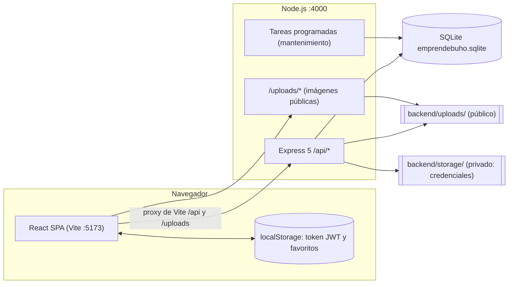
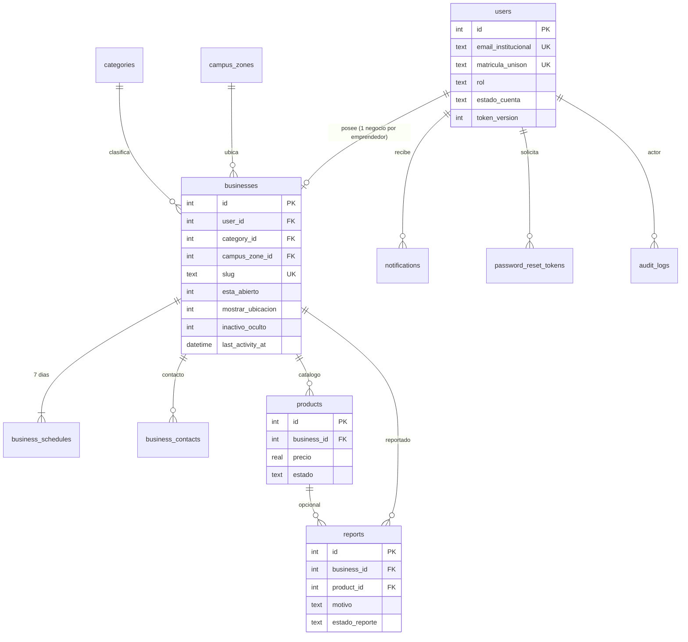
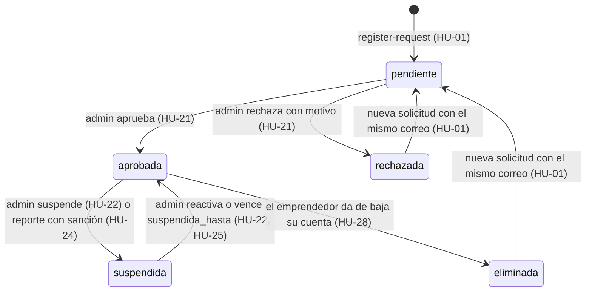
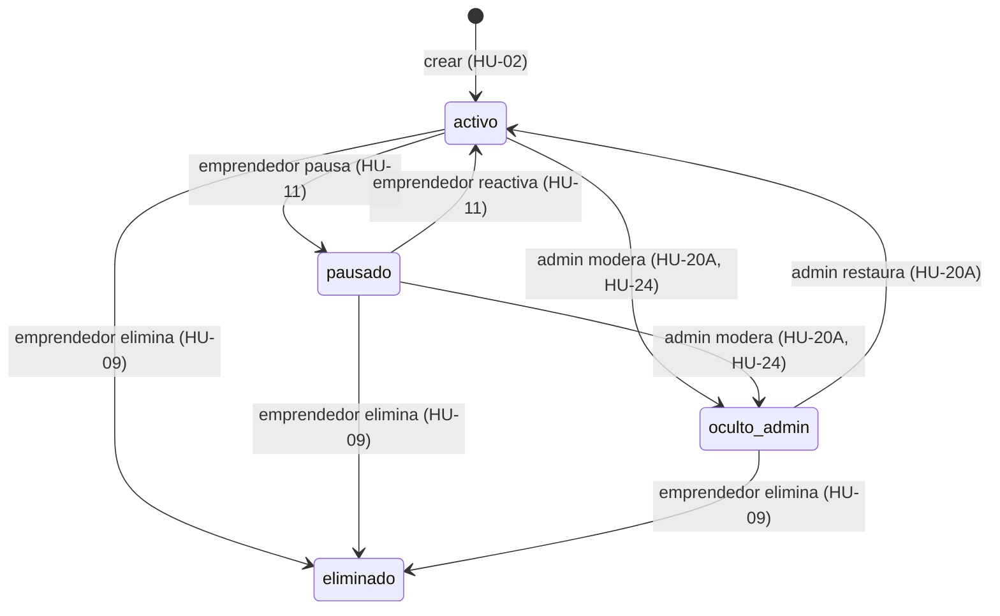

# Especificación Técnica y de Desarrollo de Software: EmprendeBúho

**Proyecto:** EmprendeBúho — *"Tu campus, tus emprendimientos"*

**Entidad Académica / Contexto:** Universidad de Sonora (UNISON), Campus Hermosillo

**Stack Tecnológico Objetivo:** React (Frontend SPA Mobile-First) + Express.js (Backend API REST) + SQLite (Base de Datos Relacional Local)

**Entorno de Ejecución:** Desarrollo 100% Local (Monorepo Cliente-Servidor sin dependencias de nube externas)

| Versión del documento | Fecha | Cambios |
| ----- | ----- | ----- |
| 1.0 | — | Especificación inicial (producto + diseño técnico). |
| 2.0 | 2026-10-19 | Revisión técnica: contrato de API unificado, esquema de base de datos corregido y endurecido, privacidad de credenciales, estrategia de pruebas y guía para agentes. Las secciones de producto (§1, §3.1, §3.2 y las columnas de producto de §3.3) **no cambian**. Detalle en [`docs/decisiones-tecnicas.md`](docs/decisiones-tecnicas.md). |

> **Cómo leer este documento**
>
> * **Fuente de verdad:** este archivo es la única fuente de verdad del producto y de su contrato técnico. Si el código y este documento no coinciden, manda el documento; cualquier cambio de contrato se hace primero aquí.
> * **Agentes de desarrollo:** antes de escribir código lean [`AGENTS.md`](AGENTS.md) (reglas operativas) y [`docs/plan-de-construccion.md`](docs/plan-de-construccion.md) (fases, tareas y criterios de aceptación).
> * **Convención de identificadores:** las columnas de la base de datos y las claves JSON de la API usan exactamente los nombres en español y `snake_case` del esquema (§4). El código JavaScript usa `camelCase` en inglés para variables y funciones internas.

## 1. Contexto del Dominio, Problemática y Alcance del Sistema

### 1.1 Problemática a Resolver

Dentro del campus de la Universidad de Sonora (UNISON), una gran cantidad de estudiantes gestiona pequeños emprendimientos (venta de alimentos preparados, repostería, snacks, bisutería, maquillaje, artículos personalizados, materiales escolares y servicios) como ingreso complementario o para solventar sus gastos de estudios. Actualmente, la difusión de estas ofertas ocurre de manera dispersa y efímera a través de historias temporales en redes sociales, mensajes en grupos estudiantiles de mensajería o recomendaciones de boca en boca.

Esta dispersión genera cuatro problemas críticos tanto para los emprendedores como para los consumidores universitarios:

| Caso Detectado | Impacto en Emprendedores | Impacto en Consumidores | 
| ----- | ----- | ----- | 
| **Información poco precisa** | Menor alcance comercial y dependencia exclusiva de contactos previos. | Dificultad para comparar alternativas, precios y menús. | 
| **Ubicación cambiante** | Pérdida de ventas potenciales mientras el vendedor se desplaza por el campus. | Pérdida de tiempo intentando localizar físicamente al vendedor. | 
| **Horarios poco visibles** | Generación de expectativas incorrectas y mensajes repetitivos sobre disponibilidad. | Incertidumbre sobre si el negocio está atendiendo en ese instante. | 
| **Ausencia de un directorio** | Poca continuidad de la identidad del negocio dentro de la comunidad. | El descubrimiento de la oferta depende puramente de la casualidad. | 

Adicionalmente, ante los lineamientos institucionales de la Universidad de Sonora para regular el comercio interno, se requiere una herramienta digital centralizada que identifique a los emprendedores pertenecientes a la comunidad estudiantil, organice su oferta y proteja su privacidad mediante ubicaciones voluntarias, temporales y configurables, sin pretender sustituir un permiso oficial.

### 1.2 Propósito del Sistema y Límites de Alcance (In-Scope vs. Out-of-Scope)

**EmprendeBúho** es una plataforma web responsiva (con experiencia de aplicación móvil y de escritorio) que combina un directorio público de negocios estudiantiles con características visuales de red social, perfiles autenticados y verificados para emprendedores, catálogos detallados de productos y canales de contacto directo.

* **Dentro del Alcance (In-Scope):**

  * Consulta pública de todo el directorio, perfiles, menús y catálogos **sin necesidad de que el consumidor cree una cuenta**.

  * Solicitud de registro de cuentas de emprendedores con acreditación de pertenencia a la UNISON y flujo de aprobación/rechazo por administradores.

  * Gestión integral del perfil del negocio (foto/logo, foto de menú general, descripción, categoría, horario de atención por día, medios de contacto e indicador manual en tiempo real de estado **Abierto / Cerrado**).

  * Gestión completa del catálogo de productos (crear, editar, eliminar lógicamente y **pausar temporalmente** productos con imagen, descripción y precio).

  * Gestión de privacidad de ubicación: activación/desactivación voluntaria en un clic de la zona aproximada del campus o punto de referencia donde se encuentra el emprendedor.

  * Motor de búsqueda, filtrado multicriterio (nombre de negocio, nombre de producto, categoría, zona del campus, rango de precio, horario de atención y estado abierto/cerrado) y ordenamiento (alfabético, por cercanía/zona o abiertos ahora).

  * Guardado de emprendimientos favoritos del lado del consumidor (persistido localmente en el navegador mediante `localStorage`), contacto directo desde el perfil (botones de llamada telefónica, WhatsApp y redes sociales) y envío de reportes de negocios con información falsa o inapropiada.

  * Panel de administración para validar solicitudes de registro, gestionar categorías del sistema, ocultar productos que infrinjan reglas, revisar/resolver reportes de consumidores, suspender cuentas temporalmente y ejecutar tareas de mantenimiento (incluyendo ocultamiento automático de negocios inactivos).

* **Fuera del Alcance (Out-of-Scope — Prohibido Implementar):**

  * **Sin procesamiento de pagos:** El sistema **no** incluye carritos de compra transaccionales, pasarelas de pago (Stripe, PayPal, tarjetas) ni cobros integrados.

  * **Sin gestión de entregas o repartidores:** El sistema **no** procesa logística de envíos; el acuerdo de entrega o punto de encuentro ocurre por contacto directo entre consumidor y emprendedor.

## 2. Arquitectura Técnica y Estructura del Proyecto Local

### 2.1 Decisiones Arquitectónicas del Stack (React + Express + SQLite)

El sistema se construye y ejecuta 100 % en local, sin servicios externos ni de pago. Son dos aplicaciones dentro de un monorepo (npm workspaces) que se comunican por una API REST JSON sobre HTTP.



#### 2.1.1 Versiones y dependencias autorizadas

| Pieza | Versión | Notas obligatorias para los agentes |
| ----- | ----- | ----- |
| Node.js | **22 LTS o 24 LTS** | `better-sqlite3` publica binarios precompilados para Windows/macOS/Linux en estas versiones. |
| npm | ≥ 10 | Monorepo con `workspaces: ["backend", "frontend"]`. |
| Express | **5.x** | Express 5 captura solo los errores de los handlers `async`, así que no hace falta `express-async-errors`. Las rutas comodín usan la sintaxis nueva (`/*splat`). |
| better-sqlite3 | última estable | Driver **síncrono**. No usar `sqlite3` ni ORMs. |
| zod | **4.x** | Única librería de validación (no usar `express-validator`). |
| React | **19** | Componentes funcionales y hooks. |
| Vite | última estable | Plantilla `react`, con JavaScript (no TypeScript). |
| react-router | **7.x en modo declarativo** | `<BrowserRouter>`, `<Routes>`, `<Route>`: misma API que la v6. No usar el modo *framework* ni *data routers*. |
| Tailwind CSS | **4.x** con `@tailwindcss/vite` | Sin `tailwind.config.js` ni `postcss.config.js`. Los tokens se declaran con `@theme` en `src/styles/index.css` (§6.1). |
| lucide-react | última estable | Iconografía. Las categorías guardan el nombre del ícono (`'Cake'`, `'Coffee'`…). |

**Backend, dependencias de producción (lista cerrada):** `express`, `better-sqlite3`, `cors`, `helmet`, `dotenv`, `bcryptjs`, `jsonwebtoken`, `multer`, `zod`, `slugify`, `express-rate-limit`.
**Backend, dependencias de desarrollo:** `nodemon`, `supertest`. Las pruebas usan el runner nativo `node:test`.
**Frontend, dependencias de producción:** `react`, `react-dom`, `react-router`, `lucide-react`.
**Frontend, dependencias de desarrollo:** `vite`, `@vitejs/plugin-react`, `tailwindcss`, `@tailwindcss/vite`, `eslint` (configuración de la plantilla Vite).
**Raíz:** `concurrently` (desarrollo).

> Agregar cualquier dependencia fuera de esta lista exige registrar la justificación en `docs/decisiones-tecnicas.md` en el mismo commit.

#### 2.1.2 Backend (`backend/`)

* **Runtime y framework:** Node.js con Express 5, módulos ES (`"type": "module"`).
* **Base de datos:** SQLite 3 mediante `better-sqlite3`, en `backend/database/emprendebuho.sqlite`. Al abrir la conexión se ejecutan `PRAGMA foreign_keys = ON;`, `PRAGMA journal_mode = WAL;` y `PRAGMA busy_timeout = 5000;`, y se registra la función SQL `normalizar()` (§4.3).
* **Capas:** `routes` (define rutas y middlewares) → `controllers` (traduce HTTP ↔ servicio y no contiene SQL) → `services` (reglas de negocio y transacciones) → `repositories` (todas las sentencias SQL, siempre parametrizadas). Ningún controlador ejecuta SQL directamente.
* **Autenticación y seguridad:** JWT (`jsonwebtoken`, HS256, expiración `JWT_EXPIRES_IN`), contraseñas con `bcryptjs` (10 *salt rounds*), validación de entrada con `zod`, cabeceras con `helmet`, CORS restringido a `CORS_ORIGIN` y *rate limiting* con `express-rate-limit` (§5.0.6). El middleware de autenticación **consulta al usuario en cada petición**. Así la suspensión, la baja o el cambio de contraseña invalidan la sesión de inmediato (`users.token_version`).
* **Almacenamiento de archivos:** `multer` en disco con nombres aleatorios (`crypto.randomUUID()` + extensión según el MIME). Solo se aceptan `image/jpeg`, `image/png` e `image/webp`, de máximo 5 MB.
  * **Públicas** (servidas estáticamente en `/uploads`): `backend/uploads/profiles/`, `menus/` y `products/`.
  * **Privadas** (nunca se sirven estáticamente): `backend/storage/credentials/`. Solo se entregan con `GET /api/admin/requests/:userId/credential` a un administrador autenticado.
* **Notificaciones y recuperación de contraseña en local:** como no hay SMTP, las notificaciones de aprobación, rechazo, suspensión y moderación (HU-27) se guardan en `notifications` y se muestran en la bandeja de la app. El estado de una solicitud se puede consultar con correo + matrícula (`POST /api/auth/request-status`). Los códigos de recuperación (HU-32) se imprimen en la consola del servidor con un formato fijo que simula un correo. Si `NODE_ENV=development`, también se devuelven en la respuesta para mostrarlos en un recuadro de "modo desarrollo".
* **Zona horaria:** SQLite guarda las fechas en UTC (`CURRENT_TIMESTAMP`). La API las devuelve en ISO-8601 con sufijo `Z`. El "ahora" de negocio (día de la semana y hora `HH:MM` para horarios) se calcula **siempre en el backend** con `America/Hermosillo` (UTC-7 fijo, sin horario de verano) mediante `Intl.DateTimeFormat`.

#### 2.1.3 Frontend (`frontend/`)

* **Framework y bundler:** React 19 + Vite.
* **Enrutamiento:** `react-router` v7 declarativo, con guardias de ruta por rol (§6.3).
* **Estilos:** Tailwind CSS 4 con los tokens institucionales de la UNISON (§6.1). Iconografía con `lucide-react`.
* **Diseño responsivo (Mobile-First):** pensado primero para el celular de un estudiante que se mueve por el campus. Debajo de `768px` hay barra de navegación inferior fija; en escritorio, barra superior.
* **Estado del cliente:** React Context API:
  * `AuthContext`: token JWT en `localStorage` (`emprendebuho_token`), usuario actual (restaurado con `GET /api/auth/me`), `login()` y `logout()`. Cierra la sesión sola ante un `401`.
  * `FavoritesContext`: arreglo de IDs en `localStorage` (`emprendebuho_favorites`), sin cuenta.
  * `ToastContext`: mensajes de éxito y error en español.
* **Datos remotos:** `fetch` envuelto en `services/api.js` (agrega el token, procesa el sobre de respuesta y convierte errores de red en mensajes claros). No se usan librerías de *data fetching*.
* **Filtros en la URL:** los filtros y el orden del directorio viven en los *query params* de la URL (`useSearchParams`). Así se pueden compartir y el botón "atrás" funciona.

### 2.2 Estructura de Directorios del Repositorio

```text
emprendebuho/
├── AGENTS.md                         # Reglas operativas para agentes de desarrollo
├── README.md                         # Instalación y ejecución local
├── package.json                      # Raíz: workspaces + scripts dev/test/build/db:reset
├── .gitignore
├── especificacion_tecnica_emprendebuho.md
├── docs/
│   ├── plan-de-construccion.md       # Fases, tareas, trazabilidad y plantillas para agentes
│   └── decisiones-tecnicas.md        # Bitácora de decisiones (ADR) y cambios v1 → v2
├── backend/
│   ├── package.json
│   ├── .env.example                  # Se copia a .env (no versionado)
│   ├── database/
│   │   ├── schema.sql                # DDL completo (§4.1)
│   │   ├── seed.js                   # Datos semilla con hashes bcrypt e imágenes placeholder (§4.4)
│   │   └── backups/                  # Respaldos .sqlite generados por mantenimiento
│   ├── uploads/                      # PÚBLICO vía /uploads
│   │   ├── profiles/
│   │   ├── menus/
│   │   └── products/
│   ├── storage/                      # PRIVADO (nunca estático)
│   │   └── credentials/
│   ├── tests/                        # node:test + supertest (§7.2)
│   │   ├── helpers/testApp.js        # App con BD temporal y semilla mínima
│   │   ├── auth.test.js
│   │   ├── businesses.public.test.js
│   │   ├── my-business.test.js
│   │   ├── reports.test.js
│   │   └── admin.test.js
│   └── src/
│       ├── app.js                    # Express: helmet, cors, json, /uploads, rutas, 404 y errorHandler
│       ├── server.js                 # Arranque HTTP + programación de tareas de mantenimiento
│       ├── config/
│       │   ├── env.js                # Lee y valida variables de entorno con zod
│       │   ├── db.js                 # Conexión, PRAGMAs, normalizar(), schema.sql, seed si BD vacía
│       │   └── upload.js             # Instancias multer: publicImage(subdir), credentialImage
│       ├── middlewares/
│       │   ├── auth.middleware.js    # requireAuth: JWT + usuario vigente + token_version
│       │   ├── role.middleware.js    # requireRole('emprendedor' | 'admin')
│       │   ├── validate.middleware.js# validate({ body, query, params }) con zod
│       │   ├── rateLimit.middleware.js
│       │   └── error.middleware.js   # notFound + errorHandler (traduce AppError, ZodError, Multer, SQLite)
│       ├── utils/
│       │   ├── AppError.js           # class AppError(status, code, message, details)
│       │   ├── response.js           # ok(res, data, message, meta)
│       │   ├── text.js               # normalizar(), escapeLike(), uniqueSlug()
│       │   ├── time.js               # nowInHermosillo() -> { dow, time }
│       │   └── files.js              # deleteUploadIfExists(), rutas seguras
│       ├── validators/               # Esquemas zod por módulo (auth, business, product, report, admin)
│       ├── repositories/             # SQL parametrizado (users, businesses, products, reports, ...)
│       ├── services/
│       │   ├── auth.service.js
│       │   ├── business.service.js
│       │   ├── product.service.js
│       │   ├── report.service.js
│       │   ├── admin.service.js
│       │   ├── maintenance.service.js  # Inactividad, levantar suspensiones vencidas, respaldo, huérfanos
│       │   ├── notification.service.js # Inserta notificación + log de consola
│       │   └── serializers.js          # sanitizePublicBusiness(), publicProduct(), ...
│       ├── controllers/
│       │   ├── auth.controller.js      # HU-01, 27, 28, 32, 40
│       │   ├── catalog.controller.js   # HU-05, 19, 23
│       │   ├── business.controller.js  # Públicos: HU-14, 15, 18, 19, 23, 29, 30, 31, 33, 38, 39
│       │   ├── product.controller.js   # Públicos: HU-33, 37
│       │   ├── myBusiness.controller.js# HU-02..13, 17, 34, 36
│       │   ├── notification.controller.js # HU-27
│       │   ├── report.controller.js    # HU-26
│       │   └── admin.controller.js     # HU-16, 20A, 20B/21, 22, 24, 25, 35
│       └── routes/
│           ├── index.js                # Monta todo bajo /api
│           ├── auth.routes.js
│           ├── catalog.routes.js
│           ├── business.routes.js
│           ├── product.routes.js
│           ├── myBusiness.routes.js
│           ├── notification.routes.js
│           ├── report.routes.js
│           └── admin.routes.js
└── frontend/
    ├── package.json
    ├── vite.config.js                # Plugins react + tailwind; proxy /api y /uploads → :4000
    ├── index.html                    # lang="es-MX"
    └── src/
        ├── main.jsx
        ├── App.jsx                   # Providers + rutas (§6.3)
        ├── styles/index.css          # @import "tailwindcss"; @theme con tokens UNISON (§6.1)
        ├── context/                  # AuthContext.jsx, FavoritesContext.jsx, ToastContext.jsx
        ├── services/api.js
        ├── hooks/                    # useApi.js, useDebounce.js, useHermosilloNow.js
        ├── utils/                    # format.js (MXN, fechas), contactLinks.js, constants.js
        ├── components/
        │   ├── layout/               # Navbar, BottomNav, Footer, AdminSidebar, EntrepreneurLayout, AdminLayout
        │   ├── routing/              # RequireRole.jsx
        │   ├── business/             # BusinessCard, BusinessProfileView, StatusBadge, ZoneBadge,
        │   │                         # ScheduleTable, ContactButtons, ReportModal, MenuLightbox
        │   ├── product/              # ProductCard, ProductFormModal, PriceRangeFilter
        │   ├── search/               # SearchBar, FilterDrawer, SortSelector, CampusZoneSelector, CategoryChips
        │   └── common/               # ErrorAlert, EmptyState, ConfirmDialog, ImageUploader, Spinner,
        │                             # Toggle, Pagination, DevCodeBox, Avatar (placeholder por iniciales)
        └── pages/
            ├── public/               # ExplorePage, BusinessDetailPage, FavoritesPage, ApplicationStatusPage, NotFoundPage
            ├── auth/                 # LoginPage, RegisterRequestPage, ForgotPasswordPage, ResetPasswordPage, AccountStatusPage
            ├── entrepreneur/         # DashboardPage, ProfileEditorPage, CatalogManagerPage,
            │                         # ScheduleLocationPage, ProfilePreviewPage, NotificationsPage, AccountSettingsPage
            └── admin/                # AdminDashboardPage, PendingRequestsPage, ReportsManagerPage,
                                      # CategoriesManagerPage, ModerationProductsPage, SystemMaintenancePage
```

> La v1 tenía una `SearchPage` separada. En la v2 la búsqueda vive en `ExplorePage` con un conmutador *Negocios / Productos* (§6.2), para cumplir RNF-01 (máximo 2 clics hasta el contacto).

### 2.3 Variables de Entorno (`backend/.env.example`)

```env
PORT=4000
NODE_ENV=development
CORS_ORIGIN=http://localhost:5173
JWT_SECRET=cambia_esto_por_una_cadena_larga_y_aleatoria
JWT_EXPIRES_IN=7d
DB_PATH=./database/emprendebuho.sqlite
UPLOAD_DIR=./uploads
STORAGE_DIR=./storage
BACKUP_DIR=./database/backups
BACKUP_KEEP=10
ALLOWED_EMAIL_DOMAINS=unison.mx
INACTIVITY_DAYS_LIMIT=30
MAINTENANCE_INTERVAL_HOURS=12
REPORT_IP_SALT=cambia_esto_tambien
```

`config/env.js` valida estas variables con zod al arrancar. Si falta una obligatoria, el proceso termina con un mensaje claro. Las pruebas usan `DB_PATH` apuntando a un archivo temporal.

### 2.4 Scripts del Monorepo

| Ubicación | Script | Acción |
| ----- | ----- | ----- |
| raíz | `npm install` | Instala ambos workspaces. |
| raíz | `npm run dev` | `concurrently` levanta backend (`nodemon src/server.js`, :4000) y frontend (`vite`, :5173). |
| raíz | `npm test` | Ejecuta `npm test -w backend` (`node --test tests/`). |
| raíz | `npm run build` | `vite build` del frontend. |
| raíz | `npm run lint` | ESLint del frontend. |
| raíz | `npm run db:reset` | Borra el `.sqlite` local y los archivos subidos (conservando los `.gitkeep`) y vuelve a crear esquema y semilla. |

## 3. Catálogo Completo de Requerimientos e Historias de Usuario

### 3.1 Requerimientos Funcionales Base (RF)

 1. **RF-01:** El sistema debe permitir a un administrador aprobar o rechazar solicitudes de registro de emprendedores acreditando su pertenencia a la Universidad de Sonora.

 2. **RF-02:** El emprendedor debe poder iniciar sesión de forma segura y administrar toda la información de su perfil de negocio.

 3. **RF-03:** El emprendedor debe poder agregar, editar, pausar temporalmente y eliminar productos de su catálogo individual.

 4. **RF-04:** El emprendedor debe poder establecer y actualizar el horario de atención de su negocio desglosado por días de la semana.

 5. **RF-05:** El emprendedor debe poder indicar en tiempo real mediante un interruptor rápido si su negocio se encuentra **Abierto** o **Cerrado**.

 6. **RF-06:** El emprendedor podrá compartir voluntariamente una ubicación aproximada o zona dentro del campus y desactivarla en cualquier momento.

 7. **RF-07:** El consumidor debe poder buscar emprendimientos por nombre del negocio o por nombre específico de un producto sin necesidad de registrarse.

 8. **RF-08:** El consumidor debe poder filtrar emprendimientos combinando categoría, horario de atención, estado (abierto/cerrado), rango de precios y zona del campus.

 9. **RF-09:** El administrador debe poder moderar y ocultar publicaciones de productos y suspender perfiles que incumplan las reglas de la plataforma.

10. **RF-10:** El sistema debe mostrar los medios de contacto directo proporcionados por el emprendedor (llamada, WhatsApp, redes sociales) para concretar la comunicación.

### 3.2 Requerimientos No Funcionales (RNF) y Reglas Técnicas

1. **RNF-01 (Usabilidad Estudiantil):** Interfaz sencilla, limpia e intuitiva diseñada para flujos rápidos de consulta entre clases (máximo 2 clics desde la portada hasta el botón de contacto del vendedor).

2. **RNF-02 (Adaptabilidad Web y Móvil):** Diseño 100% responsivo (*Mobile-First*). En pantallas menores a `768px` debe comportarse como una aplicación móvil con barra de navegación inferior fija.

3. **RNF-03 (Disponibilidad en Horario Escolar):** Operación continua garantizada durante todo el horario escolar (`07:00` a `21:00` hrs) y soporte para comparación automática de horarios locales de Hermosillo (`America/Hermosillo`, UTC-7 sin horario de verano).

4. **RNF-04 (Identidad Visual UNISON):** Aplicación estricta de la paleta de colores institucional de la Universidad de Sonora (Azul `#002D62`, Dorado `#F2A900`, Blanco `#FFFFFF`).

5. **RNF-05 (Manejo de Errores Claros):** Prohibido exponer trazas crudas de SQLite o códigos HTTP crípticos al usuario. Toda falla de validación, red o permisos debe presentarse en español con un mensaje claro y accionable.

6. **RNF-06 (Privacidad Estricta del Emprendedor):** Los consumidores **únicamente** podrán visualizar la información que el emprendedor haya decidido hacer pública. Si `mostrar_ubicacion = 0`, el backend debe omitir `campus_zone_id`, nombre de zona y descripción de ubicación en las respuestas públicas de la API.

### 3.3 Matriz Exhaustiva de las 40 Historias de Usuario (Con Criterios Técnicos de Implementación)

> **Nota sobre la Historia de Usuario 20 (HU-20):** En la documentación del proyecto, el identificador `HU-20` se utiliza en la tabla de prioridades para *"Ocultar publicaciones de productos que incumplan las reglas"* y en la tabla de asignación para *"Revisar y aprobar las solicitudes de registro de emprendedores (asegurando pertenencia a la UNISON)"*. Ambas funcionalidades son obligatorias y se especifican a continuación como **HU-20A** y **HU-20B**.

| ID | Rol | Historia de Usuario (Objetivo y Beneficio) | Prioridad / Complejidad | Especificación Técnica de Implementación (React + Express + SQLite) | 
| ----- | ----- | ----- | ----- | ----- |
| **HU-01** | Emprendedor | Solicitar hacer una cuenta para registrar mi negocio en la app. | Alta / Alta | Vista `/registro` (`RegisterRequestPage`). `POST /api/auth/register-request` (`multipart/form-data`): `nombre_completo`, `email_institucional` (**obligatorio**, dominio en `ALLOWED_EMAIL_DOMAINS` = `@unison.mx`), `matricula_unison` (**obligatoria**, 9 dígitos), `password` (8–72 caracteres, al menos una letra y un número), `credencial` (**imagen obligatoria**, se guarda en `storage/credentials/`), `nombre_negocio` y `category_id` (categoría activa). En una transacción crea `users` (`estado_cuenta = 'pendiente'`), `businesses` (slug único) y las 7 filas de `business_schedules` (cerradas). Si el correo o la matrícula pertenecen a una cuenta `rechazada` o `eliminada`, **reutiliza** la fila y la regresa a `pendiente`. |
| **HU-02** | Emprendedor | Publicar el catálogo de mi negocio (una imagen y descripción por producto) para que el cliente visualice mis ofertas. | Alta / Alta | `POST /api/my-business/products` (`multipart/form-data`: `nombre`, `descripcion`, `precio`, `imagen` **obligatoria**). Guarda la imagen en `/uploads/products/` y crea el producto con `estado = 'activo'`. Lo gestiona `CatalogManagerPage` (`/panel/catalogo`) con `ProductFormModal`. |
| **HU-03** | Emprendedor | Publicar una foto del menú de mi negocio para que el cliente visualice las ofertas de mis productos de un vistazo. | Alta / Baja | Campo `businesses.foto_menu_url`. `PUT /api/my-business/photos` con el campo `foto_menu` (sube o reemplaza y borra el archivo anterior); `DELETE /api/my-business/photos/menu` la quita. En el perfil público se muestra en la pestaña *Menú* con visor ampliable (`MenuLightbox`). |
| **HU-04** | Emprendedor | Poner una foto de perfil en mi cuenta para que los clientes me reconozcan por mi foto/logo. | Baja / Baja | Campo `businesses.foto_perfil_url`. `PUT /api/my-business/photos` con el campo `foto_perfil`; `DELETE /api/my-business/photos/perfil` la quita. Si no hay foto, `Avatar` muestra las iniciales del negocio sobre un fondo de color derivado de la categoría. |
| **HU-05** | Emprendedor | Dar una clasificación a mi negocio (alimentos, bisutería, maquillaje, etc.) para facilitar su localización. | Baja / Baja | FK `businesses.category_id` → `categories` (solo categorías `activa = 1` al elegir). Selector en el editor de perfil alimentado por `GET /api/catalogs`; se guarda con `PUT /api/my-business/profile`. |
| **HU-06** | Emprendedor | Agregar una descripción del negocio para explicar qué productos o servicios ofrezco. | Alta / Baja | Campo `businesses.descripcion` (`TEXT`, máx. 1000 caracteres, `CHECK` en la BD). Se edita en `/panel/perfil` con contador de caracteres en vivo y se guarda con `PUT /api/my-business/profile`. |
| **HU-07** | Emprendedor | Indicar el precio de cada producto para informar al cliente cuánto cuesta antes de contactarme. | Alta / Baja | Campo `products.precio` (`REAL`, `0 ≤ precio ≤ 99999.99`, máximo 2 decimales validado con zod). El frontend lo formatea con `Intl.NumberFormat('es-MX', { style: 'currency', currency: 'MXN' })` → `$35.00`. |
| **HU-08** | Emprendedor | Editar productos de mi catálogo para mantener actualizada la información de mi oferta. | Alta / Baja | `PUT /api/my-business/products/:id` (`multipart/form-data`, todos los campos opcionales; `imagen` reemplaza y borra la anterior). Verifica que el producto pertenezca al negocio del usuario (si no, `404 NOT_FOUND`). Un producto `oculto_admin` se puede editar pero **sigue oculto** hasta que un admin lo restaure. |
| **HU-09** | Emprendedor | Eliminar productos de mi catálogo para retirar productos que ya no tenga disponibles. | Alta / Baja | `DELETE /api/my-business/products/:id` con `ConfirmDialog` en la UI. Hace **borrado lógico** (`estado = 'eliminado'`), borra el archivo de imagen y deja `imagen_url = NULL`. Los productos eliminados no aparecen en ninguna respuesta. |
| **HU-10** | Emprendedor | Publicar ubicación aproximada para facilitar a los clientes encontrarme dentro del campus. | Media / Media | Campos `campus_zone_id` (zona oficial activa), `ubicacion_detalle` (máx. 120 caracteres, ej. *"Mesas frente al edificio 3K de Computación"*) y `mostrar_ubicacion = 1`. Se guardan con `PATCH /api/my-business/location`. La BD impide mostrar la ubicación sin zona (`CHECK`). |
| **HU-11** | Emprendedor | Pausar productos de mi catálogo para hacer saber a mis clientes que el producto no está disponible temporalmente. | Media / Baja | `PATCH /api/my-business/products/:id/status` con `{ "estado": "activo" \| "pausado" }` (idempotente). No aplica a productos `oculto_admin` ni `eliminado` (`409 PRODUCT_LOCKED`). En el perfil público, los pausados se muestran al final con la etiqueta *"No disponible temporalmente"*; no aparecen en `GET /api/products` ni cuentan para filtros de precio o búsqueda. |
| **HU-12** | Emprendedor | Desactivar ubicación para proteger mi privacidad cuando no quiero mostrar dónde estoy. | Media / Baja | Interruptor en el panel que envía `PATCH /api/my-business/location` con `{ "mostrar_ubicacion": false }`. Conserva la zona y la referencia en privado, pero `sanitizePublicBusiness()` deja en `null` `campus_zone_id`, `zona_codigo`, `zona_nombre` y `ubicacion_detalle` en **todas** las respuestas públicas, y el negocio deja de salir en el filtro por zona. |
| **HU-13** | Emprendedor | Agregar medios de contacto para permitir a los clientes comunicarse conmigo. | Alta / Baja | Tabla `business_contacts` (1:N). `PUT /api/my-business/contacts` reemplaza la lista completa (máx. 10, un solo `es_principal`) en una transacción. Formatos normalizados: WhatsApp y teléfono con 10 dígitos; Instagram y TikTok como usuario sin `@`; Facebook y otro como URL `https://`. |
| **HU-14** | Consumidor | Visualizar los emprendimientos disponibles para conocer los negocios que existen dentro de la universidad. | Alta / Media | Vista principal `/` (alias `/explorar`, `ExplorePage`). `GET /api/businesses` lista solo negocios de cuentas `rol = 'emprendedor'` y `estado_cuenta = 'aprobada'` con `inactivo_oculto = 0`, paginados (24 por página). Tarjetas `BusinessCard` con foto, nombre, categoría, estado Abierto/Cerrado, zona (si es pública) y rango de precios. |
| **HU-15** | Consumidor | Buscar un emprendimiento por nombre para encontrar de manera rápida un negocio específico. | Alta / Media | Parámetro `?q=` (2–60 caracteres) en `GET /api/businesses`. Búsqueda **insensible a mayúsculas y acentos** con la función SQL `normalizar()` sobre `nombre_negocio`, `descripcion` y nombres de productos activos; los comodines `%` y `_` del usuario se escapan. |
| **HU-16** | Administrador | Gestionar las categorías disponibles del sistema para mantener organizada la clasificación de negocios. | Media / Media | Vista `/admin/categorias` (`CategoriesManagerPage`). `GET /api/admin/categories` (incluye inactivas y el conteo de negocios), `POST /api/admin/categories` y `PUT /api/admin/categories/:id` (`nombre`, `descripcion`, `icono`, `activa`; el `slug` se genera del nombre). Las categorías **no se borran**: se desactivan y los negocios existentes conservan la FK. |
| **HU-17** | Emprendedor | Indicar si mi negocio está abierto o cerrado para informar si puedo atender en ese momento. | Alta / Baja | Interruptor destacado en la cabecera del panel. `PATCH /api/my-business/open-status` con `{ "esta_abierto": true \| false }`. Actualiza `esta_abierto` y, como toda mutación del emprendedor, `last_activity_at` e `inactivo_oculto = 0`. |
| **HU-18** | Consumidor | Consultar el perfil de un emprendimiento para conocer sus productos, precios, horarios y medios de contacto. | Alta / Media | Vista `/negocio/:slug` (`BusinessDetailPage` → `BusinessProfileView`). `GET /api/businesses/:slug` devuelve cabecera, estado en tiempo real, `en_horario_ahora`, horario semanal, foto del menú, catálogo (`activo` primero, luego `pausado`), contactos y zona (si es pública). Responde `404` si el negocio no es visible. |
| **HU-19** | Consumidor | Filtrar emprendimientos por categoría de producto para encontrar opciones acordes con lo que busco. | Alta / Media | Chips horizontales de categorías (`CategoryChips`) en `/` que fijan `?category_id=` en la URL y en `GET /api/businesses`. |
| **HU-20A** | Administrador | Ocultar publicaciones de productos que incumplan las reglas para evitar contenido inapropiado o engañoso. | Alta / Media | Vista `/admin/moderacion` (`ModerationProductsPage`) alimentada por `GET /api/admin/products`. `PATCH /api/admin/products/:productId/moderate` con `{ "ocultar": true, "motivo_moderacion": "..." }` cambia `estado = 'oculto_admin'` y guarda `motivo_moderacion`, `moderado_por` y `moderado_at`. Con `{ "ocultar": false }` lo restaura a `activo`. Notifica al emprendedor (`producto_oculto` / `producto_restaurado`) y registra en `audit_logs`. |
| **HU-20B / HU-21** | Administrador | Revisar las solicitudes de registro pendientes y aprobar o rechazar nuevas cuentas verificando pertenencia a la UNISON. | Alta / Alta | Vista `/admin/solicitudes` (`PendingRequestsPage`, con pestañas por estado). `GET /api/admin/requests?status=pendiente` muestra nombre, matrícula, correo, negocio, categoría y la credencial (cargada con `GET /api/admin/requests/:userId/credential`). `PATCH /api/admin/requests/:userId` con `{ "decision": "aprobada" \| "rechazada", "motivo": "..." }` (el motivo es obligatorio al rechazar). |
| **HU-22** | Administrador | Suspender temporalmente una cuenta para aplicar sanciones cuando se incumplan reglas de la plataforma. | Media / Alta | `PATCH /api/admin/users/:userId/suspend` con `{ "suspend": true, "motivo": "...", "hasta": "YYYY-MM-DD" (opcional) }`. Pone `estado_cuenta = 'suspendida'`, `motivo_estado`, `suspendida_hasta`, `esta_abierto = 0` e incrementa `token_version` (cierra sesiones). El negocio desaparece del directorio. `{ "suspend": false }` la reactiva; el mantenimiento reactiva sola la cuenta al vencer `suspendida_hasta`. No se puede suspender a un administrador. |
| **HU-23** | Consumidor | Buscar emprendimientos por zona del campus para ubicar negocios cercanos sin necesitar la ubicación exacta del vendedor. | Media / Media | Filtro `?zone_id=` en `GET /api/businesses` y `GET /api/products`: solo negocios con `mostrar_ubicacion = 1` y `campus_zone_id = :zone_id`. `CampusZoneSelector` muestra un **mapa esquemático SVG** con las zonas en sus coordenadas `mapa_x` y `mapa_y` (más una lista accesible equivalente). |
| **HU-24** | Administrador | Gestionar los reportes enviados por los consumidores para tomar decisiones sobre cuentas denunciadas. | Media / Alta | Vista `/admin/reportes` (`ReportsManagerPage`). `PATCH /api/admin/reports/:reportId` con `{ "estado_reporte", "notas_admin", "accion_automatica": "ninguna" \| "ocultar_producto" \| "suspender_cuenta", "motivo_sancion" }`. En **una sola transacción** cambia el estado del reporte, ejecuta la acción, crea la notificación y registra la auditoría. `ocultar_producto` exige que el reporte tenga `product_id`. |
| **HU-25** | Administrador | Dar mantenimiento general a la plataforma para asegurar su correcto funcionamiento. | Media / Media | Vista `/admin/mantenimiento` (`SystemMaintenancePage`). (1) `POST /api/admin/maintenance/run-inactivity-check` oculta negocios sin actividad en `INACTIVITY_DAYS_LIMIT` días; (2) `POST /api/admin/maintenance/backup` genera un respaldo con `db.backup()` y `GET /api/admin/maintenance/backups/:filename` lo descarga; (3) `GET /api/admin/maintenance/health` y `GET /api/admin/audit-logs` muestran métricas y bitácora; (4) `POST /api/admin/maintenance/cleanup-orphans` borra imágenes huérfanas. |
| **HU-26** | Consumidor | Reportar un negocio con información falsa o inapropiada para ayudar a mantener el directorio confiable. | Media / Baja | Enlace *"Reportar este negocio"* en `/negocio/:slug` que abre `ReportModal` con motivo (`informacion_falsa`, `contenido_inapropiado`, `producto_prohibido`, `suplantacion`, `otro`), producto opcional y comentario (obligatorio, de 10 caracteres o más, si el motivo es `otro`). `POST /api/reports` sin cuenta, con *rate limit* por IP (5 por hora) y máximo 1 reporte por negocio por IP cada 24 h (`ip_hash`). |
| **HU-27** | Emprendedor | Recibir una notificación cuando mi cuenta sea aprobada o rechazada para saber si ya puedo publicar. | Alta / Baja | Al aprobar o rechazar (HU-21), el backend inserta en `notifications` y escribe un log en consola. El emprendedor puede: (a) consultar sin sesión en `/estado-solicitud` (`POST /api/auth/request-status` con correo + matrícula); (b) ver la pantalla de estado al intentar iniciar sesión (HU-40); (c) ver la bandeja `/panel/notificaciones` (`GET /api/notifications`) una vez aprobado. |
| **HU-28** | Emprendedor | Eliminar mi cuenta para dejar de aparecer en el directorio si cierro mi negocio. | Media / Baja | Vista `/panel/cuenta`, "Zona de peligro". `DELETE /api/auth/my-account` con `{ "password_actual": "..." }`. Pone `estado_cuenta = 'eliminada'`, `esta_abierto = 0` y `mostrar_ubicacion = 0`, e incrementa `token_version` (revoca la sesión). El negocio desaparece del directorio. El frontend borra el token y redirige a `/`. |
| **HU-29** | Consumidor | Contactar al emprendedor directamente desde su perfil (botón de llamada/redes sociales). | Alta / Media | `ContactButtons` en `/negocio/:slug` construye los enlaces desde los valores normalizados: `https://wa.me/52{10 dígitos}?text=` + `encodeURIComponent("Hola, vi tu negocio en EmprendeBúho UNISON...")`, `tel:+52{10 dígitos}`, `https://instagram.com/{usuario}`, `https://www.tiktok.com/@{usuario}`, y la URL directa para Facebook y otro. Se abren en una pestaña nueva con `rel="noopener noreferrer"`. |
| **HU-30** | Consumidor | Ordenar los resultados de búsqueda (alfabético, por cercanía/zona, o si está abierto ahora). | Media / Alta | Parámetro `?sort=` en `GET /api/businesses`: `open_now` (por defecto: `esta_abierto DESC, en_horario_ahora DESC, nombre`), `alpha_asc`, `alpha_desc` (orden por `normalizar(nombre_negocio)`) y `proximity` (requiere `preferred_zone_id`; ordena por distancia euclidiana entre `mapa_x/mapa_y` de la zona preferida y la del negocio; los de ubicación privada o sin coordenadas van al final). |
| **HU-31** | Consumidor | Guardar emprendimientos como favoritos para encontrar rápidamente los negocios que me interesaron. | Media / Media | `FavoritesContext` guarda un arreglo de IDs en `localStorage` (`emprendebuho_favorites`). La vista `/favoritos` consulta `GET /api/businesses?ids=1,4,9` (máx. 100) para tener datos frescos y estado en tiempo real. Los IDs que ya no vuelven (negocio suspendido o eliminado) se quitan del `localStorage` en silencio. |
| **HU-32** | Emprendedor | Recuperar mi contraseña en caso de olvidarla para volver a acceder sin crear cuenta nueva. | Alta / Media | Flujo `/recuperar-password` → `/restablecer-password`. `POST /api/auth/forgot-password` responde **siempre igual** (sin revelar si existe la cuenta). Si existe, crea un código de 6 dígitos (válido 15 min) guardado como `codigo_hash` en `password_reset_tokens`, lo imprime en consola y, en `development`, lo devuelve como `dev_codigo` para el `DevCodeBox`. `POST /api/auth/reset-password` valida vigencia e intentos (máx. 5), actualiza `password_hash`, marca el código como usado e incrementa `token_version`. |
| **HU-33** | Consumidor | Filtrar productos por rango de precio para encontrar opciones que se ajusten a mi presupuesto. | Media / Media | Parámetros `?min_price=&max_price=` en `GET /api/products` y en `GET /api/businesses`. En negocios, filtra los que tengan **al menos un producto activo dentro** de `[min_price, max_price]` (un solo `EXISTS` con ambas condiciones). `PriceRangeFilter` va de `$0` a `$500+` (`$500+` = sin `max_price`). |
| **HU-34** | Emprendedor | Visualizar cómo se muestra mi perfil a los consumidores para verificar la información antes de promocionarlo. | Media / Baja | Ruta protegida `/panel/vista-previa` (`ProfilePreviewPage`). Usa `GET /api/my-business/preview`, que devuelve **exactamente** la serialización pública de `GET /api/businesses/:slug` (misma función `sanitizePublicBusiness()`, sin pausados al final ni eliminados u ocultos), y la renderiza con el mismo componente `BusinessProfileView` bajo una barra *"Modo Vista Previa Consumidor"*. |
| **HU-35** | Administrador | Consultar los reportes realizados por los consumidores para revisar negocios reportados y decidir acciones. | Alta / Media | Vista `/admin/reportes`. `GET /api/admin/reports?estado=&business_id=&page=` devuelve los reportes con negocio, producto, `reportes_del_negocio` (conteo histórico de reincidencias) y enlaces al perfil público. Hay filtros por estado (`pendiente`, `en_revision`, `resuelto_con_sancion`, `desestimado`). |
| **HU-36** | Emprendedor | Establecer el horario de atención de mi negocio para informar cuándo pueden encontrarme. | Media / Baja | Tabla `business_schedules` (PK `business_id, dia_semana`; `0 = Domingo` … `6 = Sábado`). Editor semanal en `/panel/horarios` (`ScheduleLocationPage`) que envía los 7 días a `PUT /api/my-business/schedules`, donde se reemplazan en una transacción. Si `cerrado_todo_el_dia = false`, se exige `hora_apertura < hora_cierre` en formato `HH:MM`. |
| **HU-37** | Consumidor | Buscar un producto por su nombre para encontrar rápidamente los emprendimientos que lo ofrecen. | Media / Media | Conmutador *"Negocios / Productos"* en `SearchBar`. En modo productos, `GET /api/products?q=brownie` devuelve tarjetas `ProductCard` con precio, negocio dueño (nombre, slug, foto), `esta_abierto` y zona si es pública; al tocarla se abre `/negocio/:slug`. |
| **HU-38** | Consumidor | Filtrar emprendimientos por horario de atención para encontrar negocios disponibles a la hora que necesito. | Media / Media | Parámetros `?day_of_week=0-6&time=HH:MM` en `GET /api/businesses` (los dos o ninguno), que buscan en `business_schedules` `cerrado_todo_el_dia = 0 AND hora_apertura <= :time AND :time < hora_cierre`. El botón rápido *"Disponibles a esta hora"* envía `?available_now=true` y el backend calcula día y hora en `America/Hermosillo`. |
| **HU-39** | Consumidor | Filtrar emprendimientos por estado abierto o cerrado para evitar contactar negocios que no estén atendiendo. | Alta / Media | Interruptor *"Solo abiertos ahora"* en la barra de exploración: `?open_now=true` → `esta_abierto = 1` (y `open_now=false` → solo cerrados; sin el parámetro, todos). Hay un punto verde pulsante cuando está activo. |
| **HU-40** | Emprendedor | Iniciar sesión en mi cuenta para administrar de manera segura la información de mi negocio. | Alta / Media | Vista `/login`. `POST /api/auth/login` con `{ "identificador": email o matrícula, "password" }`. Verifica con `bcrypt.compare`. Si la cuenta está `aprobada`, entrega el JWT, el usuario y el conteo de notificaciones no leídas, y redirige a `/panel` (emprendedor) o `/admin` (admin). Si está `pendiente`, `rechazada` o `suspendida`, responde `403` con `ACCOUNT_PENDING`, `ACCOUNT_REJECTED` o `ACCOUNT_SUSPENDED` y el motivo, **sin token**, y el frontend muestra `AccountStatusPage`. `eliminada` o credenciales incorrectas → `401 INVALID_CREDENTIALS`. Además, el inicio de sesión exitoso actualiza `last_login_at` y `last_activity_at` y pone `inactivo_oculto = 0`. |

## 4. Diseño de Base de Datos Relacional en SQLite (DDL y Semillas)

### 4.1 Modelo Entidad-Relación



### 4.2 Esquema Completo SQL (`backend/database/schema.sql`)

`config/db.js` ejecuta este script completo en cada arranque. Es idempotente (`IF NOT EXISTS`). El esquema se validó con SQLite 3.50: compila y sus restricciones rechazan los casos inválidos descritos en `docs/decisiones-tecnicas.md`.

```sql
PRAGMA foreign_keys = ON;
PRAGMA journal_mode = WAL;

-- =====================================================================
-- EmprendeBúho — Esquema v2 (backend/database/schema.sql)
-- Convenciones:
--   * Fechas en UTC con formato 'YYYY-MM-DD HH:MM:SS' (CURRENT_TIMESTAMP).
--   * Booleanos como INTEGER 0/1 con CHECK.
--   * Categorías y zonas NUNCA se borran físicamente: se desactivan (FK RESTRICT).
--   * Negocios y usuarios NUNCA se borran físicamente: se cambian de estado.
--   * La función normalizar(texto) la registra db.js con db.function() (ver §4.3).
-- =====================================================================

-- 1. Usuarios (Emprendedores y Administradores). Los consumidores NO tienen cuenta.
CREATE TABLE IF NOT EXISTS users (
    id INTEGER PRIMARY KEY AUTOINCREMENT,
    nombre_completo TEXT NOT NULL CHECK (length(trim(nombre_completo)) BETWEEN 3 AND 120),
    matricula_unison TEXT UNIQUE CHECK (
        matricula_unison IS NULL
        OR (length(matricula_unison) = 9 AND matricula_unison NOT GLOB '*[^0-9]*')
    ),
    email_institucional TEXT NOT NULL UNIQUE COLLATE NOCASE,  -- dominio validado en la app (ALLOWED_EMAIL_DOMAINS)
    password_hash TEXT NOT NULL,
    credencial_path TEXT,                                      -- ruta relativa dentro de backend/storage/ (NO pública)
    rol TEXT NOT NULL DEFAULT 'emprendedor' CHECK (rol IN ('emprendedor', 'admin')),
    estado_cuenta TEXT NOT NULL DEFAULT 'pendiente' CHECK (
        estado_cuenta IN ('pendiente', 'aprobada', 'rechazada', 'suspendida', 'eliminada')
    ),
    motivo_estado TEXT,                                        -- motivo de rechazo o suspensión
    suspendida_hasta DATETIME,                                 -- NULL = suspensión indefinida (hasta que un admin la levante)
    resuelto_por INTEGER REFERENCES users(id) ON DELETE SET NULL,
    fecha_resolucion DATETIME,
    token_version INTEGER NOT NULL DEFAULT 0,                  -- se incrementa para revocar todos los JWT emitidos
    last_login_at DATETIME,
    created_at DATETIME NOT NULL DEFAULT CURRENT_TIMESTAMP,
    updated_at DATETIME NOT NULL DEFAULT CURRENT_TIMESTAMP,
    CHECK (rol = 'admin' OR (matricula_unison IS NOT NULL AND credencial_path IS NOT NULL)),
    CHECK (estado_cuenta NOT IN ('rechazada', 'suspendida') OR motivo_estado IS NOT NULL)
);

-- 2. Categorías del sistema (HU-05, HU-16, HU-19)
CREATE TABLE IF NOT EXISTS categories (
    id INTEGER PRIMARY KEY AUTOINCREMENT,
    nombre TEXT NOT NULL UNIQUE COLLATE NOCASE CHECK (length(trim(nombre)) BETWEEN 2 AND 60),
    slug TEXT NOT NULL UNIQUE CHECK (slug NOT GLOB '*[^a-z0-9-]*'),
    descripcion TEXT NOT NULL DEFAULT '' CHECK (length(descripcion) <= 200),
    icono TEXT NOT NULL DEFAULT 'Store',                       -- nombre de ícono de lucide-react
    activa INTEGER NOT NULL DEFAULT 1 CHECK (activa IN (0, 1)),
    created_at DATETIME NOT NULL DEFAULT CURRENT_TIMESTAMP,
    updated_at DATETIME NOT NULL DEFAULT CURRENT_TIMESTAMP
);

-- 3. Zonas del campus UNISON (HU-10, HU-23, HU-30)
-- mapa_x / mapa_y: posición en una cuadrícula 0..100 del mapa esquemático (NULL = sin punto fijo).
CREATE TABLE IF NOT EXISTS campus_zones (
    id INTEGER PRIMARY KEY AUTOINCREMENT,
    codigo TEXT NOT NULL UNIQUE,
    nombre TEXT NOT NULL UNIQUE,
    descripcion TEXT NOT NULL DEFAULT '',
    mapa_x INTEGER CHECK (mapa_x IS NULL OR mapa_x BETWEEN 0 AND 100),
    mapa_y INTEGER CHECK (mapa_y IS NULL OR mapa_y BETWEEN 0 AND 100),
    orden_visual INTEGER NOT NULL DEFAULT 0,
    activa INTEGER NOT NULL DEFAULT 1 CHECK (activa IN (0, 1)),
    CHECK ((mapa_x IS NULL) = (mapa_y IS NULL))
);

-- 4. Emprendimientos (HU-03, HU-04, HU-05, HU-06, HU-10, HU-12, HU-17)
CREATE TABLE IF NOT EXISTS businesses (
    id INTEGER PRIMARY KEY AUTOINCREMENT,
    user_id INTEGER NOT NULL UNIQUE REFERENCES users(id) ON DELETE CASCADE,
    category_id INTEGER NOT NULL REFERENCES categories(id) ON DELETE RESTRICT,
    campus_zone_id INTEGER REFERENCES campus_zones(id) ON DELETE RESTRICT,
    nombre_negocio TEXT NOT NULL CHECK (length(trim(nombre_negocio)) BETWEEN 2 AND 80),
    slug TEXT NOT NULL UNIQUE CHECK (slug NOT GLOB '*[^a-z0-9-]*'),
    descripcion TEXT NOT NULL DEFAULT '' CHECK (length(descripcion) <= 1000),
    foto_perfil_url TEXT,                                      -- '/uploads/profiles/<uuid>.webp'
    foto_menu_url TEXT,                                        -- '/uploads/menus/<uuid>.jpg'
    esta_abierto INTEGER NOT NULL DEFAULT 0 CHECK (esta_abierto IN (0, 1)),
    mostrar_ubicacion INTEGER NOT NULL DEFAULT 0 CHECK (mostrar_ubicacion IN (0, 1)),
    ubicacion_detalle TEXT NOT NULL DEFAULT '' CHECK (length(ubicacion_detalle) <= 120),
    inactivo_oculto INTEGER NOT NULL DEFAULT 0 CHECK (inactivo_oculto IN (0, 1)),
    last_activity_at DATETIME NOT NULL DEFAULT CURRENT_TIMESTAMP,
    created_at DATETIME NOT NULL DEFAULT CURRENT_TIMESTAMP,
    updated_at DATETIME NOT NULL DEFAULT CURRENT_TIMESTAMP,
    CHECK (mostrar_ubicacion = 0 OR campus_zone_id IS NOT NULL)
);

-- 5. Horario semanal (HU-36, HU-38). Siempre existen las 7 filas por negocio.
-- dia_semana: 0 = Domingo, 1 = Lunes, ..., 6 = Sábado. Horas 'HH:MM' 24 h (America/Hermosillo).
CREATE TABLE IF NOT EXISTS business_schedules (
    business_id INTEGER NOT NULL REFERENCES businesses(id) ON DELETE CASCADE,
    dia_semana INTEGER NOT NULL CHECK (dia_semana BETWEEN 0 AND 6),
    hora_apertura TEXT CHECK (hora_apertura IS NULL OR hora_apertura GLOB '[0-2][0-9]:[0-5][0-9]'),
    hora_cierre TEXT CHECK (hora_cierre IS NULL OR hora_cierre GLOB '[0-2][0-9]:[0-5][0-9]'),
    cerrado_todo_el_dia INTEGER NOT NULL DEFAULT 1 CHECK (cerrado_todo_el_dia IN (0, 1)),
    PRIMARY KEY (business_id, dia_semana),
    CHECK (
        cerrado_todo_el_dia = 1
        OR (hora_apertura IS NOT NULL AND hora_cierre IS NOT NULL AND hora_apertura < hora_cierre)
    )
) WITHOUT ROWID;

-- 6. Medios de contacto (HU-13, HU-29). Valores normalizados (ver §5.3 PUT /contacts).
CREATE TABLE IF NOT EXISTS business_contacts (
    id INTEGER PRIMARY KEY AUTOINCREMENT,
    business_id INTEGER NOT NULL REFERENCES businesses(id) ON DELETE CASCADE,
    tipo_contacto TEXT NOT NULL CHECK (
        tipo_contacto IN ('whatsapp', 'telefono', 'instagram', 'facebook', 'tiktok', 'otro')
    ),
    valor TEXT NOT NULL CHECK (length(valor) BETWEEN 1 AND 200),
    etiqueta TEXT CHECK (etiqueta IS NULL OR length(etiqueta) <= 40),
    es_principal INTEGER NOT NULL DEFAULT 0 CHECK (es_principal IN (0, 1)),
    orden INTEGER NOT NULL DEFAULT 0,
    created_at DATETIME NOT NULL DEFAULT CURRENT_TIMESTAMP,
    UNIQUE (business_id, tipo_contacto, valor)
);

-- 7. Catálogo de productos (HU-02, HU-07, HU-08, HU-09, HU-11, HU-20A, HU-33, HU-37)
CREATE TABLE IF NOT EXISTS products (
    id INTEGER PRIMARY KEY AUTOINCREMENT,
    business_id INTEGER NOT NULL REFERENCES businesses(id) ON DELETE CASCADE,
    nombre TEXT NOT NULL CHECK (length(trim(nombre)) BETWEEN 2 AND 80),
    descripcion TEXT NOT NULL CHECK (length(trim(descripcion)) BETWEEN 1 AND 500),
    precio REAL NOT NULL CHECK (precio >= 0 AND precio <= 99999.99),
    imagen_url TEXT,                                           -- obligatoria al crear (validación de app); NULL tras borrado lógico
    estado TEXT NOT NULL DEFAULT 'activo' CHECK (
        estado IN ('activo', 'pausado', 'oculto_admin', 'eliminado')
    ),
    motivo_moderacion TEXT,
    moderado_por INTEGER REFERENCES users(id) ON DELETE SET NULL,
    moderado_at DATETIME,
    created_at DATETIME NOT NULL DEFAULT CURRENT_TIMESTAMP,
    updated_at DATETIME NOT NULL DEFAULT CURRENT_TIMESTAMP,
    CHECK (estado <> 'oculto_admin' OR motivo_moderacion IS NOT NULL)
);

-- 8. Reportes de consumidores anónimos (HU-24, HU-26, HU-35)
CREATE TABLE IF NOT EXISTS reports (
    id INTEGER PRIMARY KEY AUTOINCREMENT,
    business_id INTEGER NOT NULL REFERENCES businesses(id) ON DELETE CASCADE,
    product_id INTEGER REFERENCES products(id) ON DELETE SET NULL,
    motivo TEXT NOT NULL CHECK (
        motivo IN ('informacion_falsa', 'contenido_inapropiado', 'producto_prohibido', 'suplantacion', 'otro')
    ),
    descripcion TEXT NOT NULL DEFAULT '' CHECK (length(descripcion) <= 1000),
    ip_hash TEXT NOT NULL,                                     -- SHA-256(IP + REPORT_IP_SALT); nunca la IP en claro
    estado_reporte TEXT NOT NULL DEFAULT 'pendiente' CHECK (
        estado_reporte IN ('pendiente', 'en_revision', 'resuelto_con_sancion', 'desestimado')
    ),
    accion_tomada TEXT CHECK (
        accion_tomada IS NULL OR accion_tomada IN ('ninguna', 'ocultar_producto', 'suspender_cuenta')
    ),
    notas_admin TEXT,
    resuelto_por INTEGER REFERENCES users(id) ON DELETE SET NULL,
    created_at DATETIME NOT NULL DEFAULT CURRENT_TIMESTAMP,
    resolved_at DATETIME,
    CHECK (motivo <> 'otro' OR length(trim(descripcion)) >= 10)
);

-- 9. Notificaciones internas (HU-27, HU-20A, HU-22)
CREATE TABLE IF NOT EXISTS notifications (
    id INTEGER PRIMARY KEY AUTOINCREMENT,
    user_id INTEGER NOT NULL REFERENCES users(id) ON DELETE CASCADE,
    tipo TEXT NOT NULL CHECK (
        tipo IN ('cuenta_aprobada', 'cuenta_rechazada', 'cuenta_suspendida', 'cuenta_reactivada',
                 'producto_oculto', 'producto_restaurado', 'sistema')
    ),
    titulo TEXT NOT NULL,
    mensaje TEXT NOT NULL,
    leida INTEGER NOT NULL DEFAULT 0 CHECK (leida IN (0, 1)),
    created_at DATETIME NOT NULL DEFAULT CURRENT_TIMESTAMP
);

-- 10. Códigos de recuperación de contraseña (HU-32)
CREATE TABLE IF NOT EXISTS password_reset_tokens (
    id INTEGER PRIMARY KEY AUTOINCREMENT,
    user_id INTEGER NOT NULL REFERENCES users(id) ON DELETE CASCADE,
    codigo_hash TEXT NOT NULL,                                 -- SHA-256 del código de 6 dígitos
    expires_at DATETIME NOT NULL,
    intentos INTEGER NOT NULL DEFAULT 0 CHECK (intentos BETWEEN 0 AND 5),
    usado INTEGER NOT NULL DEFAULT 0 CHECK (usado IN (0, 1)),
    created_at DATETIME NOT NULL DEFAULT CURRENT_TIMESTAMP
);

-- 11. Bitácora de auditoría (HU-25). actor_id NULL = acción automática del sistema.
CREATE TABLE IF NOT EXISTS audit_logs (
    id INTEGER PRIMARY KEY AUTOINCREMENT,
    actor_id INTEGER REFERENCES users(id) ON DELETE SET NULL,
    accion TEXT NOT NULL,                                      -- p. ej. 'aprobar_cuenta', 'ocultar_producto', 'respaldo_bd'
    entidad_tipo TEXT NOT NULL,                                -- 'user' | 'business' | 'product' | 'report' | 'category' | 'system'
    entidad_id INTEGER,
    detalles TEXT CHECK (detalles IS NULL OR json_valid(detalles)),
    created_at DATETIME NOT NULL DEFAULT CURRENT_TIMESTAMP
);

-- Índices
CREATE INDEX IF NOT EXISTS idx_users_estado ON users(rol, estado_cuenta, created_at);
CREATE INDEX IF NOT EXISTS idx_businesses_category ON businesses(category_id);
CREATE INDEX IF NOT EXISTS idx_businesses_zone ON businesses(campus_zone_id, mostrar_ubicacion);
CREATE INDEX IF NOT EXISTS idx_businesses_visible ON businesses(inactivo_oculto, esta_abierto);
CREATE INDEX IF NOT EXISTS idx_businesses_activity ON businesses(inactivo_oculto, last_activity_at);
CREATE INDEX IF NOT EXISTS idx_products_business_estado ON products(business_id, estado, precio);
CREATE INDEX IF NOT EXISTS idx_products_estado_precio ON products(estado, precio);
CREATE INDEX IF NOT EXISTS idx_schedules_lookup ON business_schedules(dia_semana, cerrado_todo_el_dia, hora_apertura, hora_cierre);
CREATE UNIQUE INDEX IF NOT EXISTS uq_contacts_principal ON business_contacts(business_id) WHERE es_principal = 1;
CREATE INDEX IF NOT EXISTS idx_reports_estado ON reports(estado_reporte, created_at);
CREATE INDEX IF NOT EXISTS idx_reports_business ON reports(business_id);
CREATE INDEX IF NOT EXISTS idx_reports_dedupe ON reports(ip_hash, business_id, created_at);
CREATE INDEX IF NOT EXISTS idx_notifications_user ON notifications(user_id, leida);
CREATE INDEX IF NOT EXISTS idx_reset_tokens_user ON password_reset_tokens(user_id, usado);
CREATE INDEX IF NOT EXISTS idx_audit_created ON audit_logs(created_at);

-- Triggers de updated_at (SQLite no lo actualiza solo).
-- La condición WHEN evita recursión y respeta un updated_at asignado explícitamente.
CREATE TRIGGER IF NOT EXISTS trg_users_updated_at AFTER UPDATE ON users
FOR EACH ROW WHEN NEW.updated_at = OLD.updated_at
BEGIN UPDATE users SET updated_at = CURRENT_TIMESTAMP WHERE id = NEW.id; END;

CREATE TRIGGER IF NOT EXISTS trg_categories_updated_at AFTER UPDATE ON categories
FOR EACH ROW WHEN NEW.updated_at = OLD.updated_at
BEGIN UPDATE categories SET updated_at = CURRENT_TIMESTAMP WHERE id = NEW.id; END;

CREATE TRIGGER IF NOT EXISTS trg_businesses_updated_at AFTER UPDATE ON businesses
FOR EACH ROW WHEN NEW.updated_at = OLD.updated_at
BEGIN UPDATE businesses SET updated_at = CURRENT_TIMESTAMP WHERE id = NEW.id; END;

CREATE TRIGGER IF NOT EXISTS trg_products_updated_at AFTER UPDATE ON products
FOR EACH ROW WHEN NEW.updated_at = OLD.updated_at
BEGIN UPDATE products SET updated_at = CURRENT_TIMESTAMP WHERE id = NEW.id; END;
```

### 4.3 Inicialización de la Conexión (`backend/src/config/db.js`)

Orden obligatorio al arrancar:

1. Crear, si no existen, `database/`, `database/backups/`, `uploads/{profiles,menus,products}/` y `storage/credentials/`.
2. Abrir `new Database(DB_PATH)` y ejecutar `PRAGMA foreign_keys = ON`, `PRAGMA journal_mode = WAL` y `PRAGMA busy_timeout = 5000`.
3. Registrar la función de normalización **antes** de cualquier consulta:

   ```js
   // utils/text.js
   export const normalizar = (s) =>
     s == null ? null : String(s).normalize('NFD').replace(/\p{M}/gu, '').toLowerCase().trim();
   export const escapeLike = (s) => s.replace(/[\\%_]/g, (c) => '\\' + c);

   // config/db.js
   db.function('normalizar', { deterministic: true }, normalizar);
   ```

4. Ejecutar `schema.sql` con `db.exec()`.
5. Si `SELECT COUNT(*) FROM users` es `0` y `NODE_ENV !== 'test'`, ejecutar `seed.js` (§4.4).

> Las búsquedas usan `normalizar(columna) LIKE :q_like ESCAPE '\'`, donde `:q_like = '%' + escapeLike(normalizar(q)) + '%'`. Para el tamaño de un campus (cientos de negocios), el recorrido completo es aceptable y no hace falta FTS5.

### 4.4 Datos Semilla (`backend/database/seed.js`)

`seed.js` corre en una transacción, genera los hashes con `bcryptjs` y crea imágenes placeholder **SVG** (iniciales y color por categoría) en `uploads/` y `storage/credentials/`, para que la demo tenga imágenes sin archivos binarios versionados. Los SVG solo los crea la semilla; las subidas de usuarios siguen limitadas a JPEG, PNG y WebP.

* **Categorías iniciales (`categories`):**

  | # | nombre | slug | icono |
  | ----- | ----- | ----- | ----- |
  | 1 | Alimentos y Comidas | `alimentos` | `Utensils` |
  | 2 | Repostería y Postres | `reposteria` | `Cake` |
  | 3 | Snacks y Bebidas | `snacks` | `Coffee` |
  | 4 | Bisutería y Accesorios | `bisuteria` | `Gem` |
  | 5 | Maquillaje y Cuidado Personal | `maquillaje` | `Sparkles` |
  | 6 | Artículos Personalizados y Stickers | `personalizados` | `Palette` |
  | 7 | Material Escolar y Electrónica | `material-escolar` | `BookOpen` |
  | 8 | Servicios y Asesorías | `servicios` | `Briefcase` |

* **Zonas del campus UNISON (`campus_zones`):** las coordenadas son aproximadas, en una cuadrícula 0–100 del mapa esquemático (x crece hacia el este, y hacia el sur).

  | orden | codigo | nombre | descripcion | mapa_x | mapa_y |
  | ----- | ----- | ----- | ----- | ----- | ----- |
  | 1 | `ZONA-CIENCIAS` | Ciencias Exactas y Computación | Edificios 3K, 3B, Matemáticas, Física y Geología | 30 | 30 |
  | 2 | `ZONA-BIBLIOTECA` | Biblioteca Central y Museo | Explanada de Biblioteca Fernando Pesqueira y alrededores | 50 | 40 |
  | 3 | `ZONA-PLAZA` | Plaza del Estudiante y Comedor Universitario | Corazón del campus y áreas de descanso | 50 | 55 |
  | 4 | `ZONA-INGENIERIA` | División de Ingeniería | Ingeniería Civil, Industrial, Minas, Químicas y Metalurgia | 20 | 50 |
  | 5 | `ZONA-SOCIALES` | Ciencias Sociales, Derecho y Contabilidad | ECA, Derecho, Psicología, Comunicación y Trabajo Social | 70 | 35 |
  | 6 | `ZONA-SALUD` | Ciencias Biológicas y de la Salud | Medicina, Enfermería, Odontología, Químico Biólogo y Nutrición | 75 | 60 |
  | 7 | `ZONA-HUMANIDADES` | Humanidades y Bellas Artes | Lenguas Extranjeras, Arquitectura, Artes y Letras | 60 | 20 |
  | 8 | `ZONA-DEPORTIVA` | Área Deportiva y Gimnasio Universitario | Estadio Castro Servín y canchas | 40 | 80 |
  | 9 | `ZONA-MOVIL` | Vendedor en Movimiento / Entrega a Acordar en Campus | Sin punto fijo, se desplaza entre departamentos | `NULL` | `NULL` |

* **Cuentas de prueba preconfiguradas:**

  | Cuenta | Credenciales | Estado y datos |
  | ----- | ----- | ----- |
  | Administrador principal | `admin@unison.mx` / `AdminUnison2026!` | `rol = 'admin'`, `estado_cuenta = 'aprobada'`. |
  | Emprendedor demo 1: *"Búho Brownies & Postres"* | `fernanda.demo@unison.mx` / `Buho2026!` (matrícula `221200001`) | Aprobada; Repostería y Postres; `ZONA-CIENCIAS` con `mostrar_ubicacion = 1` y detalle *"Mesas frente al edificio 3K"*; **abierto**; horario lunes a viernes 08:00–15:00; contactos WhatsApp (principal) e Instagram; foto de perfil y foto de menú; **4 productos activos** (\$20–\$60) y **1 pausado**. |
  | Emprendedor demo 2: *"Stickers y Pines Cholesky"* | `orlando.demo@unison.mx` / `Buho2026!` (matrícula `221200002`) | Aprobada; Artículos Personalizados y Stickers; `ZONA-PLAZA` guardada pero con **`mostrar_ubicacion = 0`** (para probar la privacidad); cerrado; horario lunes, miércoles y viernes 10:00–14:00; 3 productos activos (\$10–\$250) y 1 `oculto_admin` con motivo. |
  | Emprendedor demo 3: pendiente | `nuevo.emprendedor@unison.mx` / `Buho2026!` (matrícula `221200003`) | `estado_cuenta = 'pendiente'`, con credencial placeholder, para probar de inmediato HU-20B / HU-21. |
  | Emprendedor demo 4: rechazado | `rechazado.demo@unison.mx` / `Buho2026!` (matrícula `221200004`) | `estado_cuenta = 'rechazada'`, motivo *"La credencial no es legible"*, para probar HU-27 y HU-40. |

* **Reportes de ejemplo:** 2 reportes `pendiente` sobre el demo 2 (uno con `product_id`), para probar HU-24 y HU-35.

### 4.5 Reglas de Integridad y Ciclos de Vida

#### 4.5.1 Estados de la cuenta (`users.estado_cuenta`)



| Estado | ¿Puede iniciar sesión? | ¿Negocio visible al público? |
| ----- | ----- | ----- |
| `pendiente` | No: `403 ACCOUNT_PENDING` | No |
| `aprobada` | Sí | Sí (si `inactivo_oculto = 0`) |
| `rechazada` | No: `403 ACCOUNT_REJECTED` + motivo | No |
| `suspendida` | No: `403 ACCOUNT_SUSPENDED` + motivo y fecha fin | No |
| `eliminada` | No: `401 INVALID_CREDENTIALS` | No |

#### 4.5.2 Estados del producto (`products.estado`)



| Estado | Perfil público | `GET /api/products` | Búsqueda y precio | Panel del emprendedor |
| ----- | ----- | ----- | ----- | ----- |
| `activo` | Sí | Sí | Cuenta | Sí |
| `pausado` | Sí, al final, con etiqueta ámbar | No | No cuenta | Sí |
| `oculto_admin` | No | No | No cuenta | Sí, con alerta roja y `motivo_moderacion` |
| `eliminado` | No | No | No cuenta | No |

#### 4.5.3 Actividad e inactividad (`businesses.last_activity_at`, `inactivo_oculto`)

* **Cuentan como actividad**, y por lo tanto ponen `last_activity_at = CURRENT_TIMESTAMP` e `inactivo_oculto = 0`: el inicio de sesión exitoso de un emprendedor y **cualquier** petición exitosa que modifique datos bajo `/api/my-business/*`. Se hace en `business.service.touchActivity(businessId)`, que llama cada servicio de escritura.
* **Barrido de inactividad** (`maintenance.service.runInactivityCheck()`):

  ```sql
  UPDATE businesses
     SET inactivo_oculto = 1, esta_abierto = 0
   WHERE inactivo_oculto = 0
     AND last_activity_at < datetime('now', '-' || :dias || ' days');
  ```

  Corre al arrancar el servidor, cada `MAINTENANCE_INTERVAL_HOURS` horas (con `setInterval`, solo si `NODE_ENV !== 'test'`) y bajo demanda desde `/admin/mantenimiento`. Registra en `audit_logs` (`actor_id = NULL` cuando lo dispara el sistema) cuántos negocios ocultó.
* **Levantar suspensiones vencidas** (mismo barrido): las cuentas `suspendida` con `suspendida_hasta <= CURRENT_TIMESTAMP` pasan a `aprobada`, con notificación `cuenta_reactivada` y auditoría.

#### 4.5.4 Reglas transversales

* Usuarios, negocios, categorías y zonas **nunca** se borran físicamente. Las FK con `ON DELETE CASCADE` solo existen por si se borra a mano en desarrollo.
* Todas las operaciones de varias sentencias (registro, horarios, contactos, resolución de reportes, decisiones de admin) usan `db.transaction(fn)`.
* Al reemplazar o borrar una imagen se elimina el archivo anterior del disco, siempre con rutas resueltas dentro de `UPLOAD_DIR` o `STORAGE_DIR` (nunca rutas que vengan del cliente).

## 5. Especificación Detallada de la API REST (Express.js)

### 5.0 Convenciones Globales de la API

#### 5.0.1 Sobre de Respuesta Estándar
Todas las respuestas JSON devuelven uno de estos dos sobres:

* **Éxito (`200 OK`, `201 Created`):**
  ```json
  {
    "ok": true,
    "data": {},
    "message": "Mensaje opcional en español",
    "meta": { "page": 1, "limit": 24, "total": 42, "total_pages": 2 }
  }
  ```
  (`meta` solo se incluye en listados paginados).

* **Error (RNF-05 — prohibido exponer trazas crudas de SQLite o stacks en producción):**
  ```json
  {
    "ok": false,
    "error": {
      "code": "VALIDATION_ERROR",
      "message": "Revisa los campos marcados e inténtalo de nuevo.",
      "details": [
        { "field": "email_institucional", "message": "Debe ser un correo institucional @unison.mx" }
      ]
    }
  }
  ```

#### 5.0.2 Catálogo Cerrado de Códigos de Error

| Código (`error.code`) | HTTP | Cuándo se devuelve | Mensaje base en español |
| ----- | ----- | ----- | ----- |
| `VALIDATION_ERROR` | 400 | Falla de esquema `zod` en `body`, `query` o `params`, o archivo faltante. | Revisa los datos enviados e inténtalo de nuevo. |
| `INVALID_FILE` | 400 | MIME no permitido (`!= jpeg/png/webp`) o archivo `> 5 MB` (`LIMIT_FILE_SIZE`). | La imagen debe ser JPG, PNG o WebP y pesar máximo 5 MB. |
| `INVALID_CREDENTIALS` | 401 | Correo/matrícula o contraseña incorrectos, o cuenta en estado `'eliminada'`. | Credenciales incorrectas. Verifica tu correo/matrícula y contraseña. |
| `UNAUTHORIZED` | 401 | Token JWT ausente, malformado, expirado o revocado (`token_version` no coincide). | Tu sesión expiró o no es válida. Inicia sesión nuevamente. |
| `ACCOUNT_PENDING` | 403 | Login o petición con `estado_cuenta = 'pendiente'`. | Tu solicitud de cuenta aún está en revisión por un administrador. |
| `ACCOUNT_REJECTED` | 403 | Login con `estado_cuenta = 'rechazada'` (incluye `motivo_estado` en `details`). | Tu solicitud de registro fue rechazada. |
| `ACCOUNT_SUSPENDED` | 403 | Login o petición con `estado_cuenta = 'suspendida'` (incluye `motivo_estado` y `suspendida_hasta`). | Tu cuenta se encuentra suspendida temporalmente. |
| `FORBIDDEN` | 403 | Rol insuficiente (`emprendedor` intentando acceder a `/api/admin/*` o viceversa). | No tienes permisos para realizar esta acción. |
| `NOT_FOUND` | 404 | Recurso inexistente, eliminado, oculto o perteneciente a otro emprendedor. | No encontramos el recurso solicitado. |
| `CONFLICT` | 409 | Duplicado de `email_institucional`, `matricula_unison`, `nombre` de categoría o contacto repetido (`SQLITE_CONSTRAINT_UNIQUE`). | Ya existe un registro con esos datos. |
| `PRODUCT_LOCKED` | 409 | Intento de pausar/activar un producto en `'oculto_admin'` o `'eliminado'`. | Este producto fue moderado por un administrador y no puede cambiarse de estado. |
| `RESET_CODE_INVALID` | 400 | Código de recuperación incorrecto, vencido, ya usado o con `>= 5` intentos fallidos. | El código de recuperación es inválido o ha expirado. Solicita uno nuevo. |
| `RATE_LIMITED` | 429 | Exceso de peticiones por IP (login, recuperación o reportes). | Has realizado demasiados intentos. Espera unos minutos antes de volver a intentarlo. |
| `INTERNAL_ERROR` | 500 | Cualquier error inesperado (se registra completo en consola del servidor). | Ocurrió un problema en el servidor. Inténtalo de nuevo en unos momentos. |

#### 5.0.3 Autenticación, JWT y Revocación Inmediata (`auth.middleware.js`)
* El token JWT se firma con `HS256` y contiene el payload `{ sub: user.id, rol: user.rol, tv: user.token_version }`.
* Se envía en la cabecera `Authorization: Bearer <token>`.
* En **cada** petición protegida, `requireAuth`:
  1. Verifica la firma y vigencia del JWT.
  2. Consulta en SQLite `SELECT id, rol, estado_cuenta, motivo_estado, suspendida_hasta, token_version FROM users WHERE id = :sub`.
  3. Si el usuario no existe o `token_version !== payload.tv`, responde `401 UNAUTHORIZED`.
  4. Si `estado_cuenta === 'suspendida'`, responde `403 ACCOUNT_SUSPENDED` con `{ motivo_estado, suspendida_hasta }`.
  5. Si `estado_cuenta !== 'aprobada'`, responde `403` con el código correspondiente.
  6. Si antes estaba suspendido con `suspendida_hasta <= CURRENT_TIMESTAMP`, levanta la suspensión en el acto (`estado_cuenta = 'aprobada'`) y continúa.
  7. Inyecta `req.user = { id, rol, businessId }` en la petición.

#### 5.0.4 Paginación y Ordenamiento
* Parámetros estándar en listados: `page` (entero `>= 1`, default `1`) y `limit` (entero `1..50`, default `24`).
* El `ORDER BY` **nunca** interpola texto del usuario: se elige desde un diccionario fijo (`SORT_CLAUSES[sort]`).

#### 5.0.5 Serialización de Fechas y Zona Horaria
* Todas las columnas `DATETIME` de SQLite (`YYYY-MM-DD HH:MM:SS` en UTC) se serializan a ISO-8601 con sufijo `Z` (`2026-10-19T17:00:00Z`).
* Para comparar horarios de atención (`business_schedules`), el backend obtiene el día y hora actuales en Hermosillo (`America/Hermosillo`, UTC-7 sin horario de verano) mediante `nowInHermosillo()` (`{ dow: 0..6, time: 'HH:MM' }`).

#### 5.0.6 Límites de Tasa (`rateLimit.middleware.js`)
En entorno `NODE_ENV === 'test'`, los *rate limiters* se desactivan o usan un límite alto (`10000`) para no interferir con las pruebas automatizadas:
* `POST /api/auth/login`: máx. 10 intentos / 15 min por IP.
* `POST /api/auth/register-request`: máx. 5 solicitudes / hora por IP.
* `POST /api/auth/forgot-password` y `reset-password`: máx. 5 intentos / 15 min por IP.
* `POST /api/reports`: máx. 5 reportes / hora por IP, más regla de negocio de máximo 1 reporte por `(ip_hash, business_id)` cada 24 horas.

---

### 5.1 Endpoints Públicos (Consumidor y Consulta General)

No requieren autenticación.

#### 5.1.1 `GET /api/catalogs` (HU-05, HU-19, HU-23)
Devuelve las categorías y zonas del campus activas para poblar filtros y selectores.
* **Respuesta `200`:**
  ```json
  {
    "ok": true,
    "data": {
      "categories": [
        { "id": 2, "nombre": "Repostería y Postres", "slug": "reposteria", "descripcion": "", "icono": "Cake" }
      ],
      "campus_zones": [
        { "id": 1, "codigo": "ZONA-CIENCIAS", "nombre": "Ciencias Exactas y Computación", "descripcion": "Edificios 3K, 3B, Matemáticas, Física y Geología", "mapa_x": 30, "mapa_y": 30, "orden_visual": 1 }
      ]
    }
  }
  ```

#### 5.1.2 `GET /api/businesses` (HU-14, HU-15, HU-19, HU-23, HU-30, HU-31, HU-33, HU-38, HU-39)
Lista y filtra emprendimientos visibles (`u.estado_cuenta = 'aprobada' AND u.rol = 'emprendedor' AND b.inactivo_oculto = 0`).

* **Parámetros de consulta (`req.query`, todos opcionales):**
  * `q`: texto de 2 a 60 caracteres. Busca sin acentos ni mayúsculas en `nombre_negocio`, `descripcion` y nombres de productos activos.
  * `category_id`: entero positivo.
  * `zone_id`: entero positivo. Solo devuelve negocios con `mostrar_ubicacion = 1` y `campus_zone_id = zone_id`.
  * `open_now`: `'true'` (`esta_abierto = 1`) o `'false'` (`esta_abierto = 0`). Si se omite, incluye ambos.
  * `min_price`, `max_price`: números `>= 0`. Si ambos se envían, se valida `min_price <= max_price`. Filtra negocios que tengan **al menos un producto activo dentro** de `[min_price, max_price]`.
  * `day_of_week` (`0..6`) y `time` (`HH:MM` 24 h): deben enviarse juntos. Filtra negocios cuyo horario de ese día tenga `cerrado_todo_el_dia = 0 AND hora_apertura <= time AND time < hora_cierre`.
  * `available_now`: `'true'`. Atajo que rellena `day_of_week` y `time` con la hora actual de Hermosillo (`nowInHermosillo()`).
  * `ids`: lista de enteros separados por coma (ej. `1,4,9`, máx. 100 IDs) para la vista de Favoritos (HU-31). Omite en silencio IDs inexistentes, suspendidos o inactivos.
  * `sort`: `'open_now'` (default) | `'alpha_asc'` | `'alpha_desc'` | `'proximity'`.
  * `preferred_zone_id`: entero positivo (requerido cuando `sort = 'proximity'`; si la zona no tiene coordenadas o no se envía, cae a `'open_now'`).
  * `page` (default `1`), `limit` (default `24`, máx. `50`).

* **Cláusulas de ordenamiento (`SORT_CLAUSES`):**
  * `open_now`: `b.esta_abierto DESC, en_horario_ahora DESC, normalizar(b.nombre_negocio) ASC`
  * `alpha_asc`: `normalizar(b.nombre_negocio) ASC`
  * `alpha_desc`: `normalizar(b.nombre_negocio) DESC`
  * `proximity`: `CASE WHEN _mapa_x IS NULL THEN 1 ELSE 0 END ASC, ((_mapa_x - :px)*(_mapa_x - :px) + (_mapa_y - :py)*(_mapa_y - :py)) ASC, b.esta_abierto DESC, normalizar(b.nombre_negocio) ASC`

* **Regla Crítica de Privacidad (`sanitizePublicBusiness`, HU-12 y RNF-06):**
  En `GET /api/businesses`, `GET /api/businesses/:slug`, `GET /api/products` y `GET /api/my-business/preview`, todo negocio pasa por `sanitizePublicBusiness(row)`:
  * Elimina campos internos (`_mapa_x`, `_mapa_y`).
  * Convierte `esta_abierto`, `mostrar_ubicacion` y `en_horario_ahora` a booleanos (`true`/`false`).
  * Si `mostrar_ubicacion` es `false`, fuerza `campus_zone_id = null`, `zona_codigo = null`, `zona_nombre = null` y `ubicacion_detalle = null`.

* **Consulta SQL Parametrizada de Referencia:**
  ```sql
  -- Consulta de referencia v2 para GET /api/businesses (business.repository.js)
  -- Todos los parámetros se envían siempre (NULL cuando el filtro no aplica).
  --   :q_like       -> '%' || escapeLike(normalizar(q)) || '%'  o NULL
  --   :category_id, :zone_id, :min_price, :max_price, :day_of_week, :time -> valor o NULL
  --   :open_now     -> 1 (abiertos), 0 (cerrados) o NULL (todos)
  --   :ids_json     -> '[1,4,9]' (favoritos) o NULL
  --   :now_dow, :now_time -> día/hora actuales en America/Hermosillo (siempre presentes)
  -- El ORDER BY se elige de una lista blanca en JS (ver §5.1.2); LIMIT/OFFSET se agregan al final.
  SELECT
    b.id, b.nombre_negocio, b.slug, b.descripcion,
    b.foto_perfil_url, b.foto_menu_url, b.esta_abierto, b.mostrar_ubicacion, b.updated_at,
    c.id AS category_id, c.nombre AS category_nombre, c.slug AS category_slug, c.icono AS category_icono,
    CASE WHEN b.mostrar_ubicacion = 1 THEN z.id END          AS campus_zone_id,
    CASE WHEN b.mostrar_ubicacion = 1 THEN z.codigo END      AS zona_codigo,
    CASE WHEN b.mostrar_ubicacion = 1 THEN z.nombre END      AS zona_nombre,
    CASE WHEN b.mostrar_ubicacion = 1 THEN b.ubicacion_detalle END AS ubicacion_detalle,
    (SELECT MIN(p.precio) FROM products p WHERE p.business_id = b.id AND p.estado = 'activo') AS precio_minimo,
    (SELECT MAX(p.precio) FROM products p WHERE p.business_id = b.id AND p.estado = 'activo') AS precio_maximo,
    EXISTS (
      SELECT 1 FROM business_schedules s
      WHERE s.business_id = b.id AND s.dia_semana = :now_dow AND s.cerrado_todo_el_dia = 0
        AND s.hora_apertura <= :now_time AND :now_time < s.hora_cierre
    ) AS en_horario_ahora,
    CASE WHEN b.mostrar_ubicacion = 1 THEN z.mapa_x END AS _mapa_x,   -- solo para ordenar; se elimina al serializar
    CASE WHEN b.mostrar_ubicacion = 1 THEN z.mapa_y END AS _mapa_y
  FROM businesses b
  JOIN users u        ON u.id = b.user_id
  JOIN categories c   ON c.id = b.category_id
  LEFT JOIN campus_zones z ON z.id = b.campus_zone_id
  WHERE u.estado_cuenta = 'aprobada'
    AND u.rol = 'emprendedor'
    AND b.inactivo_oculto = 0
    -- Favoritos (HU-31)
    AND (:ids_json IS NULL OR b.id IN (SELECT value FROM json_each(:ids_json)))
    -- Texto libre (HU-15, HU-37): nombre, descripción o nombre de producto activo; sin acentos ni mayúsculas
    AND (:q_like IS NULL
         OR normalizar(b.nombre_negocio) LIKE :q_like ESCAPE '\'
         OR normalizar(b.descripcion)    LIKE :q_like ESCAPE '\'
         OR EXISTS (SELECT 1 FROM products p
                    WHERE p.business_id = b.id AND p.estado = 'activo'
                      AND normalizar(p.nombre) LIKE :q_like ESCAPE '\'))
    -- Categoría (HU-19)
    AND (:category_id IS NULL OR b.category_id = :category_id)
    -- Zona (HU-23): solo negocios con ubicación pública
    AND (:zone_id IS NULL OR (b.mostrar_ubicacion = 1 AND b.campus_zone_id = :zone_id))
    -- Abierto / cerrado (HU-39)
    AND (:open_now IS NULL OR b.esta_abierto = :open_now)
    -- Rango de precio (HU-33): al menos UN producto activo DENTRO del rango
    AND ((:min_price IS NULL AND :max_price IS NULL) OR EXISTS (
          SELECT 1 FROM products p
          WHERE p.business_id = b.id AND p.estado = 'activo'
            AND p.precio >= COALESCE(:min_price, 0)
            AND p.precio <= COALESCE(:max_price, 99999.99)))
    -- Horario (HU-38): intervalo semiabierto [apertura, cierre)
    AND (:day_of_week IS NULL OR :time IS NULL OR EXISTS (
          SELECT 1 FROM business_schedules s
          WHERE s.business_id = b.id AND s.dia_semana = :day_of_week AND s.cerrado_todo_el_dia = 0
            AND s.hora_apertura <= :time AND :time < s.hora_cierre))
  ```

#### 5.1.3 `GET /api/businesses/:slug` (HU-18, HU-29)
Devuelve el perfil público completo de un emprendimiento visible. Si el negocio no existe, su cuenta no está `'aprobada'` o `inactivo_oculto = 1`, responde `404 NOT_FOUND`.
* **Respuesta `200`:**
  * Datos del negocio pasados por `sanitizePublicBusiness()`.
  * `schedules`: arreglo de 7 elementos (`dia_semana` `0..6`) con `{ dia_semana, hora_apertura, hora_cierre, cerrado_todo_el_dia }`.
  * `contacts`: arreglo ordenado por `es_principal DESC, orden ASC, id ASC` con `{ id, tipo_contacto, valor, etiqueta, es_principal }`.
  * `products`: productos del negocio con `estado IN ('activo', 'pausado')`, ordenados por `CASE WHEN estado = 'activo' THEN 0 ELSE 1 END, normalizar(nombre) ASC`. Nunca incluye `oculto_admin` ni `eliminado`, ni expone `motivo_moderacion`.

#### 5.1.4 `GET /api/products` (HU-33, HU-37)
Buscador público de productos en todo el campus. Solo devuelve productos con `p.estado = 'activo'` cuyos negocios sean visibles (`u.estado_cuenta = 'aprobada' AND b.inactivo_oculto = 0`).
* **Query params opcionales:** `q` (2–60 caracteres; busca con `normalizar()` en `p.nombre` y `p.descripcion`), `category_id`, `zone_id` (exige `b.mostrar_ubicacion = 1`), `open_now` (`'true'`/`'false'`), `min_price`, `max_price`, `sort` (`'price_asc'` | `'price_desc'` | `'alpha_asc'` | `'open_now'`, default `'open_now'`), `page`, `limit`.
* **Cada elemento de `data` incluye:** `{ id, nombre, descripcion, precio, imagen_url, business: { id, nombre_negocio, slug, foto_perfil_url, esta_abierto, category_nombre, mostrar_ubicacion, campus_zone_id, zona_nombre } }` (con la ubicación del negocio sanitizada por RNF-06).

#### 5.1.5 `POST /api/reports` (HU-26)
Registra un reporte de consumidor sobre un negocio (y opcionalmente un producto de ese negocio).
* **Body JSON:**
  * `business_id`: entero positivo (el negocio debe existir y ser visible).
  * `product_id`: entero positivo opcional (si se envía, debe pertenecer a `business_id`).
  * `motivo`: `'informacion_falsa' | 'contenido_inapropiado' | 'producto_prohibido' | 'suplantacion' | 'otro'`.
  * `descripcion`: texto de hasta 1000 caracteres; **obligatorio con mínimo 10 caracteres** cuando `motivo === 'otro'`.
* **Anti-abuso:** calcula `ip_hash = sha256(req.ip + REPORT_IP_SALT)`. Si ya existe un reporte con el mismo `(ip_hash, business_id)` en las últimas 24 horas, responde `429 RATE_LIMITED`.
* **Respuesta `201`:** `{ id, estado_reporte: "pendiente" }`.

---

### 5.2 Endpoints de Autenticación y Gestión de Cuenta (`/api/auth` y `/api/notifications`)

#### 5.2.1 `POST /api/auth/register-request` (HU-01)
Solicita la creación de una cuenta de emprendedor.
* **Formato:** `multipart/form-data`.
* **Campos:**
  * `nombre_completo`: texto (3–120 caracteres).
  * `email_institucional`: email válido cuyo dominio esté en `ALLOWED_EMAIL_DOMAINS` (`@unison.mx`). Se guarda en minúsculas.
  * `matricula_unison`: cadena de exactamente 9 dígitos numéricos (`^\d{9}$`).
  * `password`: 8–72 caracteres, al menos una letra y un dígito.
  * `credencial`: archivo de imagen **obligatorio** (`jpeg`/`png`/`webp`, `<= 5 MB`), guardado en `backend/storage/credentials/<uuid>.<ext>`.
  * `nombre_negocio`: texto (2–80 caracteres).
  * `category_id`: entero de una categoría con `activa = 1`.
  * `descripcion`: texto opcional (máx. 1000 caracteres).
* **Regla de reutilización de cuenta rechazada o eliminada:**
  * Si existe un usuario con ese correo o matrícula en estado `'pendiente'`, `'aprobada'` o `'suspendida'`, responde `409 CONFLICT` (borrando el archivo recién subido).
  * Si existe en estado `'rechazada'` o `'eliminada'` (y si coinciden correo y matrícula o pertenecen al mismo `user.id`), se reutiliza el registro en una transacción: se reemplaza la credencial anterior, se actualiza `password_hash`, `estado_cuenta = 'pendiente'`, `motivo_estado = NULL`, `token_version = token_version + 1`, y se actualizan los datos base del negocio.
  * Si es nuevo, inserta en `users` (`estado_cuenta = 'pendiente'`), en `businesses` (generando `slug` único con `slugify`, sufijo `-2`, `-3` si colisiona; `mostrar_ubicacion = 0`, `esta_abierto = 0`) y las 7 filas de `business_schedules` (`cerrado_todo_el_dia = 1`).
* **Respuesta `201`:** `{ user_id, estado_cuenta: "pendiente", email_institucional, matricula_unison }`.

#### 5.2.2 `POST /api/auth/login` (HU-40)
* **Body JSON:** `{ identificador: string (email o matrícula de 9 dígitos), password: string }`.
* **Flujo:**
  1. Busca al usuario por `email_institucional = :id` o `matricula_unison = :id`.
  2. Si no existe, `estado_cuenta === 'eliminada'` o `bcrypt.compare` es falso → `401 INVALID_CREDENTIALS`.
  3. Si `estado_cuenta === 'pendiente'` → `403 ACCOUNT_PENDING` con `{ estado_cuenta, fecha_solicitud: created_at }`.
  4. Si `estado_cuenta === 'rechazada'` → `403 ACCOUNT_REJECTED` con `{ estado_cuenta, motivo_estado, fecha_resolucion }`.
  5. Si `estado_cuenta === 'suspendida'` y `suspendida_hasta` aún no vence → `403 ACCOUNT_SUSPENDED` con `{ estado_cuenta, motivo_estado, suspendida_hasta }`. (Si ya venció, la reactiva a `'aprobada'` primero).
  6. Si `estado_cuenta === 'aprobada'`: actualiza `users.last_login_at = CURRENT_TIMESTAMP`; si es emprendedor, actualiza `businesses.last_activity_at = CURRENT_TIMESTAMP` e `inactivo_oculto = 0`. Firma el JWT y devuelve `200`:
     ```json
     {
       "ok": true,
       "data": {
         "token": "<jwt>",
         "user": { "id": 2, "nombre_completo": "...", "email_institucional": "...", "matricula_unison": "221200001", "rol": "emprendedor", "estado_cuenta": "aprobada" },
         "business": { "id": 1, "nombre_negocio": "...", "slug": "buho-brownies", "esta_abierto": true, "mostrar_ubicacion": true },
         "unread_notifications": 1
       }
     }
     ```

#### 5.2.3 `GET /api/auth/me`
Protegido con `requireAuth`. Devuelve `{ user, business, unread_notifications }` para restaurar la sesión al recargar el navegador.

#### 5.2.4 `POST /api/auth/request-status` (HU-27)
Permite a un aspirante consultar el estado de su solicitud sin iniciar sesión. Se usa `POST` y se exigen ambos datos (correo y matrícula) para no exponer estados ni motivos de rechazo a terceros ni dejarlos en logs de URL.
* **Body JSON:** `{ email_institucional: string, matricula_unison: string }`.
* **Respuesta `200`:** `{ estado_cuenta, motivo_estado, suspendida_hasta, created_at, fecha_resolucion, nombre_negocio }`. Si no coincide el par `(email, matrícula)`, responde `404 NOT_FOUND`.

#### 5.2.5 `POST /api/auth/forgot-password` y `POST /api/auth/reset-password` (HU-32)
* **`POST /api/auth/forgot-password`:**
  * Body: `{ email_institucional: string }`.
  * Si existe un usuario no eliminado con ese correo: invalida códigos previos no usados (`usado = 1`), genera un código numérico aleatorio de 6 dígitos (`crypto.randomInt(100000, 1000000)`), guarda `sha256(codigo)` en `password_reset_tokens` con `expires_at = datetime('now', '+15 minutes')` e imprime en la consola del servidor un recuadro con el código.
  * Respuesta `200` (idéntica exista o no el correo): `{ sent: true, dev_codigo: "482910" }` (`dev_codigo` **solo** se incluye cuando `NODE_ENV === 'development'` o `'test'`).
* **`POST /api/auth/reset-password`:**
  * Body: `{ email_institucional: string, codigo_recuperacion: /^\d{6}$/, nueva_password: string }`.
  * Busca el token activo más reciente del usuario (`usado = 0 AND expires_at > CURRENT_TIMESTAMP AND intentos < 5`). Si no hay, responde `400 RESET_CODE_INVALID`.
  * Si el hash no coincide: incrementa `intentos = intentos + 1` (si llega a 5, marca `usado = 1`) y responde `400 RESET_CODE_INVALID`.
  * Si coincide: en una transacción actualiza `password_hash`, incrementa `token_version = token_version + 1` (revoca sesiones activas) y marca `usado = 1`.

#### 5.2.6 `DELETE /api/auth/my-account` (HU-28)
Protegido con `requireAuth` + `requireRole('emprendedor')`.
* **Body JSON:** `{ password_actual: string }`.
* Verifica `password_actual` con `bcrypt.compare` (si falla → `401 INVALID_CREDENTIALS`).
* En una transacción: marca `users.estado_cuenta = 'eliminada'`, incrementa `token_version`, y en `businesses` pone `esta_abierto = 0` y `mostrar_ubicacion = 0`. Registra en `audit_logs`.

#### 5.2.7 Bandeja de Notificaciones (`/api/notifications`, HU-27)
Protegidos con `requireAuth`:
* `GET /api/notifications`: devuelve las últimas 50 notificaciones del usuario (`{ items, unread_count }`).
* `PATCH /api/notifications/:id/read`: marca una notificación propia como `leida = 1`.
* `PATCH /api/notifications/read-all`: marca todas las notificaciones del usuario como `leida = 1`.

---

### 5.3 Endpoints Protegidos del Emprendedor (`/api/my-business`)

Todos requieren `requireAuth` y `requireRole('emprendedor')` (que exige `estado_cuenta === 'aprobada'`). Toda petición de escritura exitosa invoca `touchActivity(businessId)` (`last_activity_at = CURRENT_TIMESTAMP`, `inactivo_oculto = 0`).

#### 5.3.1 `GET /api/my-business` (HU-40)
Devuelve el perfil completo de administración del emprendedor, **incluyendo** los datos privados de ubicación aunque `mostrar_ubicacion = 0`, los 7 horarios, contactos, y todos sus productos excepto los `'eliminado'` (incluye `'activo'`, `'pausado'` y `'oculto_admin'` con su `motivo_moderacion` y `moderado_at`).

#### 5.3.2 `GET /api/my-business/preview` (HU-34)
Devuelve **exactamente** la misma estructura que `GET /api/businesses/:slug`, aplicando `sanitizePublicBusiness()` y filtrando los productos a `estado IN ('activo', 'pausado')`, para que el emprendedor compruebe cómo lo ven los consumidores (incluso si su ubicación está oculta).

#### 5.3.3 `PUT /api/my-business/profile` (HU-05, HU-06)
* **Body JSON:** `{ nombre_negocio: string (2..80), category_id: int, descripcion: string (0..1000) }`.
* Verifica que `category_id` exista (y que esté activa, o que sea la categoría que ya tenía asignada el negocio).
* Si `nombre_negocio` cambió, regenera `slug` único.

#### 5.3.4 `PUT /api/my-business/photos` y `DELETE /api/my-business/photos/:tipo` (HU-03, HU-04)
* `PUT /api/my-business/photos` (`multipart/form-data`): acepta `foto_perfil` y/o `foto_menu` (al menos uno). Guarda en `/uploads/profiles/` o `/uploads/menus/`, actualiza la columna y borra el archivo anterior si existía.
* `DELETE /api/my-business/photos/:tipo` (`:tipo` en `'perfil' | 'menu'`): borra el archivo en disco y deja la columna en `NULL`.

#### 5.3.5 `PATCH /api/my-business/open-status` (HU-17)
* **Body JSON:** `{ esta_abierto: boolean }`.
* Actualiza `businesses.esta_abierto` (`1` o `0`).

#### 5.3.6 `PATCH /api/my-business/location` (HU-10, HU-12)
Actualización parcial de ubicación y de su interruptor de privacidad:
* **Body JSON:** `{ mostrar_ubicacion?: boolean, campus_zone_id?: int | null, ubicacion_detalle?: string (0..120) }` (al menos un campo).
* **Reglas:**
  * Si el estado resultante tiene `mostrar_ubicacion === true` y `campus_zone_id === null`, responde `400 VALIDATION_ERROR` (*"Selecciona una zona del campus antes de mostrar tu ubicación"*).
  * Si el emprendedor envía solo `{ mostrar_ubicacion: false }` desde el interruptor rápido (HU-12), se apaga `mostrar_ubicacion = 0` **conservando** `campus_zone_id` y `ubicacion_detalle` guardados en la base de datos para cuando vuelva a activarla, pero ocultándolos de inmediato en toda la API pública.

#### 5.3.7 `PUT /api/my-business/schedules` (HU-36)
* **Body JSON:** `{ schedules: [ { dia_semana: 0..6, cerrado_todo_el_dia: boolean, hora_apertura: "HH:MM" | null, hora_cierre: "HH:MM" | null }, ... ] }`.
* Debe contener exactamente los 7 días (`0..6`) sin repetir. Si `cerrado_todo_el_dia === false`, valida formato `HH:MM` (`00:00` a `23:59`) y `hora_apertura < hora_cierre`. Reemplaza las 7 filas en una transacción.

#### 5.3.8 `PUT /api/my-business/contacts` (HU-13)
* **Body JSON:** `{ contacts: [ { tipo_contacto, valor, etiqueta?, es_principal } ] }` (0 a 10 elementos; a lo sumo uno con `es_principal: true`; si hay contactos y ninguno viene marcado como principal, el primero se marca como principal).
* **Normalización y validación por `tipo_contacto`:**
  * `whatsapp` y `telefono`: se quitan espacios, guiones, paréntesis y prefijo `+52` / `521` / `52`; el resultado debe ser exactamente **10 dígitos** (`^\d{10}$`). Se guarda solo los 10 dígitos.
  * `instagram` y `tiktok`: acepta `@usuario` o URL de perfil y extrae el nombre de usuario (`^[A-Za-z0-9._]{1,30}$`), guardado sin `@`.
  * `facebook` y `otro`: debe ser una URL válida con protocolo `https://` o `http://`.
* Reemplaza los contactos del negocio en una transacción.

#### 5.3.9 CRUD y Pausa del Catálogo de Productos (HU-02, HU-07, HU-08, HU-09, HU-11)
* **`POST /api/my-business/products`** (HU-02, HU-07):
  * `multipart/form-data`: `nombre` (2–80), `descripcion` (1–500), `precio` (`0..99999.99`, máx. 2 decimales) e `imagen` (**obligatoria** al crear). Crea con `estado = 'activo'`.
* **`PUT /api/my-business/products/:id`** (HU-07, HU-08):
  * `multipart/form-data`: `nombre`, `descripcion`, `precio` e `imagen` opcionales (al menos un campo). Verifica que el producto pertenezca al negocio del usuario y que `estado !== 'eliminado'` (si no, `404 NOT_FOUND`).
  * Si el producto estaba en `estado = 'oculto_admin'`, **permanece** en `'oculto_admin'` tras la edición (`updated_at > moderado_at` le indica al administrador en la bandeja de moderación que fue corregido y está listo para revisarse).
* **`PATCH /api/my-business/products/:id/status`** (HU-11):
  * Body JSON: `{ estado: "activo" | "pausado" }` (idempotente).
  * Si el producto está en `'oculto_admin'`, responde `409 PRODUCT_LOCKED`.
* **`DELETE /api/my-business/products/:id`** (HU-09):
  * Marca `estado = 'eliminado'`, borra el archivo de imagen del disco y pone `imagen_url = NULL`.

---

### 5.4 Endpoints Protegidos de Administración (`/api/admin`)

Todos requieren `requireAuth` y `requireRole('admin')`. Toda mutación registra un evento en `audit_logs` dentro de la misma transacción.

#### 5.4.1 `GET /api/admin/stats`
Resumen para las tarjetas del panel administrativo (`AdminDashboardPage`): conteo de solicitudes `pendiente`, cuentas `aprobada`/`suspendida`, negocios abiertos ahora, negocios ocultos por inactividad, productos `oculto_admin` y reportes `pendiente`/`en_revision`.

#### 5.4.2 Solicitudes de Registro y Credenciales (HU-20B, HU-21, HU-27)
* **`GET /api/admin/requests`:**
  * Query: `status` (`'pendiente' | 'aprobada' | 'rechazada' | 'suspendida'`, default `'pendiente'`), `q`, `page`, `limit`.
  * Devuelve lista de aspirantes (`rol = 'emprendedor'`) con datos del usuario, datos básicos de su negocio y categoría.
* **`GET /api/admin/requests/:userId/credential`:**
  * Envía con `res.sendFile` la imagen de credencial almacenada en `backend/storage/credentials/` con `Cache-Control: private, no-store`. Nunca es accesible sin token de administrador.
* **`PATCH /api/admin/requests/:userId`:**
  * Body JSON: `{ decision: "aprobada" | "rechazada", motivo?: string }`. Cuando `decision === 'rechazada'`, `motivo` es **obligatorio** (5–500 caracteres).
  * En una transacción: actualiza `users.estado_cuenta`, `motivo_estado`, `resuelto_por = req.user.id`, `fecha_resolucion = CURRENT_TIMESTAMP`, inserta en `notifications` (`cuenta_aprobada` o `cuenta_rechazada`) y en `audit_logs`.

#### 5.4.3 Suspensión y Reactivación de Cuentas (HU-22)
* **`PATCH /api/admin/users/:userId/suspend`:**
  * Body JSON: `{ suspend: boolean, motivo?: string, hasta?: string (ISO date YYYY-MM-DD) }`.
  * No permite suspender a un usuario con `rol = 'admin'` (`403 FORBIDDEN`).
  * Si `suspend === true`: exige `motivo` (5–500 caracteres); pone `estado_cuenta = 'suspendida'`, `motivo_estado`, `suspendida_hasta`, incrementa `token_version` (cierra sesiones), apaga `businesses.esta_abierto = 0`, crea notificación `cuenta_suspendida` y registra en `audit_logs`.
  * Si `suspend === false`: restaura `estado_cuenta = 'aprobada'`, limpia `motivo_estado` y `suspendida_hasta`, crea notificación `cuenta_reactivada` y registra en `audit_logs`.

#### 5.4.4 Moderación de Productos (HU-20A)
* **`GET /api/admin/products`:**
  * Query: `estado` (`'oculto_admin' | 'activo' | 'pausado'`), `q`, `business_id`, `page`, `limit`. Incluye una bandera calculada `editado_tras_moderacion: updated_at > moderado_at`.
* **`PATCH /api/admin/products/:productId/moderate`:**
  * Body JSON: `{ ocultar: boolean, motivo_moderacion?: string }`.
  * Si `ocultar === true`: exige `motivo_moderacion` (5–500 caracteres), cambia `estado = 'oculto_admin'`, guarda `moderado_por = req.user.id` y `moderado_at = CURRENT_TIMESTAMP`, notifica al emprendedor (`producto_oculto`) y registra en `audit_logs`.
  * Si `ocultar === false`: restaura `estado = 'activo'`, limpia `motivo_moderacion`, notifica (`producto_restaurado`) y registra en `audit_logs`.

#### 5.4.5 Gestión de Reportes de Consumidores (HU-24, HU-35)
* **`GET /api/admin/reports`:**
  * Query: `estado` (`'pendiente' | 'en_revision' | 'resuelto_con_sancion' | 'desestimado'`), `business_id`, `page`, `limit`.
  * Cada fila incluye datos del negocio (`id, nombre_negocio, slug, estado_cuenta`), del producto (si aplica) y `reportes_del_negocio` (total histórico de reportes contra ese negocio para detectar reincidencias).
* **`PATCH /api/admin/reports/:reportId`:**
  * Body JSON:
    ```json
    {
      "estado_reporte": "en_revision | resuelto_con_sancion | desestimado",
      "notas_admin": "Texto opcional",
      "accion_automatica": "ninguna | ocultar_producto | suspender_cuenta",
      "motivo_sancion": "Obligatorio cuando accion_automatica != ninguna"
    }
    ```
  * Reglas ejecutadas en **una sola transacción SQLite**:
    * Si `accion_automatica === 'ocultar_producto'`, el reporte debe tener `product_id` (si no, `400 VALIDATION_ERROR`) y se ejecuta la misma lógica de moderación de `5.4.4`, forzando `estado_reporte = 'resuelto_con_sancion'`.
    * Si `accion_automatica === 'suspender_cuenta'`, se ejecuta la misma lógica de suspensión de `5.4.3`, forzando `estado_reporte = 'resuelto_con_sancion'`.
    * Actualiza el reporte (`estado_reporte`, `accion_tomada`, `notas_admin`, `resuelto_por`, `resolved_at`) y registra en `audit_logs`.

#### 5.4.6 Gestión de Categorías (HU-16)
* **`GET /api/admin/categories`:** devuelve todas las categorías (activas e inactivas) con `negocios_count` (`SELECT COUNT(*) FROM businesses WHERE category_id = c.id`).
* **`POST /api/admin/categories`:** `{ nombre, descripcion?, icono, activa? }`. Genera `slug` único a partir de `nombre`.
* **`PUT /api/admin/categories/:id`:** `{ nombre?, descripcion?, icono?, activa? }`. Si se desactiva (`activa = false`), los negocios existentes conservan su `category_id`, pero la categoría deja de ofrecerse a nuevos registros.

#### 5.4.7 Mantenimiento del Sistema y Auditoría (HU-25)
* **`GET /api/admin/maintenance/health`:** devuelve tamaño del archivo `.sqlite`, conteo de filas por tabla, negocios inactivos candidatos a ocultarse, archivos en `/uploads` y lista de respaldos disponibles.
* **`POST /api/admin/maintenance/run-inactivity-check`:** ejecuta el barrido de inactividad (§4.5.3) y el levantamiento de suspensiones vencidas; devuelve `{ ocultados: number, reactivados: number }`.
* **`POST /api/admin/maintenance/backup`:** ejecuta `await db.backup(destPath)` hacia `backend/database/backups/emprendebuho_YYYYMMDD_HHMMSS.sqlite`, conserva los últimos `BACKUP_KEEP` respaldos y devuelve `{ filename, size_bytes, created_at }`.
* **`GET /api/admin/maintenance/backups/:filename`:** valida que `filename` cumpla `^emprendebuho_\d{8}_\d{6}\.sqlite$` (prevención de *path traversal*) y descarga el archivo.
* **`POST /api/admin/maintenance/cleanup-orphans`:** elimina de `uploads/` los archivos que no estén referenciados en `businesses` ni `products` y que tengan más de 1 hora de antigüedad.
* **`GET /api/admin/audit-logs`:** listado paginado de `audit_logs` con filtro opcional por `accion` y `entidad_tipo`.

## 6. Especificación de Interfaz de Usuario (React) e Identidad Visual UNISON

### 6.1 Sistema de Diseño y Colores Institucionales (RNF-04 y Accesibilidad WCAG AA)

El archivo `frontend/src/styles/index.css` importa Tailwind CSS v4 y expone los tokens de color de la Universidad de Sonora tanto como variables CSS como clases utilitarias (`bg-unison-blue`, `text-unison-blue`, `bg-unison-gold`, etc.):

```css
@import "tailwindcss";

@theme {
  --color-unison-blue: #002D62;
  --color-unison-blue-light: #004B9B;
  --color-unison-gold: #F2A900;
  --color-unison-gold-soft: #FFF5D6;
  --color-status-open: #16A34A;
  --color-status-open-bg: #DCFCE7;
  --color-status-closed: #64748B;
  --color-status-closed-bg: #F1F5F9;
  --color-status-paused: #D97706;
  --color-status-danger: #DC2626;
}

:root {
  /* Variables heredadas para componentes que usen var(--*) */
  --unison-blue: #002D62;          /* Azul Marino Principal - Cabeceras, navegación, botones primarios */
  --unison-blue-light: #004B9B;    /* Azul Secundario - Estados hover, enlaces activos */
  --unison-gold: #F2A900;          /* Dorado Institucional - Acentos, insignias, fondos destacados */
  --unison-gold-soft: #FFF5D6;     /* Fondo suave para alertas informativas o día actual */
  --status-open: #16A34A;          /* Verde Esmeralda - Negocio Abierto Ahora */
  --status-open-bg: #DCFCE7;
  --status-closed: #64748B;        /* Gris Pizarra - Negocio Cerrado */
  --status-closed-bg: #F1F5F9;
  --status-paused: #D97706;        /* Ámbar - Producto Pausado Temporalmente */
  --status-danger: #DC2626;        /* Rojo - Error, Reporte o Cuenta Suspendida */
  --bg-canvas: #F8FAFC;
  --bg-card: #FFFFFF;
  --text-primary: #0F172A;
  --text-secondary: #475569;
  --border-subtle: #E2E8F0;
}
```

> **Regla obligatoria de contraste (WCAG AA ≥ 4.5:1):** El dorado `#F2A900` sobre blanco tiene un contraste de `1.9:1` (ilegible). **Queda prohibido usar `--unison-gold` como color de texto sobre fondo blanco o claro.** Cuando se use dorado en insignias o botones secundarios, debe ser como **fondo** (`bg-unison-gold` o `bg-unison-gold-soft`) con **texto azul marino** (`text-unison-blue`, contraste `7.5:1`) o texto `#0F172A`.

### 6.2 Mapa de Vistas y Flujos de Usuario en React

1. **Vista Pública de Exploración y Búsqueda (`/`, alias `/explorar` — `ExplorePage.jsx`):**
   * **Cabecera UNISON (`Navbar.jsx`):** Logo de EmprendeBúho, buscador global (`SearchBar.jsx` con *debounce* de 300 ms) con conmutador *"Negocios"* / *"Productos"* (`HU-15`, `HU-37`), interruptor rápido **"Solo abiertos ahora"** (`HU-39`) con punto verde pulsante y acceso a **Favoritos** (`HU-31`) con contador.
   * **Carrusel de Categorías (`CategoryChips.jsx`, `HU-19`) y Selector de Zona del Campus (`CampusZoneSelector.jsx`, `HU-23`):** Permite elegir en un clic una categoría o una zona del campus sobre un **mapa esquemático SVG** interactivo (con las 8 zonas fijas posicionadas según `mapa_x`/`mapa_y` y botón adicional para `ZONA-MOVIL`, más lista accesible por teclado).
   * **Barra de Filtros Avanzados y Ordenamiento (`FilterDrawer.jsx` y `SortSelector.jsx` — `HU-30`, `HU-33`, `HU-38`):** Panel lateral/modal con rango de precios (`$0` a `$500+`), filtro por horario específico (*"Abiertos el día... a las..."* o botón rápido *"Disponibles a esta hora"* que activa `available_now=true`) y selector de ordenamiento (*Abiertos primero*, *Alfabético A–Z*, *Alfabético Z–A*, *Cercanía a mi zona seleccionada*). Todos los filtros se reflejan en `useSearchParams()`.
   * **Cuadrícula Tipo Red Social (`HU-14`):**
     * En modo *Negocios*: tarjetas `BusinessCard.jsx` con foto de menú/perfil (o `Avatar` con iniciales si no tiene foto), insignia de categoría (`HU-05`), badge en tiempo real **ABIERTO / CERRADO** (`HU-17`; si `esta_abierto === true` pero `en_horario_ahora === false`, muestra subtítulo discreto *"Fuera de su horario habitual"*), badge de zona del campus (solo si `mostrar_ubicacion === true`; de lo contrario muestra *"Ubicación privada — Acordar por mensaje"*), rango de precios y botón de corazón para Favoritos (`HU-31`).
     * En modo *Productos* (`HU-37`): tarjetas `ProductCard.jsx` con foto del producto, precio en MXN, nombre del negocio dueño, badge Abierto/Cerrado y enlace directo a `/negocio/:slug`.

2. **Vista de Perfil Público del Emprendimiento (`/negocio/:slug` — `BusinessDetailPage.jsx`, `HU-18`):**
   * Renderiza el componente reutilizable `BusinessProfileView.jsx` (compartido con la vista previa `HU-34`).
   * **Encabezado del Perfil:** Foto de perfil, nombre del negocio, categoría, descripción completa (`HU-06`), estado Abierto/Cerrado en tiempo real, indicador `en_horario_ahora` y ubicación aproximada (respetando `HU-12`).
   * **Barra de Acción Directa (`ContactButtons.jsx`, `HU-29`):** Botones grandes optimizados para pulgar en móvil (cumpliendo RNF-01: 2 clics desde portada hasta el contacto): **WhatsApp** (`https://wa.me/52{10 dígitos}?text=...`), **Llamar** (`tel:+52{10 dígitos}`), **Instagram**, **TikTok**, **Facebook** y **Guardar en Favoritos**.
   * **Pestañas de Contenido:**
     * *Catálogo de Productos (`HU-02`, `HU-07`, `HU-11`):* Buscador local y filtro de precio dentro del negocio; muestra primero los productos `'activo'` y al final los `'pausado'` con insignia ámbar *"No disponible temporalmente"*.
     * *Foto del Menú (`HU-03`):* Si `foto_menu_url` existe, la muestra con visor ampliable a pantalla completa (`MenuLightbox.jsx`).
     * *Horarios e Información (`ScheduleTable.jsx`, `HU-36`):* Tabla de Lunes a Domingo con el día actual de Hermosillo resaltado con fondo `--unison-gold-soft` y borde `--unison-gold`.
   * **Pie de Perfil:** Enlace *"¿Información falsa o contenido inapropiado? Reportar este negocio"* (`HU-26`) que abre `ReportModal.jsx`.

3. **Vistas Públicas de Autenticación y Estado de Solicitud:**
   * `/login` (`LoginPage.jsx`, `HU-40`): ingreso con correo `@unison.mx` o matrícula. Si la API responde `ACCOUNT_PENDING`, `ACCOUNT_REJECTED` o `ACCOUNT_SUSPENDED`, redirige a `/estado-cuenta` (`AccountStatusPage.jsx`) mostrando el motivo claro y, si fue rechazada, botón para volver a enviar solicitud en `/registro`.
   * `/registro` (`RegisterRequestPage.jsx`, `HU-01`): formulario con validación en vivo de correo `@unison.mx`, matrícula de 9 dígitos, subida de foto de credencial y datos iniciales del negocio.
   * `/estado-solicitud` (`ApplicationStatusPage.jsx`, `HU-27`): consulta pública con correo + matrícula (`POST /api/auth/request-status`).
   * `/recuperar-password` y `/restablecer-password` (`ForgotPasswordPage.jsx`, `ResetPasswordPage.jsx`, `HU-32`): incluye `DevCodeBox.jsx` cuando el backend devuelve `dev_codigo` en desarrollo local.

4. **Panel del Emprendedor (`/panel/*` — protegido por `RequireRole('emprendedor')`):**
   * **Control Maestro Superior en `EntrepreneurLayout.jsx` (`HU-17` y `HU-12`):** Dos interruptores siempre visibles en la cabecera del panel:
     1. **Estado del Negocio:** `🟢 Abierto (Atendiendo ahora)` vs `⚪ Cerrado` (`PATCH /api/my-business/open-status`).
     2. **Visibilidad de Ubicación:** `📍 Mostrar mi zona en el campus` vs `🔒 Ubicación oculta (Privado)` (`PATCH /api/my-business/location`).
   * `/panel` (`DashboardPage.jsx`): resumen del negocio, accesos rápidos, alerta si tenía `inactivo_oculto` y últimas notificaciones.
   * `/panel/perfil` (`ProfileEditorPage.jsx` — `HU-03`, `HU-04`, `HU-05`, `HU-06`, `HU-13`): subida con previsualización y borrado de foto de perfil y foto de menú, categoría, descripción con contador `0/1000` y editor dinámico de medios de contacto.
   * `/panel/catalogo` (`CatalogManagerPage.jsx` — `HU-02`, `HU-07`, `HU-08`, `HU-09`, `HU-11`): lista de productos con interruptor de pausa en un clic, modal de creación/edición (`ProductFormModal.jsx`) y confirmación de borrado. Los productos con `estado = 'oculto_admin'` muestran alerta roja con `motivo_moderacion` e instrucción de editarlos para solicitar su revisión.
   * `/panel/horarios` (`ScheduleLocationPage.jsx` — `HU-10`, `HU-12`, `HU-36`): selector de zona del campus, detalle de ubicación y tabla editable de los 7 días.
   * `/panel/vista-previa` (`ProfilePreviewPage.jsx` — `HU-34`): consume `GET /api/my-business/preview` y renderiza `BusinessProfileView` bajo un cintillo *"Modo Vista Previa Consumidor — Así ven tu perfil los estudiantes"*.
   * `/panel/notificaciones` (`NotificationsPage.jsx` — `HU-27`): bandeja de notificaciones con botón *"Marcar todas como leídas"*.
   * `/panel/cuenta` (`AccountSettingsPage.jsx` — `HU-28`): datos de la cuenta y sección **Zona de Peligro** con *"Cerrar mi negocio y eliminar mi cuenta"* (confirmación con contraseña actual).

5. **Panel de Administración (`/admin/*` — protegido por `RequireRole('admin')`):**
   * `/admin` (`AdminDashboardPage.jsx`): tarjetas de métricas (`GET /api/admin/stats`) y accesos directos.
   * `/admin/solicitudes` (`PendingRequestsPage.jsx` — `HU-20B`, `HU-21`): pestañas por estado (`pendiente`, `aprobada`, `rechazada`, `suspendida`), visor de credencial autenticada (`GET /api/admin/requests/:userId/credential`), botón **Aprobar** y modal **Rechazar con motivo** (o **Suspender / Reactivar** en cuentas aprobadas/suspendidas, `HU-22`).
   * `/admin/reportes` (`ReportsManagerPage.jsx` — `HU-24`, `HU-35`): tabla filtrable por estado, insignia de reincidencias (`reportes_del_negocio`) y modal de resolución con acción integrada (*Sin sanción*, *Ocultar producto*, *Suspender cuenta*).
   * `/admin/moderacion` (`ModerationProductsPage.jsx` — `HU-20A`): buscador de productos de cualquier negocio, filtro de `oculto_admin` (destacando los que tienen `editado_tras_moderacion = true`) y acciones **Ocultar con motivo** / **Restaurar**.
   * `/admin/categorias` (`CategoriesManagerPage.jsx` — `HU-16`): tabla CRUD con contador de negocios asociados e interruptor `activa`.
   * `/admin/mantenimiento` (`SystemMaintenancePage.jsx` — `HU-25`): estado de salud de la base de datos, botones para ejecutar barrido de inactividad, limpiar archivos huérfanos, crear y descargar respaldos `.sqlite`, y tabla paginada de `audit_logs`.

### 6.3 Tabla Completa de Rutas del Frontend (`App.jsx`)

| Ruta | Componente | Acceso | Historias |
| ----- | ----- | ----- | ----- |
| `/` y `/explorar` | `ExplorePage` | Público | HU-14, 15, 19, 23, 30, 33, 37, 38, 39 |
| `/negocio/:slug` | `BusinessDetailPage` | Público | HU-03, 04, 06, 18, 26, 29, 31, 36 |
| `/favoritos` | `FavoritesPage` | Público | HU-31 |
| `/estado-solicitud` | `ApplicationStatusPage` | Público | HU-27 |
| `/login` | `LoginPage` | Público (redirige si ya hay sesión) | HU-40 |
| `/registro` | `RegisterRequestPage` | Público | HU-01 |
| `/estado-cuenta` | `AccountStatusPage` | Público | HU-27, 40 |
| `/recuperar-password` | `ForgotPasswordPage` | Público | HU-32 |
| `/restablecer-password` | `ResetPasswordPage` | Público | HU-32 |
| `/panel` | `DashboardPage` | `emprendedor` | HU-12, 17, 40 |
| `/panel/perfil` | `ProfileEditorPage` | `emprendedor` | HU-03, 04, 05, 06, 13 |
| `/panel/catalogo` | `CatalogManagerPage` | `emprendedor` | HU-02, 07, 08, 09, 11 |
| `/panel/horarios` | `ScheduleLocationPage` | `emprendedor` | HU-10, 12, 36 |
| `/panel/vista-previa` | `ProfilePreviewPage` | `emprendedor` | HU-34 |
| `/panel/notificaciones` | `NotificationsPage` | `emprendedor` | HU-27 |
| `/panel/cuenta` | `AccountSettingsPage` | `emprendedor` | HU-28 |
| `/admin` | `AdminDashboardPage` | `admin` | HU-25, 35 |
| `/admin/solicitudes` | `PendingRequestsPage` | `admin` | HU-20B, 21, 22 |
| `/admin/reportes` | `ReportsManagerPage` | `admin` | HU-22, 24, 35 |
| `/admin/moderacion` | `ModerationProductsPage` | `admin` | HU-20A |
| `/admin/categorias` | `CategoriesManagerPage` | `admin` | HU-16 |
| `/admin/mantenimiento` | `SystemMaintenancePage` | `admin` | HU-25 |
| `*` | `NotFoundPage` | Público | RNF-05 |

## 7. Guía de Configuración, Pruebas y Ejecución para Agentes de Desarrollo

> Las reglas operativas detalladas para los agentes se encuentran en [`AGENTS.md`](AGENTS.md) y la división por fases, propiedad de archivos, matriz de trazabilidad de las 40 Historias de Usuario y plantillas de prompts para subagentes están en [`docs/plan-de-construccion.md`](docs/plan-de-construccion.md). Esta sección resume la configuración técnica obligatoria y la estrategia de verificación.

### 7.1 Inicialización del Monorepo

1. **`package.json` raíz:**
   ```json
   {
     "name": "emprendebuho",
     "private": true,
     "workspaces": ["backend", "frontend"],
     "scripts": {
       "dev": "concurrently -n API,WEB -c blue,yellow \"npm run dev -w backend\" \"npm run dev -w frontend\"",
       "test": "npm test -w backend",
       "build": "npm run build -w frontend",
       "lint": "npm run lint -w frontend",
       "db:reset": "npm run db:reset -w backend"
     },
     "devDependencies": {
       "concurrently": "^9.0.0"
     }
   }
   ```

2. **Configuración de Vite (`frontend/vite.config.js`):**
   ```js
   import { defineConfig } from 'vite';
   import react from '@vitejs/plugin-react';
   import tailwindcss from '@tailwindcss/vite';

   export default defineConfig({
     plugins: [react(), tailwindcss()],
     server: {
       port: 5173,
       proxy: {
         '/api': 'http://localhost:4000',
         '/uploads': 'http://localhost:4000'
       }
     }
   });
   ```

### 7.2 Estrategia Obligatoria de Pruebas Automatizadas (`backend/tests/`)

El backend se verifica con `node --test` y `supertest` contra una base de datos SQLite temporal por suite (`helpers/testApp.js`). Antes de dar por terminada la fase de backend, `npm test` debe pasar al 100 % cubriendo como mínimo estos casos:

1. **`auth.test.js` (HU-01, 27, 28, 32, 40):**
   * Rechaza registro con correo fuera de `@unison.mx`, matrícula que no sea de 9 dígitos o sin archivo `credencial`.
   * Crea cuenta en `'pendiente'`, impide login con `403 ACCOUNT_PENDING` y permite consultar estatus con correo + matrícula (`POST /api/auth/request-status`).
   * Permite volver a solicitar registro con el mismo correo tras haber sido `'rechazada'` o `'eliminada'`.
   * Flujo completo de `forgot-password` → `reset-password` (incluyendo bloqueo tras 5 intentos fallidos e invalidación de tokens previos).
   * Baja de cuenta (`DELETE /api/auth/my-account`): revoca el JWT de inmediato (`401` en la siguiente llamada) y oculta el negocio del directorio.

2. **`businesses.public.test.js` (HU-12, 14, 15, 18, 19, 23, 30, 31, 33, 37, 38, 39 y RNF-06):**
   * **Privacidad estricta (`RNF-06`):** cuando `mostrar_ubicacion = 0`, `GET /api/businesses`, `GET /api/businesses/:slug` y `GET /api/products` devuelven `campus_zone_id: null`, `zona_nombre: null` y `ubicacion_detalle: null`, y el negocio **no** aparece al filtrar por `?zone_id=`.
   * **Búsqueda sin acentos (`normalizar`):** `?q=BUHO` y `?q=limon` encuentran *"Búho Brownies"* y *"Pay de Limón"*; `?q=%` no actúa como comodín.
   * **Rango de precio conjunto (`HU-33`):** un negocio con productos de `$5` y `$600` **no** aparece al filtrar `min_price=100&max_price=200`.
   * **Horario semiabierto (`HU-38`):** con horario `08:00`–`14:00`, aparece a las `08:00` y `13:59`, pero **no** a las `14:00`.
   * **Favoritos resilientes (`HU-31`):** `?ids=1,999,suspendido` devuelve únicamente los negocios activos sin fallar.

3. **`my-business.test.js` (HU-02..13, 17, 34, 36):**
   * Un emprendedor **no** puede editar ni borrar productos de otro emprendedor (`404 NOT_FOUND`).
   * Un producto en `'oculto_admin'` puede editarse, pero permanece en `'oculto_admin'` y responde `409 PRODUCT_LOCKED` si se intenta activar con `PATCH .../status`.
   * `PATCH /api/my-business/location` con `{ mostrar_ubicacion: true }` sin zona falla con `400`; con `{ mostrar_ubicacion: false }` apaga la visibilidad conservando la zona guardada.
   * `GET /api/my-business/preview` respeta la misma sanitización pública que ve el consumidor.
   * Cualquier mutación reactiva `inactivo_oculto = 0` y refresca `last_activity_at`.

4. **`reports.test.js` y `admin.test.js` (HU-16, 20A, 20B/21, 22, 24, 25, 26, 35):**
   * Un consumidor anónimo puede crear un reporte, pero el segundo reporte al mismo negocio desde la misma IP en menos de 24 h recibe `429 RATE_LIMITED`.
   * La credencial estudiantil **no** es accesible públicamente y solo responde `200` en `GET /api/admin/requests/:userId/credential` con token de admin.
   * Al suspender una cuenta (`PATCH /api/admin/users/:id/suspend`), el JWT que ya tenía el emprendedor deja de funcionar de inmediato (`403 ACCOUNT_SUSPENDED`) y su negocio desaparece de `GET /api/businesses`.
   * Resolver un reporte con `accion_automatica = 'ocultar_producto'` o `'suspender_cuenta'` aplica la sanción, crea la notificación y escribe en `audit_logs` en una sola transacción.
   * El barrido de inactividad oculta negocios con `last_activity_at` antiguo y el respaldo `POST /api/admin/maintenance/backup` genera un archivo `.sqlite` válido.

### 7.3 Lista de Verificación de Entrega (Definition of Done)

Antes de dar por concluida la construcción del software, el equipo o los agentes deben comprobar que:

1. `npm test` ejecuta todas las suites de integración del backend en verde (`0 fail`) y `npm run build` compila el frontend de producción sin errores.
2. Un **Consumidor anónimo** (sin iniciar sesión) puede explorar el directorio, buscar por nombre de negocio o de producto (con y sin acentos), filtrar por categoría, zona del campus (mapa esquemático), horario, rango de precio y estado abierto/cerrado, ordenar resultados, ver el perfil completo con foto de menú ampliable y catálogo, guardar favoritos en su navegador, abrir los enlaces de contacto directo (WhatsApp/Llamada/Redes) en máximo 2 clics desde la portada y enviar un reporte sobre un negocio.
3. Un **Emprendedor** puede solicitar su cuenta con correo `@unison.mx`, matrícula de 9 dígitos y foto de credencial, consultar el estado de su solicitud, iniciar sesión una vez aprobado, recuperar su contraseña localmente, alternar en tiempo real entre **Abierto** y **Cerrado**, activar o desactivar su ubicación en el campus (comprobando que al desactivarla desaparece de las respuestas públicas de la API), editar su foto de perfil, foto de menú, descripción, categoría, horarios y medios de contacto, crear/editar/pausar/eliminar productos con precio e imagen, previsualizar su perfil como consumidor, leer sus notificaciones y dar de baja su cuenta.
4. Un **Administrador** puede iniciar sesión, revisar la credencial estudiantil de forma privada y aprobar o rechazar solicitudes pendientes de estudiantes UNISON, gestionar las categorías del sistema, revisar y resolver reportes enviados por consumidores (aplicando sanciones directas), ocultar o restaurar productos moderados, suspender temporalmente o reactivar cuentas y ejecutar las herramientas de mantenimiento, auditoría y respaldo de la base de datos SQLite local.
